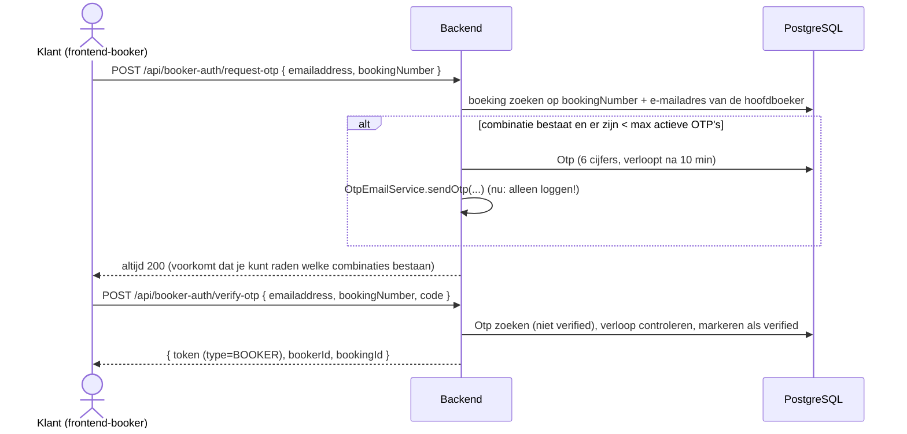

# Booker-portal (klanten, OTP-login)

Externe klanten (bookers) loggen **zonder wachtwoord** in met een eenmalige code (OTP). Ze krijgen een beperkt JWT dat alleen toegang geeft tot de data van **hun eigen boeking** via `/api/booker-portal/**`. De frontend is `frontend-booker`: één **dashboard** met alles van de boeking op één pagina (zie [frontend.md](frontend.md); het ontwerp staat in [voorstel-booker-dashboard.md](voorstel-booker-dashboard.md)).

## Loginflow



- De code is 6 cijfers (`SecureRandom`, 100000–999999). Instellingen: `app.otp.expiry-minutes` (10), `app.otp.max-active-per-email` (3).
- **De OTP-mail wordt nog niet echt verstuurd**: `OtpEmailService.sendOtp` logt de code. Zie [open-items.md](open-items.md) (ook daar: verlopen OTP's tellen mee voor het maximum).
- NGINX beperkt `/api/booker-auth/` tot een lage frequentie tegen raden.

## Token en context

| Claim | Medewerker | Booker |
|---|---|---|
| `sub` | accountId | bookerId |
| `type` | `EMPLOYEE` | `BOOKER` |
| `bookingId` | – | de boeking |
| `org`, `authorities`, `roles` | ja | nee |
| Levensduur | `app.jwt.expiration-ms` (1 uur) | `app.jwt.booker-expiration-ms` (1 uur) |

`JwtAuthenticationFilter` zet bij `type=BOOKER` de `BookerContext` (ThreadLocal, parallel aan `TenantContext`): `getBookerId()`, `getBookingId()`, `isBooker()`; opgeruimd in dezelfde `finally`. Een `BOOKER`-token krijgt vast de authorities `BOOKER_PORTAL_READ` en `BOOKER_PORTAL_UPDATE` (die staan niet in de rol-tabel).

## Endpoints

| Methode | Pad | Authority | Omschrijving |
|---|---|---|---|
| POST | `/api/booker-auth/request-otp` | publiek | OTP aanvragen |
| POST | `/api/booker-auth/verify-otp` | publiek | OTP verifiëren → JWT |
| GET | `/api/booker-portal/overview` | `BOOKER_PORTAL_READ` | kerngegevens voor het dashboard: boekingsnummer, status, periode, totaalbedrag, voornaam van de boeker, voornamen van de reizigers, naam en huisstijl van de organisatie |
| GET | `/api/booker-portal/itinerary` | `BOOKER_PORTAL_READ` | reisschema van de boeking (verblijven en activiteiten door elkaar; het dashboard gebruikt de twee lijsten hieronder) |
| GET | `/api/booker-portal/booking-lines` | `BOOKER_PORTAL_READ` | boekingsregels (verblijven) |
| GET | `/api/booker-portal/booking-activities` | `BOOKER_PORTAL_READ` | boekingsactiviteiten |
| GET | `/api/booker-portal/accommodations` | `BOOKER_PORTAL_READ` | accommodaties van de boeking |
| GET | `/api/booker-portal/activities` | `BOOKER_PORTAL_READ` | activiteiten van de boeking |
| GET | `/api/booker-portal/documents` | `BOOKER_PORTAL_READ` | de documenten van de boeking met `visibleInPortal = true`, **zonder de bytes**: `documentId`, `displayname`, `mimeType`, `size`, `createdAt` |
| GET | `/api/booker-portal/documents/{id}/content` | `BOOKER_PORTAL_READ` | het bestand als download (`Content-Disposition: attachment`); alleen van de eigen boeking én zichtbaar in het portaal, anders 404 |
| GET | `/api/booker-portal/messages` | `BOOKER_PORTAL_READ` | de e-mails die via RDS aan de hoofdboeker van de eigen boeking zijn verstuurd (`sent_email`), nieuwste eerst, **zonder inhoud**: `messageId`, `subject`, `fromAddress`, `resent`, `createdAt` (geen ontvangersadres, medewerker of tenant) |
| GET | `/api/booker-portal/messages/{id}` | `BOOKER_PORTAL_READ` | één mail met de HTML zoals verstuurd (`bodyHtml`); een mail van een andere boeking is 404 |
| GET | `/api/booker-portal/payments` | `BOOKER_PORTAL_READ` | betalingen van de boeking met de **huidige status** al bepaald: `molliePaymentId`, `description`, `amount`, `currency`, `method`, `currentStatus`, `createdAt` |
| GET | `/api/booker-portal/payments/status-entries` | `BOOKER_PORTAL_READ` | statushistorie: alleen `molliePaymentId`, `status`, `createdAt` (geen reden, correctie of naam van een medewerker) |
| POST | `/api/booker-portal/payments/pay/{molliePaymentId}` | `BOOKER_PORTAL_UPDATE` | betaling bij Mollie starten → `checkoutUrl` |

Ontwerpregels: alle antwoorden zijn **eigen, minimale DTO's** (geen entities of brede DTO's; geen `createdBy`, `tenantOrganization` of Mollie-gegevens) en elke query is gebonden aan het `bookingId` uit de `BookerContext`; een `molliePaymentId` of document van een andere boeking wordt geweigerd. Tests (`BookerPortal*ControllerTest`) controleren per endpoint dat er niets interns meekomt. De betaalflow staat in [mollie.md](mollie.md).

## Het dashboard (frontend)

Het scherm van de klant is één pagina; de klant hoeft nergens op te klikken om iets te zien. De kaarten (kop met aftelling of dag van de reis en voortgang van de boeking, *wat komt eraan / nu*, tijdlijn, betalingen, verblijven, activiteiten, en berichten en documenten) laden elk met een eigen laad-, leeg- en foutstand. De kaart *Berichten en documenten* toont de verzonden e-mails en de vrijgegeven documenten in één lijst; **alle** verzonden e-mails aan de hoofdboeker staan erin (de klant heeft ze immers ontvangen), betalingen niet. De indeling past zich aan de schermbreedte aan: telefoon (< 600 px) één kolom, tablet (600–999 px) twee kolommen, desktop (≥ 1000 px) een brede en een smalle kolom. Details in [frontend.md](frontend.md#frontend-booker) en [voorstel-booker-dashboard.md](voorstel-booker-dashboard.md).

- De **fase van de reis** (voor, tijdens, na) volgt uit de datums, niet uit de status; de status zet een medewerker handmatig.
- De **huisstijl** van de organisatie (`primaryColor`, `accentColor`, `cardTitleColor`) komt uit `overview` en kleurt de hele pagina; zonder thema blijft de standaard-teal.
- **Betalen:** de knop start `POST …/payments/pay/{id}` en stuurt de klant naar Mollie. Na terugkeer (Mollie stuurt naar `/payments`, dat naar het dashboard verwijst) ververst het dashboard de betalingen ±30 seconden, tot de webhook de nieuwe status heeft gezet.

## Package-structuur

```
bookerportal.entity      Otp
bookerportal.dto         OtpRequestDto, OtpVerifyDto, BookerLoginResponseDto, BookerPortalAccommodationDto, BookerPortalActivityDto, ItineraryItemDto,
                         Portal{Overview,Booking,Booker,Traveler,Organization,Document,DocumentContent,Message,MessageContent,Payment,PaymentStatus}Dto (records)
bookerportal.mapper      PortalMapper (MapStruct: entities → minimale DTO's; enums als lowercase)
bookerportal.repository  OtpRepository
bookerportal.service     BookerAuthService, OtpEmailService, BookerPortalOverviewService, BookerPortalDocumentService, BookerPortalMessageService, BookerPortalPaymentService
bookerportal.controller  BookerAuthController, BookerPortal{Overview,Accommodations,Activities,BookingActivity,BookingLine,Document,Itinerary,Message,Payment}Controller
bookerportal.security    BookerContext
```

## Testen met curl

```bash
# lokaal draait de backend zonder TLS op 127.0.0.1:8666, context-path /rds
curl -X POST http://localhost:8666/rds/api/booker-auth/request-otp \
  -H "Content-Type: application/json" \
  -d '{"emailaddress":"klaas@example.com","bookingNumber":"BK-2026-001"}'
# de code staat in het backend-log (OtpEmailService)
curl -X POST http://localhost:8666/rds/api/booker-auth/verify-otp \
  -H "Content-Type: application/json" \
  -d '{"emailaddress":"klaas@example.com","bookingNumber":"BK-2026-001","code":"<code>"}'
curl http://localhost:8666/rds/api/booker-portal/overview -H "Authorization: Bearer <booker-token>"
curl http://localhost:8666/rds/api/booker-portal/documents -H "Authorization: Bearer <booker-token>"
```

(De seed-boekingen hebben andere nummers dan `BK-2026-001`; kijk in `V2__initial_data.sql` of in de UI.)
