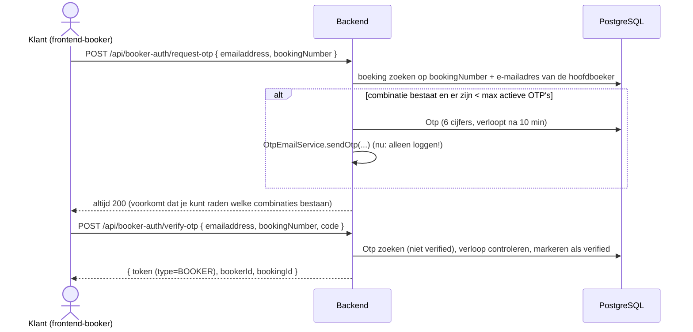

# Booker-portal (klanten, OTP-login)

Externe klanten (bookers) loggen **zonder wachtwoord** in met een eenmalige code (OTP). Ze krijgen een beperkt JWT dat alleen toegang geeft tot de data van **hun eigen boeking** via `/api/booker-portal/**`. De frontend is `frontend-booker` (zie [frontend.md](frontend.md)).

## Loginflow



- De code is 6 cijfers (`SecureRandom`, 100000–999999). Instellingen: `app.otp.expiry-minutes` (10), `app.otp.max-active-per-email` (3).
- **De OTP-mail wordt nog niet echt verstuurd**: `OtpEmailService.sendOtp` logt de code. Zie [open-items.md](open-items.md) (ook daar: verlopen OTP's tellen mee voor het maximum).
- NGINX beperkt `/api/booker-auth/` tot een lage frequentie tegen raden.

## Token en context

| Claim | Medewerker | Booker |
|---|---|---|
| `sub` | accountId | bookerId |
| `type` | `EMPLOYEE` | `BOOKER` |
| `bookingId` | – | de boeking |
| `org`, `authorities`, `roles` | ja | nee |
| Levensduur | `app.jwt.expiration-ms` (1 uur) | `app.jwt.booker-expiration-ms` (1 uur) |

`JwtAuthenticationFilter` zet bij `type=BOOKER` de `BookerContext` (ThreadLocal, parallel aan `TenantContext`): `getBookerId()`, `getBookingId()`, `isBooker()`; opgeruimd in dezelfde `finally`. Een `BOOKER`-token krijgt vast de authorities `BOOKER_PORTAL_READ` en `BOOKER_PORTAL_UPDATE` (die staan niet in de rol-tabel).

## Endpoints

| Methode | Pad | Authority | Omschrijving |
|---|---|---|---|
| POST | `/api/booker-auth/request-otp` | publiek | OTP aanvragen |
| POST | `/api/booker-auth/verify-otp` | publiek | OTP verifiëren → JWT |
| GET | `/api/booker-portal/itinerary` | `BOOKER_PORTAL_READ` | reisschema van de boeking |
| GET | `/api/booker-portal/booking-lines` | `BOOKER_PORTAL_READ` | boekingsregels (verblijven) |
| GET | `/api/booker-portal/booking-activities` | `BOOKER_PORTAL_READ` | boekingsactiviteiten |
| GET | `/api/booker-portal/accommodations` | `BOOKER_PORTAL_READ` | accommodaties van de boeking |
| GET | `/api/booker-portal/activities` | `BOOKER_PORTAL_READ` | activiteiten van de boeking |
| GET | `/api/booker-portal/documents` | `BOOKER_PORTAL_READ` | documenten van de boeking |
| GET | `/api/booker-portal/documents/{id}` | `BOOKER_PORTAL_READ` | één document (alleen van de eigen boeking) |
| GET | `/api/booker-portal/payments` | `BOOKER_PORTAL_READ` | betalingen van de boeking |
| GET | `/api/booker-portal/payments/status-entries` | `BOOKER_PORTAL_READ` | statushistorie (de klant ziet "Betaald" zodra de webhook binnen is) |
| POST | `/api/booker-portal/payments/pay/{molliePaymentId}` | `BOOKER_PORTAL_UPDATE` | betaling bij Mollie starten → `checkoutUrl` |

Ontwerpregels: alle antwoorden zijn **eigen, minimale DTO's** (geen entities of brede DTO's) en elke query is gebonden aan het `bookingId` uit de `BookerContext`; een `molliePaymentId` van een andere boeking wordt geweigerd. De betaalflow staat in [mollie.md](mollie.md).

## Package-structuur

```
bookerportal.entity      Otp
bookerportal.dto         OtpRequestDto, OtpVerifyDto, BookerLoginResponseDto, BookerPortalAccommodationDto, BookerPortalActivityDto, ItineraryItemDto
bookerportal.repository  OtpRepository
bookerportal.service     BookerAuthService, OtpEmailService, BookerPortalPaymentService
bookerportal.controller  BookerAuthController, BookerPortal{Accommodations,Activities,BookingActivity,BookingLine,Document,Itinerary,Payment}Controller
bookerportal.security    BookerContext
```

## Testen met curl

```bash
# lokaal draait de backend zonder TLS op 127.0.0.1:8666, context-path /rds
curl -X POST http://localhost:8666/rds/api/booker-auth/request-otp \
  -H "Content-Type: application/json" \
  -d '{"emailaddress":"klaas@example.com","bookingNumber":"BK-2026-001"}'
# de code staat in het backend-log (OtpEmailService)
curl -X POST http://localhost:8666/rds/api/booker-auth/verify-otp \
  -H "Content-Type: application/json" \
  -d '{"emailaddress":"klaas@example.com","bookingNumber":"BK-2026-001","code":"<code>"}'
curl http://localhost:8666/rds/api/booker-portal/documents -H "Authorization: Bearer <booker-token>"
```

(De seed-boekingen hebben andere nummers dan `BK-2026-001`; kijk in `V2__initial_data.sql` of in de UI.)
