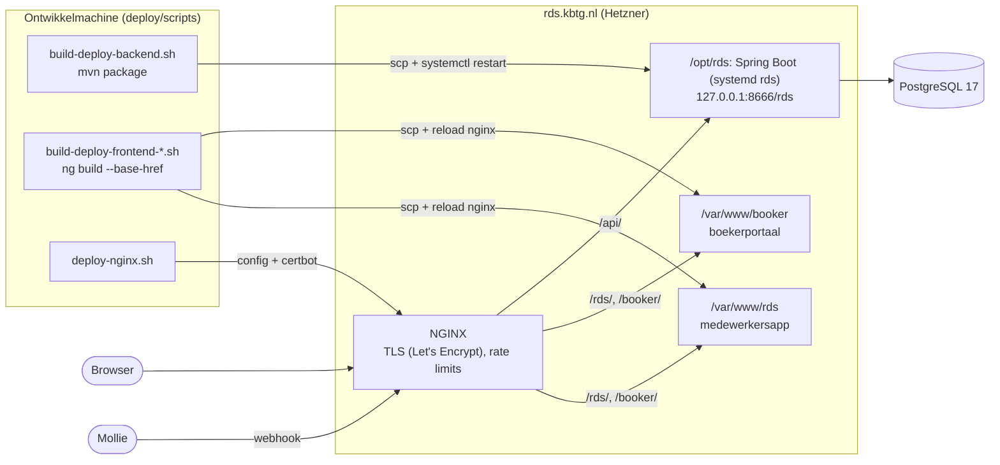

# Bouwen, testen, draaien en deployen

## Vereisten

- JDK 21, Maven 3.9 (`./mvnw` of de eigen installatie, bv. `/Users/keesbosma/apache-maven-3.9.16/bin/mvn`)
- Node + npm (Angular 22), een browser voor `ng test` (Firefox of Chrome)
- PostgreSQL 17 lokaal (Postgres.app): database `rdsdb`, gebruiker/wachtwoord `rds`/`rds` op `localhost:5432` (zie `application.yaml`) — **alleen nodig om de applicatie te draaien**; de tests gebruiken hun eigen database (zie *Testdatabase* hieronder)

## Lokaal draaien

```bash
# backend (poort 8666, context-path /rds, alleen op 127.0.0.1); Flyway migreert bij het starten
./mvnw spring-boot:run

# medewerkers-app  → http://localhost:4200  (dev-proxy: /api → http://localhost:8666/rds/api)
cd frontend-employee && npm install && npm start

# klanten-app      → http://localhost:4300
cd frontend-booker && npm install && npm start
```

- E-mail is lokaal **log-only** zolang `spring.mail.host` niet gezet is (niets wordt echt verstuurd; de mail komt in het log).
- Mollie lokaal: `start/scripts/start-mollie-tunnel.sh` (Cloudflare quick-tunnel) schrijft de publieke webhook-URL in `application-rds-local.yaml`; start de backend met profiel `rds-local`; stoppen met `stop-mollie-tunnel.sh`. De tunnel-URL verandert bij elke start.
- De OTP-code voor de klantenportal staat in het backend-log (zie [bookerportal.md](bookerportal.md)).

## Backend bouwen en testen

```bash
mvn clean install        # compileert (incl. MapStruct), draait alle tests, bouwt de jar
mvn test                 # alleen de tests
mvn -q -DskipTests compile
mvn -q -Dtest='NaamTest' -DfailIfNoTests=false test   # één klasse
```

- Unit-tests (Mockito) hebben geen database nodig. De **integratietests** (`*ControllerTest`, `ApplicationTests`) starten de hele Spring-context met `@SpringBootTest` + MockMvc en draaien `@Transactional` (rollback per test) tegen de seeddata van V2, op een **eigen tijdelijke database** (zie hieronder). Basisklassen: `AbstractControllerTest` (organisaties, login-helpers) en `AbstractBookingControllerTest` (vaste UUID's voor boekingen, bookers, …).
- Stand 19-10-2026: **697 tests, 0 failures** (waarvan ±50 testklassen); jsoup-, POI- en xdocreport-gedrag wordt door `HtmlToDocxConverterTest` end-to-end gedekt.
- `DeleteVerificationControllerTest` controleert voor elke resource dat een delete het record **echt** weghaalt (GET 200 → DELETE 204 → GET 404; daarna `flush()`/`clear()` omdat een MockMvc-IT in één transactie draait en de persistence-context anders een database-cascade verbergt).
- Nieuwe migratie ⇒ nieuw bestand `V<n>__omschrijving.sql`; de volledige suite valideert het schema (`ddl-auto: validate`).

### Testdatabase (embedded PostgreSQL)

De backend-tests starten zelf een **tijdelijke, echte PostgreSQL 17** (Zonky *embedded-postgres*) en draaien daarop alle Flyway-migraties (dus ook de seeddata). Na afloop verdwijnt alles. Je hoeft niets te installeren of te starten, en de tests raken je lokale `rdsdb` nooit.

- `EmbeddedPostgresInitializer` (src/test/java/…/support) zet de datasource-properties van elke Spring-testcontext; geregistreerd in `src/test/resources/META-INF/spring.factories`. Eén database per testrun, gedeeld door alle contexten. Alleen in src/test: de applicatie zelf start hier nooit mee.
- De properties staan bovenaan: een test draait dus nooit per ongeluk tegen een echte database, ook niet als `SPRING_DATASOURCE_*` gezet is. `TestDatabaseIsolationTest` bewaakt dat.
- **Aannames over de seeddata zijn veilig**: elke run begint met precies de data uit de migraties. Tests zijn `@Transactional` met rollback; **commit dus nooit in een test**, anders ziet een volgende test die data (draai de suite eens met `-Dsurefire.runOrder=random` om dat te controleren).
- De eerste run downloadt de PostgreSQL-binaries (± 20 MB per platform) uit Maven Central; daarna staan ze in `~/.m2`. Ondersteund: macOS (Intel en Apple Silicon), Linux amd64, Windows amd64. De binaries zijn gepind op 17.x via `embedded-postgres-binaries.version` in de pom (productie draait PostgreSQL 17).
- Draai je tests in een omgeving zonder internet, laat dan eerst één keer `./mvnw test` lopen met netwerk, of zet de binaries in een eigen Maven-mirror.

### Bekende kuren
- **Editor-stubs in `target/`** ("Unresolved compilation problem"): wacht een paar seconden na het opslaan, verwijder de betrokken `.class`-bestanden en draai opnieuw; Maven zelf is correct.
- Een test die op een niet-bestaande boeking/booker uit de seed leunt: kijk naar de UUID's in de basisklassen en in `V2__initial_data.sql`.
- Wijzig je een FreeMarker-instelling in `FreemarkerHardening`: die past de **gedeelde** xdocreport-configuratie aan, dus een test kan niet "onbeveiligd" vergelijken (zie `DocgenTemplateInjectionTest`).

## Frontend bouwen en testen

```bash
cd frontend-employee   # idem frontend-booker
npx ng build                                   # standaardbuild (controleert o.a. of alles compileert)
npx ng build --configuration production --base-href /rds/     # productie (employee)
npx ng test --watch=false --browsers=FirefoxHeadless          # alle specs
npx ng test --watch=false --browsers=FirefoxHeadless \
    --include='src/app/shared/template-editor/**/*.spec.ts' \
    --include='src/app/translate-test.setup.spec.ts'          # een deel (setup altijd meenemen!)
```

- Stand 20-10-2026: **556 specs, 0 failures** in `frontend-employee` (Firefox 158); `frontend-booker` heeft nu dezelfde opzet (Firefox headless) en **158 specs, 0 failures**.
- `src/app/translate-test.setup.spec.ts` laadt de echte nl-vertalingen in elke spec; wie specs selecteert met `--include` moet dat bestand mee-includen, anders zie je vertaalsleutels in plaats van tekst.
- TipTap in een test: de editor draait echt in Firefox; plak/drop-gedrag test je door de ProseMirror-handlers rechtstreeks aan te roepen (synthetische `ClipboardEvent`s dragen geen bestanden).
- Dev-proxy en `base href`: zie [frontend.md](frontend.md).
- **Firefox start niet ("Cannot start FirefoxHeadless")** terwijl je gewone Firefox open staat: een tweede Firefox met een eigen profiel geeft dan zijn opdracht door aan de draaiende instantie of wacht op die. Zet `MOZ_NO_REMOTE=1` zodat Karma een losse instantie start (de Firefox die je zelf open hebt blijft ongemoeid):

  ```bash
  MOZ_NO_REMOTE=1 npx ng test --watch=false --browsers=FirefoxHeadless
  ```

  Helpt dat niet en blijft elke start hangen op `org.mozilla.updater` (te zien met `ps aux | grep -i updater`), dan staat er een Firefox-update klaar die nog niet is toegepast: sluit Firefox helemaal af (⌘Q), start hem opnieuw zodat de update installeert, en draai de specs nogmaals. Op macOS bestaat het commando `timeout` niet, dus een testrun met een tijdslimiet moet je anders afbreken (bv. `pkill -f "ng test"`).

## Deployen



Scripts staan in `deploy/scripts/` en gebruiken `ssh`/`scp` naar `root@kbtg.nl` (centraal in `deploy/scripts/remote.sh`, eenmalig te overschrijven met `REMOTE=root@<host>`). Dat is een publieke DNS-naam: geen HOSTS-regel nodig, vertrouwen loopt via je SSH-sleutel en de host key in `known_hosts`:

| Script | Wat |
|---|---|
| `build-deploy-backend.sh` | `mvn clean package -DskipTests`, `systemctl stop rds`, jar naar `/opt/rds`, `systemctl start rds` |
| `build-deploy-frontend-employee.sh` | `ng build --configuration production --base-href /rds/`, kopieert naar `/var/www/rds`, `systemctl reload nginx` |
| `build-deploy-frontend-booker.sh` | idem met `--base-href /booker/` naar `/var/www/booker` |
| `deploy-nginx.sh` | NGINX-config voor `rds.kbtg.nl` + Let's Encrypt-certificaat (zie hieronder) |
| `build-deploy-all.sh` | `deploy-nginx.sh` en daarna de drie builds achter elkaar |

**NGINX — `https://rds.kbtg.nl`** (`deploy/nginx/`). DNS (Hetzner DNS): `@` en wildcard `*` → `178.104.163.88` (A) en `2a01:4f8:c2c:f8fc::1` (AAAA), dus elk subdomein komt bij de server uit. De configs luisteren daarom op IPv4 én IPv6. Certificaat van Let's Encrypt, geen self-signed meer.

| Bestand | Op de server | Wat |
|---|---|---|
| `rds.kbtg.nl.conf` | `/etc/nginx/sites-available/rds.kbtg.nl` (+ symlink) | `/` → `/rds/`, `/rds/` en `/booker/` (assets 7 dagen cache, `index.html` niet), `/api/` → `http://127.0.0.1:8666/rds/api/`, Mollie-webhook en e-mailafbeeldingen publiek met rate-limit, login/TOTP/herstel/booker-OTP rate-limited, scanner-blokkade (444), `/monitoring` alleen voor beheer-IP's, HSTS. Poort 80 → HTTPS, behalve de ACME-challenge. |
| `rds-zones.conf` | `/etc/nginx/conf.d/rds-zones.conf` | Rate-limit-zones `rds_login`, `rds_mollie`, `rds_email_image` (eigen namen, botsen niet met andere sites) |
| `rds.kbtg.nl.bootstrap.conf` | tijdelijk | Alleen poort 80 + ACME, om het eerste certificaat op te halen (de echte config verwijst naar certificaatbestanden die er dan nog niet zijn) |
| `catch-all.conf` | `/etc/nginx/sites-available/00-catch-all` (+ symlink) | `default_server` voor poort 80/443 (IPv4 en IPv6): onbekende hostnamen en het kale IP krijgen geen antwoord (`444`, TLS-handshake geweigerd). Nodig door het wildcard-DNS-record `*.kbtg.nl`. Geldt voor de hele NGINX-server. Een ander subdomein toestaan = eigen site-config met `server_name` (gaat altijd voor). Vereist NGINX ≥ 1.19.4 |
| `install.sh` | draait op de server | Plaatst bovenstaande; faalt `nginx -t`, dan wordt de vorige versie teruggezet |

`deploy-nginx.sh` controleert eerst of `rds.kbtg.nl` publiek naar de server wijst (Let's Encrypt kijkt niet naar je HOSTS-bestand). De **eerste keer** vraagt certbot interactief om een e-mailadres en akkoord met de voorwaarden van Let's Encrypt; daarna is het script idempotent. De catch-all wordt de eerste keer alleen geplaatst met `./deploy-nginx.sh --with-catch-all` (daarna altijd bijgewerkt); doe dat pas als de Mollie-webhook en de e-mailafbeeldingen niet meer via het kale IP lopen, want die verzoeken krijgen dan geen antwoord meer. `install.sh` stopt vooraf als er al een andere `default_server` is. Vernieuwen gaat automatisch (`certbot.timer`, met `systemctl reload nginx` als deploy-hook). Vereist op de server: `apt install certbot` en poort 80 open in de Hetzner-firewall.

**Publieke URL's van de backend**: `app.email.public-api-base-url` en `app.mollie.urls.webhook` staan in `application.yaml` nog op `http://178.104.163.88/...`. Op de server worden ze overschreven; met Let's Encrypt horen ze naar `https://rds.kbtg.nl/api` resp. `https://rds.kbtg.nl/api/mollie/payments/webhook` te wijzen.

**Serverconfig** (SMTP, geheimen) hoort in omgevingsvariabelen (`SPRING_MAIL_HOST`, …), niet in de repository.

## Logging en monitoring
- Jetty-access-log: `/opt/rds/log/access.log` (rotatie 30 dagen); lokaal profiel `rds-local` schrijft naar `access.log` in de werkmap.
- JavaMelody op `/monitoring` (SQL, HTTP-statistieken); alleen via NGINX voor beheer-IP's.
- Actuator is aanwezig; controleer welke endpoints open staan voordat je de server publiek maakt.
