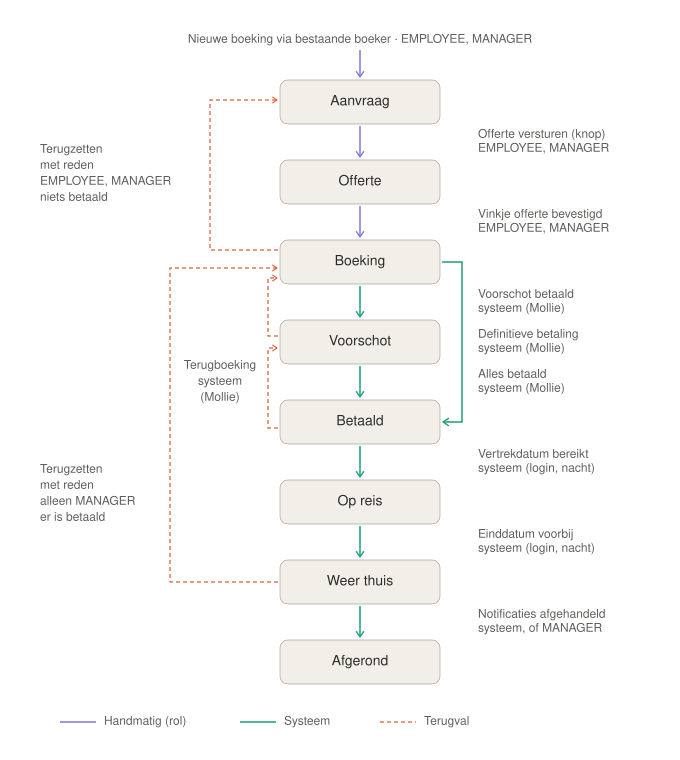

# Domein

Het volledige tabelmodel staat in [database-model.md](database-model.md); begrippen in [glossary.md](glossary.md). Hier staat wat het model **betekent** en welke regels gelden.

## Tenant (organisatie)

Het systeem is multi-tenant per **ORGANIZATION**. Elke tenant-entiteit heeft `tenantOrganization` (UUID, onveranderlijk) en audit-velden (`createdAt/By`, `modifiedAt/By`). Een gebruiker ziet en wijzigt uitsluitend data van de eigen organisatie; zie [security.md](security.md).

Een organisatie heeft daarnaast: een **Mollie-sleutel** (`mollie_key`), een **afzenderadres voor e-mail** (`email_from`), en een **thema** (`organization_theme`: primaire/accentkleur, logo-URL, kaarttitelkleur).

## Gebruikersmodel (auth)

`ORGANIZATION → PERSON → ACCOUNT → (ACCOUNT_ROLE) ROLE → (ROLE_AUTHORITY) AUTHORITY`

- Een **persoon** hoort bij één organisatie; een **account** (login) hoort bij één persoon.
- Een account kan vergrendeld zijn, een vervaldatum hebben, een wachtwoordwijziging afdwingen en **TOTP** (2FA) hebben.
- Rollen: `ADMIN`, `MANAGER`, `EMPLOYEE`. Rechten zitten op **authorities** (granulair, bv. `BOOKING_READ`); de UI en `@PreAuthorize` kijken naar authorities.

## Boekingsdomein

```
Booker ──< Booking >── (hoofdboeker, optioneel)
Booking ──< Traveler
Booking ──< BookingLine >── Accommodation, Supplier
Booking ──< BookingActivity >── Activity
Booking ──< Document
Booking ──< BookingMolliePayment >── MolliePayment ──< MolliePaymentStatusEntry
Accommodation ──< AccommodationSupplier >── Supplier
Booker / Accommodation / Supplier ──< (koppeltabel) >── Address
DocumentTemplate, EmailTemplate, EmailImage   (per organisatie, los van een boeking)
```

| Begrip | Betekenis |
|---|---|
| **Booking** | het reisdossier. Heeft een **boekingsnummer** (`BK-<jaar>-<5 cijfers>`, gegenereerd, uniek) en een **status**. `fromDate`, `untilDate` en `totalSum` worden **afgeleid** uit de boekingsregels (min/max datum, som van prijzen) plus de activiteiten — ze worden niet apart opgeslagen. |
| **Booker** | de opdrachtgever/hoofdboeker (persoon, geen login). Een boeking verwijst naar maximaal één booker (de koppeling mag leeg zijn). |
| **Traveler** | een reiziger bij één boeking (naam, geslacht, geboortedatum, initialen). |
| **Accommodation** / **Supplier** | verblijfplaats en leverancier; een **BookingLine** koppelt een boeking aan een combinatie met periode en prijs. |
| **Activity** | activiteit (tour, excursie, ticket, transfer); **BookingActivity** plaatst die in een boeking met datum/tijd, ontmoetingspunt en totaalprijs. |
| **Address** | herbruikbaar adres met rol (woon, factuur, accommodatie, leverancier) |
| **Document** | een bestand bij een boeking (geüpload of gegenereerd uit een template; docx of pdf) |
| **MolliePayment** | een (verwachte of echte) betaling; losstaand van Booking, gekoppeld via een koppeltabel (maximaal één boeking per betaling, afgedwongen met een UNIQUE-constraint) |

### Levenscyclus van een boeking

`AANVRAAG → OFFERTE → BOEKING → VOORSCHOT → BETAALD → OPREIS → WEERTHUIS → AFGEROND`

De status is een enum (`BookingStatus`, in de database bewaakt door een CHECK-constraint); er is geen afgedwongen toestandsmachine: de medewerker zet de status. In de API en UI is de waarde lowercase (`aanvraag`, …), in het template-model de hoofdletter-naam (`BOEKING`).



Het diagram toont het **doelontwerp** (stap 1 t/m 5 van de automatische statussen): paars = handmatig met de rol die het mag, groen = systeem, oranje gestreept = terugval. Gebouwd is alleen stap 1: een nieuwe boeking start als `AANVRAAG` en het vinkje *Offerte bevestigd* zet `BOEKING`; de overige overgangen zet de medewerker nog zelf. *Terugzetten met reden* kan naar elke eerdere status; zolang er niets betaald is mogen EMPLOYEE en MANAGER dat, daarna alleen een MANAGER. Een terugboeking via Mollie zet de status één stap terug (`BETAALD → VOORSCHOT`, `VOORSCHOT → BOEKING`).

### Booker, prospect en het aanmeldproces

Een **prospect** is **geen apart type**: het is een `Booker` met `status = PROSPECT` (kolom `booker.status`, migratie V4; waarden `PROSPECT`, `ACTIVE`, `NIETACTIEF`). Zo blijft het datamodel klein en kan een prospect zonder verhuizing een gewone boeker worden.

1. Medewerker registreert een potentiële klant op het scherm *Prospects* (status `PROSPECT`, nog geen boeking).
2. Mail met een e-mailtemplate versturen: mail-icoon op de regel in het scherm *Prospects* (template kiezen, voorbeeld bekijken, verzenden).
3. Vanaf een boeker (rij-icoon) of via de boekingenlijst een **concept-boeking** starten. **Een boeking ontstaat alleen vanuit een bestaande boeker** (de API weigert een boeking zonder `bookerId`, en een nieuwe boeking begint altijd als `AANVRAAG`); in het keuzevenster staat dus geen *Nieuwe boeker* meer.
4. **De status van een boeker volgt uit zijn boekingen** en is niet te kiezen (`BookerStatusUpdater`, sinds V17): geen boeking `PROSPECT`, minstens één boeking die nog niet is afgerond `ACTIVE`, alle boekingen afgerond `NIETACTIEF`. Elke nieuwe boeker begint als `PROSPECT`; een `status` in het verzoek wordt genegeerd. De backend rekent de status opnieuw na aanmaken, koppelen, ontkoppelen, een statuswijziging en verwijderen van een boeking. De knop *Maak boeker* is vervallen.

### Offerte bevestigen

De hoofdboeker bevestigt de (laatste) offerte van een **boeking**: `booking.quote_confirmed` met `quote_confirmed_at` (V17). Een medewerker zet het vinkje *Offerte bevestigd* in de dialoog *Boekinggegevens*. Dat kan alleen in status `OFFERTE` en met een hoofdboeker; de server zet dan het moment (`now()`) en de status op `BOEKING`. Uitvinken kan niet (`400`); terugzetten gaat later via een statuswijziging met reden.

### Concept-boeking

`/bookings/new?bookerId=…` opent het boekingsdetail voorgevuld met de hoofdboeker, maar **persisteert niets**. De boeking wordt pas aangemaakt (`ensureBookingPersisted`) zodra de eerste onderdelen worden toegevoegd (reiziger, boekingsregel, activiteit, betaling, …). Is er al een lopende (niet-afgeronde) boeking voor die boeker, dan vraagt het scherm eerst bevestiging. Een nieuwe boeking zonder boeker wordt teruggestuurd naar het overzicht.

## Documenten en templates

- **DocumentTemplate** (Word, `.docx`) → met een boeking samengevoegd tot een **Document** (docx of pdf). Naam: `<sjabloonnaam> - <boekingsnummer> - <datum tijd>.ext` (het tijdstip voorkomt naamconflicten bij herhaald gebruik).
- **EmailTemplate** → met een booker of boeking samengevoegd tot onderwerp + HTML, te bekijken (voorbeeld) of te versturen, alleen vanuit een boeking of een prospect.
- Beide gebruiken **hetzelfde model** (`booking.*`, bij e-mail ook `prospect.*`) en dezelfde editor: zie [templates.md](templates.md).

## Betalen

De medewerker legt een betaling vast (`MolliePayment` + koppeling met de boeking); de klant betaalt in de portal; de webhook werkt de status bij (`OPEN → … → PAID`). Zie [mollie.md](mollie.md).

## Domeinregels om te onthouden

- **Geschiedenis blijft:** een boeking (en een booker, accommodatie, leverancier of activiteit waarin zo'n boeking voorkomt) met documenten of betalingen kan niet verwijderd worden (409). Documenten en betalingen hebben geen verwijderfunctie (geen knop en geen endpoint; `DELETE` geeft `405`). Zie [security.md](security.md).
- Altijd tenant-filtering respecteren; nooit een entity naar buiten (DTO's).
- Entities zijn onveranderlijk; een update behoudt `createdAt/By` en `tenantOrganization`.
- Booker-portal-endpoints geven **minimale** eigen DTO's en zijn gebonden aan de boeking uit het token.
- Een afbeelding in de bibliotheek hoort bij één organisatie en wordt nooit tussen organisaties gedeeld.
