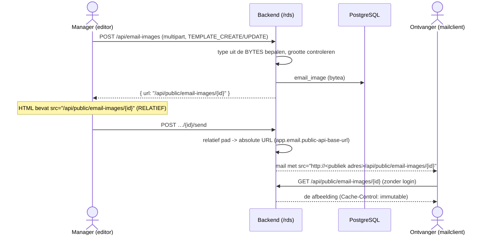
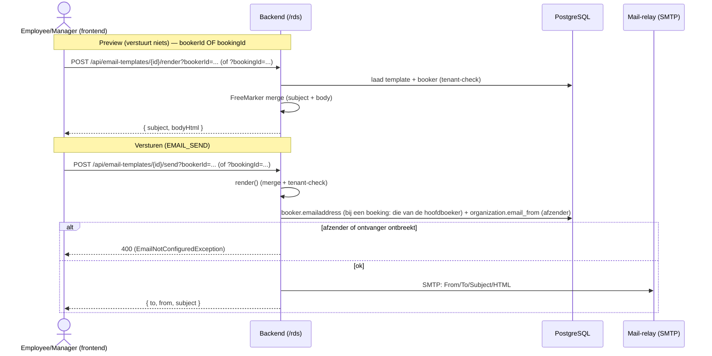

# E-mail (templates, merge & versturen)

## Overzicht

- E-mailtemplates (onderwerp + HTML-body) staan **per organisatie** in de database (`email_template`).
- Een template wordt met **FreeMarker** gemerged met de gegevens van een **booker/prospect** (`${prospect.*}`) of van een **boeking** (`${booking.*}`, zie [templates.md](templates.md)).
- Het resultaat kan **voorbekeken** (render) en **verstuurd** (send) worden — voor een booker/prospect, of voor een boeking (dan naar de hoofdboeker). **In de interface kan dat alleen vanuit een boeking (*Toevoegen → E-mail aan hoofdboeker*) of vanuit een prospect (mail-icoon in *Prospects*)**; het scherm *E-mailtemplates* is alleen voor het beheren van templates. De API-endpoints zelf zijn niet beperkt.
- De WYSIWYG-editor, de variabelen, de afbeeldingenbibliotheek en de herhaalde tabellen zijn **gedeeld** met de Word-templates: zie [templates.md](templates.md).
- De **afzender** (`From`) is per organisatie instelbaar (`organization.email_from`).
- De applicatie is een **SMTP-client**, geen mailserver: ze levert af bij een externe **mail-relay**.
- Lokaal zonder SMTP-config → **log-only** (niets wordt echt verstuurd, alles wordt gelogd).

Opgebouwd in slices:

| Slice | Inhoud |
|---|---|
| 2a | Templates in DB + FreeMarker-merge + render (backend) |
| 2b | Templatebeheer + preview (frontend-employee) |
| 3  | Daadwerkelijk versturen + per-org afzender + mailer-abstractie |
| 3b | WYSIWYG-editor (TipTap), afbeeldingenbibliotheek, afscherming van FreeMarker |
| 4  | Gedeeld model met documenten, e-mail voor een boeking, herhaalde tabellen, Word-editor ([templates.md](templates.md)) |

---

## Domein

### `email_template` (per organisatie)

| Kolom | Betekenis |
|---|---|
| `email_template_id` | PK (UUID) |
| `name` | Naam (verplicht) |
| `description` | Korte omschrijving |
| `subject` | Onderwerp — mag `${prospect.*}` en `${booking.*}` bevatten (platte tekst) |
| `body_html` | HTML-body — mag `${prospect.*}` en `${booking.*}` bevatten (HTML) |
| audit + `tenant_organization` | Standaard audit-velden + tenant |

Migratie: `V5__email_template.sql`.

### Afzender per organisatie

`organization.email_from` (migratie `V6__email_sending.sql`) bevat het afzenderadres dat als `From` gebruikt wordt. Leeg = er kan niet verstuurd worden (nette fout, zie hieronder).

---

## Verzonden e-mails bewaren

Een mail die voor een **boeking** wordt verstuurd (dus naar de hoofdboeker) wordt na het succesvol versturen bewaard in `sent_email` (migratie V14): van, aan, onderwerp, HTML zoals verstuurd, wie en wanneer. Mislukt het versturen, dan wordt er niets bewaard. Een mail voor een booker/prospect (zonder boeking) wordt niet bewaard. De tabel is alleen-toevoegen (triggers weigeren `UPDATE`/`DELETE`/`TRUNCATE`) en een boeking met verzonden e-mails kan niet worden verwijderd (`ON DELETE RESTRICT` en `DeletionGuard`, 409). Opnieuw versturen maakt een nieuwe regel; het origineel blijft staan.

## Templating / merge (FreeMarker)

Twee FreeMarker-configuraties (zie `EmailRenderServiceImpl`):

- **subject** → platte tekst, **geen** escaping.
- **body** → `HTMLOutputFormat`, dus `${...}` wordt **HTML-geëscaped** (bescherming tegen HTML-injectie via persoon-data).

Het model is **hetzelfde als bij documenten** (`BookingContextService`, pakket `docgen`); er is geen aparte e-mailvariant meer. Zie [templates.md](templates.md) voor alle velden. Voor e-mail zijn er twee ingangen:

| Verstuurd voor | Model in de template |
|---|---|
| een **booker/prospect** (`?bookerId=`) | `${prospect.*}` |
| een **boeking** (`?bookingId=`) | `${booking.*}` én `${prospect.*}` (= de hoofdboeker, dus dezelfde plek als `${booking.booker.*}`) |

Beschikbare placeholders onder `${prospect.*}` (uit `BookerContext`):

| Placeholder | Bron (Booker) |
|---|---|
| `${prospect.firstname}` | voornaam |
| `${prospect.prefix}` | tussenvoegsel |
| `${prospect.lastname}` | achternaam |
| `${prospect.fullName}` | "voornaam tussenvoegsel achternaam" (samengesteld) |
| `${prospect.callsign}` | roepnaam |
| `${prospect.telephone}` | telefoon |
| `${prospect.emailaddress}` | e-mailadres |
| `${prospect.gender}` | geslacht (enum-naam, bv. `MAN`; net als in documenten) |
| `${prospect.birthdate}` | geboortedatum (`jjjj-mm-dd`) |
| `${prospect.initials}` | initialen |

> "prospect" is de modelnaam in de template; het werkt voor **elke** booker, ongeacht status (PROSPECT of ACTIVE). Een template met `${booking.*}` werkt alleen als de mail **voor een boeking** wordt verstuurd; voor een prospect geeft dat een duidelijke melding ("Onbekende of lege placeholder … `${booking}`").
>
> **Wijziging t.o.v. de eerste versie:** `${prospect.gender}` geeft nu de enum-naam in hoofdletters (`MAN`) in plaats van de lowercase waarde, omdat e-mail en documenten nu één model delen.

**Herhaalde tabellen** (`data-repeat`) worden voor e-mail omgezet naar `<#list …>` rond de laatste rij; zie [templates.md](templates.md).

**Veiligheid van het model:** de template is door een gebruiker geschreven (niet-vertrouwd). FreeMarker draait daarom afgeschermd: `?new` en `?api` zijn uit, include/import kan niet, en het model bestaat uit **platte** maps/lijsten/tekst/getallen (geen Java-objecten), zodat bv. `${prospect.class}` niets oplevert.

---

## Afbeeldingen in templates

De editor heeft een afbeelding-knop (en ondersteunt slepen/plakken van een afbeeldingsbestand). Een afbeelding wordt **geüpload**, nooit als base64 in de HTML gezet: base64 maakt `body_html` zwaar en wordt door veel mailclients geblokkeerd.

**Waarom een relatief pad in de opgeslagen HTML?** Dan laadt de afbeelding in de editor en preview via de eigen origin (dev-proxy of NGINX), en staat er geen hostnaam in je templates. Verandert het publieke adres later (IP → domeinnaam), dan blijven alle opgeslagen templates geldig: het absolute adres wordt pas bij het **versturen** ingevuld (`EmailImageUrlResolver`).

**Publiek endpoint — bewuste keuzes** (een ontvanger heeft geen JWT):

| Maatregel | Waarom |
|---|---|
| Alleen `GET /api/public/email-images/{uuid}` is `permitAll` | Uploaden en alles anders blijft achter login. |
| Onraadbare UUID als sleutel | Geen opsomming van andermans afbeeldingen mogelijk. |
| Type uit de **bytes** (PNG/JPEG/GIF/WebP), niet uit de client | Een bestand met `.png`-naam maar HTML-inhoud komt er niet door. |
| **SVG niet toegestaan** | SVG is XML en kan scripts bevatten. |
| `Content-Security-Policy: default-src 'none'; sandbox` | Extra vangnet als iemand de URL als pagina opent. |
| Maximaal 2 MB (`app.email.image.max-bytes`) | Beperkt misbruik en opslag. |
| Geen tenant-filter bij uitleveren | Een ontvanger heeft geen organisatie; `tenant_organization` is alleen herkomst. |

**Opslag:** tabel `email_image` (`V7__email_image.sql`), bytes in `bytea` — dezelfde aanpak als `document_template`. Een afbeelding is onveranderlijk; een nieuwe versie is een nieuwe rij.

### Bibliotheek (beheer van afbeeldingen)

In de template-editor staat naast de variabelen een tab **Afbeeldingen**: de bibliotheek van de eigen organisatie. Daar kun je uploaden, een afbeelding de tekst in **slepen** (of aanklikken om op de cursor in te voegen) en verwijderen. Slepen of plakken van een afbeeldingsbestand rechtstreeks in de tekst werkt ook; zo'n bestand wordt eerst geüpload.

**Verwijderen kan alleen als de afbeelding ongebruikt is**:

| Controle | Waar | Reden |
|---|---|---|
| Geen e-mailtemplate **en geen Word-template uit de editor** (`source_html`) **van dezelfde organisatie** bevat het pad | server → `409 Conflict` | Afbeeldingen worden niet tussen organisaties gedeeld (zie hieronder), dus een andere organisatie kan het verwijderen niet blokkeren. |
| Niet in de tekst die nu in de editor staat | frontend | Die nog niet opgeslagen tekst ziet de server niet. |
| Recht `TEMPLATE_DELETE` (alleen MANAGER) | server + knop verborgen | Verwijderen is destructief, net als een template verwijderen. |
| Afbeelding hoort bij de eigen organisatie | server → `403` | Tenant-isolatie. |

> **Let op — verstuurde mails.** Een al verstuurde mail bevat een link naar de afbeelding op de server en wordt **niet** gecontroleerd (dat kan niet). Na verwijderen is het plaatje in zulke mails weg. De bevestigingsdialoog waarschuwt hier expliciet voor. Wil je dat nooit, dan is "verbergen" (uit de bibliotheek, maar nog uitleveren) een alternatief; dat is nu bewust niet gebouwd.

**Afbeeldingen zijn per organisatie (tenant), nooit gedeeld.**
- Een afbeelding wordt alleen door zijn **UUID** geïdentificeerd. De bestandsnaam is informatief en nergens uniek of zoeksleutel: twee organisaties met een `logo.png` hebben twee losse afbeeldingen.
- **Bij het opslaan** van een template (aanmaken en wijzigen) controleert de server dat elke verwijzing naar een afbeelding naar een afbeelding van de **eigen** organisatie wijst. Een verwijzing naar andermans of een onbekende afbeelding geeft `400`; de melding maakt geen onderscheid tussen "bestaat niet" en "is van een ander", zodat er niets over andermans afbeeldingen lekt. Ook een geplakte absolute URL telt als verwijzing.
- Lijst, verwijderen en de "in gebruik"-controle zijn per organisatie.
- **Uitzondering, bewust:** het **uitleveren** (`GET /api/public/email-images/{uuid}`) filtert niet op organisatie. Een ontvanger heeft geen organisatie of login; de onraadbare UUID is de sleutel. Dat is de enige plek waar een afbeelding over een organisatiegrens heen leesbaar is, en alleen voor wie de UUID uit een verstuurde mail heeft.

**Beveiliging van slepen:** een sleepactie kan van elke pagina komen. De editor accepteert daarom alleen een payload waarvan de URL exact het publieke pad van een geüploade afbeelding is (`/api/public/email-images/<uuid>`); een externe URL wordt genegeerd (anders zou iemand een tracking-pixel in een template kunnen slepen).

**Lijst zonder bytes:** de lijst-query leest alleen metadata (projectie), zodat tientallen afbeeldingen van elk 2 MB niet in het geheugen worden geladen.

> **Publiek bereikbaar maken (NGINX, jij past dit zelf toe).** Op het publieke IP stond alleen de Mollie-webhook open. Voor afbeeldingen is in [deploy/nginx/rds.conf](../deploy/nginx/rds.conf) een smalle location toegevoegd: alleen exact `/api/public/email-images/<uuid>`, alleen GET/HEAD, met rate-limit (zone `email_image_limit` hoort in het `http{}`-blok). Zonder deze stap zijn afbeeldingen in verstuurde mail **niet zichtbaar** voor ontvangers.
>
> Let op: het publieke adres is nu **http** (IP, geen certificaat). Mailclients laden dat meestal prima, maar een eigen domein met TLS is de nette eindsituatie; wijzig dan alleen `app.email.public-api-base-url`.

**Lokaal:** de preview gebruikt het relatieve pad en werkt dus gewoon. `public-api-base-url` speelt alleen bij echt versturen (lokaal is dat log-only), en staat standaard op het remote adres — net als de Mollie-webhook.

---

## Flow: render (preview) en send

De verzendservice (`EmailSendServiceImpl`) **hergebruikt** `render()`/`renderForBooking()` voor de merge (inclusief tenant-check), haalt daarna de ontvanger en afzender (organisatie) op, en faalt **fail-fast** met een nette `400` als het afzender- of ontvangeradres ontbreekt. Bij een boeking is de ontvanger de **hoofdboeker**; heeft de boeking geen hoofdboeker (of die geen e-mailadres), dan wordt er niets verstuurd. De controller eist **precies één** van `bookerId` en `bookingId` (anders `400`).

---

## Mailer-abstractie (wel/niet echt versturen)

Interface `EmailSender` met twee implementaties; de keuze valt in `EmailSenderConfig` op basis van `spring.mail.host`:

| Implementatie | Wanneer actief | Gedrag |
|---|---|---|
| `SmtpEmailSender` | `spring.mail.host` **is** gezet | Verstuurt echt via `JavaMailSender` (SMTP-client) |
| `LoggingEmailSender` | geen `spring.mail.host` | **Log-only**: verstuurt niets, logt From/To/Subject/body |

> `host` is dus de aan/uit-knop. Lokaal (fake data) bewust leeg → je ziet in de log precies wat verstuurd zou worden, zonder echte mail.

---

## SMTP-configuratie

In `application.yaml` staat een uitgecommentarieerd `spring.mail`-blok met uitleg per property. Op test/productie via env-vars (`SPRING_MAIL_HOST`, `SPRING_MAIL_PORT`, `SPRING_MAIL_USERNAME`, `SPRING_MAIL_PASSWORD`).

| Property | Betekenis |
|---|---|
| `spring.mail.host` | Host/IP van de relay. Gezet ⇒ echt versturen; leeg ⇒ log-only. |
| `spring.mail.port` | `587` = STARTTLS (gangbaar), `465` = SMTPS/SSL, `25` = onversleuteld (afgeraden). |
| `spring.mail.username` | Inlognaam bij de relay (vaak e-mailadres of API-user). |
| `spring.mail.password` | Wachtwoord/API-sleutel; via env-var, niet hardcoden. |
| `spring.mail.properties.mail.smtp.auth` | `true` = authenticeren met username/password. |
| `spring.mail.properties.mail.smtp.starttls.enable` | `true` = upgraden naar TLS (hoort bij poort 587). |
| `mail.smtp.*timeout` (optioneel) | Connect-/lees-/schrijf-time-outs (ms) zodat een trage relay niet laat hangen. |

Alles onder `spring.mail.properties.*` wordt 1-op-1 doorgegeven aan de onderliggende JavaMail-sessie.

---

## Relay & deliverability

De app is een **SMTP-client**, geen mail(transfer)server. Ze doet dus **niet**:

- luisteren op poort 25 / inkomende mail;
- MX-lookups en directe bezorging bij de ontvangende mailserver;
- een uitgaande wachtrij met retries;
- DKIM-signing, SPF/DMARC-alignment, IP-/reputatiebeheer.

Dat doet de **relay** (eigen Postfix/Exim als smarthost, of een provider zoals SES, SendGrid, Mailgun, Postmark, M365/Gmail SMTP). De app → één SMTP-verbinding naar de relay → de relay transporteert naar de buitenwereld.

**Belangrijk voor de per-org afzender** (`organization.email_from`, bv. `noreply@puurkroatie.nl`): de relay moet gemachtigd zijn om namens dat domein te versturen, anders landt mail in spam of wordt geweigerd — ook al verstuurt de app technisch correct. Zorg per afzenderdomein voor:

- **SPF** — DNS-record dat de relay toestaat namens het domein te versturen.
- **DKIM** — ondertekeningssleutel bij de relay, publieke sleutel in DNS.
- **DMARC** — beleid dat SPF/DKIM afdwingt en rapportage geeft.

Keuze van `email_from` per organisatie en keuze van relay hangen dus samen: de relay moet voor elk gebruikt afzenderdomein geautoriseerd zijn.

---

## Autorisatie

| Actie | Authority | ADMIN | MANAGER | EMPLOYEE |
|---|---|:--:|:--:|:--:|
| Templates lezen / renderen | `TEMPLATE_READ` | – | ✓ | ✓ |
| Template aanmaken/wijzigen/verwijderen | `TEMPLATE_CREATE/UPDATE/DELETE` | – | ✓ | – |
| E-mail versturen | `EMAIL_SEND` | – | ✓ | ✓ |
| Afbeelding uploaden / bibliotheek bekijken | `TEMPLATE_CREATE` of `TEMPLATE_UPDATE` | – | ✓ | – |
| Afbeelding verwijderen | `TEMPLATE_DELETE` | – | ✓ | – |
| Afbeelding ophalen (publiek) | geen (zonder login) | ✓ | ✓ | ✓ |

- `EMAIL_SEND` is een **eigen** authority (los van `TEMPLATE_*`): een template beheren is iets anders dan er mail mee versturen. Toegekend in `V6__email_sending.sql` aan MANAGER en EMPLOYEE.
- ADMIN is puur systeembeheer en heeft deze business-authorities bewust niet.
- Frontend toont componenten op basis van **authorities** (nooit rollen), conform de projectregels.

> **Frontend-zichtbaarheid:** het menu-item *E-mailtemplates* is zichtbaar bij `TEMPLATE_READ` (dus MANAGER én EMPLOYEE). De aanmaak-/bewerk-/verwijderknoppen in de lijst blijven achter `TEMPLATE_CREATE` (alleen MANAGER); *Inzien* toont de template alleen-lezen. Versturen zit niet in de lijst: de verstuur-knop in de dialoog vanuit een boeking of prospect zit achter `EMAIL_SEND`. Zo kan een EMPLOYEE de templates bekijken en mailen zonder ze te kunnen beheren.

---

## API-endpoints

| Methode | Pad | Authority | Omschrijving |
|---|---|---|---|
| GET | `/api/email-templates` | `TEMPLATE_READ` | Lijst (tenant-gefilterd) |
| GET | `/api/email-templates/{id}` | `TEMPLATE_READ` | Eén template |
| POST | `/api/email-templates` | `TEMPLATE_CREATE` | Aanmaken |
| PUT | `/api/email-templates/{id}` | `TEMPLATE_UPDATE` | Wijzigen |
| DELETE | `/api/email-templates/{id}` | `TEMPLATE_DELETE` | Verwijderen |
| POST | `/api/email-templates/{id}/render?bookerId=…` of `?bookingId=…` | `TEMPLATE_READ` | Merge-preview (verstuurt niets); precies één van de twee parameters |
| POST | `/api/email-templates/{id}/send?bookerId=…` of `?bookingId=…` | `EMAIL_SEND` | Verstuurt de gemergde mail naar de booker, resp. de hoofdboeker van de boeking |
| GET | `/api/sent-emails/booking/{bookingId}` | `BOOKING_READ` | Verzonden e-mails van een boeking, nieuwste eerst (met leesbare naam van de verzender) |
| GET | `/api/sent-emails/{id}` | `BOOKING_READ` | Eén verzonden e-mail, inclusief de bewaarde HTML |
| POST | `/api/sent-emails/{id}/resend` | `EMAIL_SEND` | Stuurt dezelfde inhoud opnieuw naar hetzelfde adres; 201 met de nieuwe regel (`resentFromId` verwijst naar het origineel). Geen PUT/DELETE: alleen-toevoegen |
| POST | `/api/email-images` | `TEMPLATE_CREATE`/`UPDATE` | Upload een afbeelding (multipart, deel `file`) → `{ url, … }` |
| GET | `/api/email-images` | `TEMPLATE_CREATE`/`UPDATE` | Bibliotheek van de eigen organisatie (zonder bytes, met `inUse`) |
| DELETE | `/api/email-images/{id}` | `TEMPLATE_DELETE` | Verwijdert een ongebruikte afbeelding; `409` als een e-mailtemplate of een Word-template uit de editor hem gebruikt |
| GET | `/api/public/email-images/{uuid}` | **publiek** | Levert de afbeelding uit (voor mailclients) |

---

## Codekaart

| Laag | Klasse(n) |
|---|---|
| Controller | `email/controller/EmailTemplateController`, `EmailImageController` (upload), `PublicEmailImageController` (publiek) |
| Service (CRUD) | `email/service/EmailTemplateService` (+ impl) |
| Service (merge) | `email/service/EmailRenderService` (+ impl; `render` voor een booker, `renderForBooking` voor een boeking) |
| Service (versturen) | `email/service/EmailSendService` (+ impl) |
| Service (afbeeldingen) | `email/service/EmailImageService` (+ impl), `ImageTypes` (type uit bytes), `EmailImageUrlResolver` (relatief → absoluut), `EmailImageInUseException` (409) |
| Mailer | `email/service/EmailSender` → `impl/SmtpEmailSender`, `impl/LoggingEmailSender` |
| Config | `email/config/EmailSenderConfig` |
| Context | gedeeld met documenten: `docgen/service/BookingContextService` (+ impl) levert `BookerContext`/`BookingContext`; `docgen/service/RepeatTables` (herhaalde tabellen), `docgen/service/TemplateModels` (platte modellen) |
| Afbeeldingscontrole | `email/service/TemplateImages` (gedeeld met Word-templates: alleen afbeeldingen van de eigen organisatie) |
| DTO's | `EmailTemplateDto`, `EmailRenderDto`, `EmailSendResultDto`, `EmailImageDto`, `EmailImageListItemDto`, `EmailImageContentDto` |
| Entity | `email/entity/EmailTemplate`, `email/entity/EmailImage`, `auth/entity/Organization` (`email_from`) |
| Migraties | `V5__email_template.sql`, `V6__email_sending.sql`, `V7__email_image.sql` |

Frontend (frontend-employee): `features/email-templates/*` (lijst, editor-dialog, verstuur-dialog met voorbeeld voor een vaste prospect of boeking, service), de **gedeelde** editor in `shared/template-editor/*` (`template-body-editor`, `template-image-library`, `template-image.service`, `template-variables`), *Toevoegen → E-mail aan hoofdboeker* in de tijdlijn *Berichten en documenten* van het boekingdetail, het mail-icoon in `features/prospects`, en `organization.email_from` in het org-detailformulier.

---

## Beperkingen / toekomst

- **Geen eigen wachtrij/retry**: aflevering en herpogingen zijn de verantwoordelijkheid van de relay. Mislukt de SMTP-verbinding, dan komt dat als fout terug op de send-call.
- **Geen bijlagen** en geen CC/BCC (alleen subject + HTML-body naar één ontvanger). Afbeeldingen zijn geen bijlagen maar links naar een publieke URL (geen `cid:`-inbedding).
- **Geen automatisch opruimen**: een geüploade afbeelding blijft staan tot iemand hem in de bibliotheek verwijdert (alleen als ongebruikt).
- **Geen koppeling afbeelding ↔ template**: de relatie zit alleen als pad in de HTML.
- **Geen tracking** (opens/clicks) — dat zou via de relay/provider moeten.
- Verzenden gebeurt **synchroon** binnen de request; bij grote volumes zou een asynchrone verwerking (queue) wenselijk zijn.
