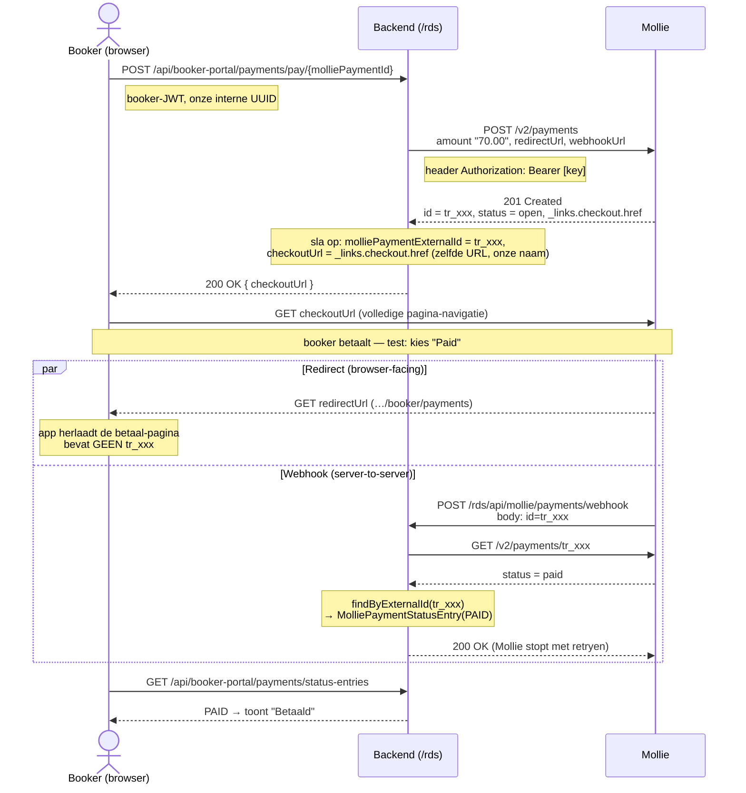

# Mollie Integratie

## Overzicht

- Betalingen via Mollie API
- Eigen entity: MolliePayment
- Koppeling via BookingMolliePayment

---

## Flow

Kort: `create payment (Mollie API)` → `sla op in DB` → `booker betaalt op Mollie` → `webhook werkt status bij`.

### Twee id's (niet verwarren!)

| Id | Wat | Waar gebruikt |
|---|---|---|
| `molliePaymentId` | **Onze** interne UUID (bijv. `20dc1a1b-…`) | pad van de pay-call, koppeltabel `BookingMolliePayment`, DB primary key |
| `tr_xxx` = `molliePaymentExternalId` | **Mollie's** payment-id (`tr_` = transaction) | door Mollie aangemaakt, gebruikt in de webhook + status-GET |

### Sequence-diagram



### Toelichting per stap

1. **pay-call** — de booker klikt "Betalen"; de app stuurt **onze** `molliePaymentId` (UUID) naar de backend.
2. **create at Mollie** — de backend bouwt het bedrag als string met exact 2 decimalen (`"70.00"`) en stuurt `redirectUrl` + `webhookUrl` mee.
3. **tr_xxx ontstaat hier** — Mollie maakt de payment aan en geeft `id = tr_xxx` terug. Die bewaren we als `molliePaymentExternalId`. De betaalpagina-URL komt uit `_links.checkout.href` en slaan we op als `checkoutUrl` — **zelfde URL, onze veldnaam**.
4. **checkoutUrl terug naar de app.**
5. **navigatie naar Mollie** — `window.location = checkoutUrl`; de booker betaalt op de Mollie-checkoutpagina.
6. **na betaling splitst het in twee onafhankelijke sporen:**
    - **Redirect (browser-facing):** Mollie stuurt de browser terug naar `redirectUrl`. Bevat **geen** `tr_xxx`; de app herlaadt enkel de lijst. Mag intern/IP zijn.
    - **Webhook (server-to-server):** Mollie POST't `id=tr_xxx` naar `webhookUrl`. Moet **publiek bereikbaar** zijn en via NGINX op `/rds/api/mollie/payments/webhook` uitkomen.
7. **status ophalen** — de webhook-body bevat alleen de id (geen status). De backend haalt de **echte** status apart op via `GET /v2/payments/tr_xxx`, zoekt ons record via `tr_xxx` en schrijft een `MolliePaymentStatusEntry(PAID)` weg.
8. **app leest de status** — de booker-portal haalt de status-entries op en toont "Betaald". De **enige** statusbron is de webhook, niet de redirect.

> **Let op:** redirect ≠ webhook. De redirect is browser-facing (mag een intern/IP-adres zijn), de webhook wordt door Mollie's servers op het internet aangeroepen en moet dus publiek bereikbaar zijn — inclusief de `/rds` context-path in NGINX.

[//]: # (Flow 1: EMPLOYEE maakt betaling aan &#40;frontend-employee&#41;)

[//]: # ()
[//]: # (frontend-employee → POST /api/mollie/payments → MolliePaymentController)

[//]: # ()
[//]: # (Stap voor stap:)

[//]: # ()
[//]: # (1. EMPLOYEE maakt een MolliePaymentDto aan in de UI &#40;bedrag, valuta, beschrijving&#41;)

[//]: # (2. MolliePaymentController.create&#40;&#41; &#40;regel 50-55&#41; — vereist PAYMENT_CREATE authority)

[//]: # (3. MollieServiceImpl.create&#40;&#41; &#40;regel 42-56&#41;:)

[//]: # (   - Maakt een MolliePayment entity aan &#40;zonder molliePaymentExternalId — nog niet bij Mollie&#41;)

[//]: # (   - @PrePersist zet automatisch: createdAt, createdBy, tenantOrganization &#40;via TenantContext&#41;, status → OPEN)

[//]: # (   - Slaat op in DB)

[//]: # (   - Maakt een initiële StatusEntry aan via statusEntryService)

[//]: # (   - Retourneert DTO)

[//]: # ()
[//]: # (Resultaat: Er bestaat nu een MolliePayment record in de DB met status OPEN, maar nog geen echte Mollie-betaling. Het is een "aankondiging" van een verwachte betaling.)

[//]: # ()
[//]: # (De link naar een booking gebeurt via de BookingMolliePayment koppeltabel &#40;apart beheerd&#41;.)

[//]: # ()
[//]: # (  ---)

[//]: # (Flow 2: BOOKER betaalt via booker-portal &#40;frontend-booker&#41;)

[//]: # ()
[//]: # (frontend-booker → POST /api/booker-portal/payments/pay/{molliePaymentId} → BookerPortalPaymentController)

[//]: # ()
[//]: # (Stap voor stap:)

[//]: # ()
[//]: # (1. BOOKER ziet zijn betalingen &#40;via GET /api/booker-portal/payments → haalt alle MolliePayments voor zijn booking op via BookingMolliePayment koppeltabel&#41;)

[//]: # (2. BOOKER klikt "Betalen" op een openstaande betaling)

[//]: # (3. BookerPortalPaymentController.initiatePayment&#40;&#41; &#40;regel 43-49&#41; — vereist BOOKER_PORTAL_UPDATE)

[//]: # (   - Haalt bookingId uit BookerContext &#40;sessie-gebonden, niet TenantContext&#41;)

[//]: # (4. BookerPortalPaymentService.initiatePayment&#40;&#41; &#40;regel 69-118&#41;:)

[//]: # (   - Verificatie: controleert dat de molliePaymentId daadwerkelijk bij deze booking hoort &#40;via BookingMolliePayment&#41;)

[//]: # (   - Bouwt PaymentRequestDto: bedrag + valuta van bestaand record, redirect/webhook URLs uit MollieConfig)

[//]: # (   - Roept Mollie API aan via mollieRestClient.post&#40;&#41; — dit maakt de echte betaling bij Mollie)

[//]: # (   - Update bestaand record: vult molliePaymentExternalId &#40;Mollie's tr_xxxx ID&#41;, checkoutUrl, en status in)

[//]: # (   - Retourneert PaymentResponseDto met o.a. de checkoutUrl)

[//]: # (5. Frontend redirect de booker naar de checkoutUrl &#40;Mollie betaalpagina&#41;)

[//]: # ()
[//]: # (  ---)

[//]: # (Flow 3: Webhook &#40;na betaling&#41;)

[//]: # ()
[//]: # (Mollie → POST /api/mollie/payments/webhook?id=tr_xxxx → MolliePaymentController)

[//]: # ()
[//]: # (1. MolliePaymentController.handleWebhook&#40;&#41; &#40;regel 78-82&#41; — geen auth &#40;Mollie roept dit aan&#41;)

[//]: # (2. MollieServiceImpl.updatePaymentFromMollie&#40;&#41; &#40;regel 138-166&#41;:)

[//]: # (   - Haalt actuele status op bij Mollie via GET /{id})

[//]: # (   - Zoekt het interne record op via molliePaymentExternalId)

[//]: # (   - Update de status &#40;bijv. OPEN → PAID&#41;)

[//]: # (   - Maakt een StatusEntry aan voor audit trail)

[//]: # ()
[//]: # (  ---)

[//]: # (Samenvatting visueel)

[//]: # ()
[//]: # (EMPLOYEE &#40;frontend-employee&#41;           BOOKER &#40;frontend-booker&#41;)

[//]: # (│                                       │)

[//]: # (│ POST /api/mollie/payments             │ GET /api/booker-portal/payments)

[//]: # (│ &#40;PAYMENT_CREATE&#41;                      │ &#40;BOOKER_PORTAL_READ&#41;)

[//]: # (▼                                       │)

[//]: # (┌──────────────┐                            │ POST /api/booker-portal/payments/pay/{id})

[//]: # (│ MolliePayment│ ◄─── record in DB ──────── │ &#40;BOOKER_PORTAL_UPDATE&#41;)

[//]: # (│ status: OPEN │                            ▼)

[//]: # (│ externalId:  │                    ┌──────────────────────┐)

[//]: # (│   &#40;null&#41;     │                    │ BookerPortalPayment  │)

[//]: # (└──────────────┘                    │ Service              │)

[//]: # (│  1. verify ownership │)

[//]: # (│  2. POST → Mollie API│)

[//]: # (│  3. update record    │)

[//]: # (│     + externalId     │)

[//]: # (│     + checkoutUrl    │)

[//]: # (└──────────┬───────────┘)

[//]: # (│)

[//]: # (▼)

[//]: # (Booker → Mollie checkout)

[//]: # (│)

[//]: # (▼)

[//]: # (Mollie → webhook → status update)

[//]: # ()
[//]: # (Key takeaway: De EMPLOYEE maakt het betalingsrecord aan &#40;bedrag, beschrijving&#41;, de BOOKER triggert de daadwerkelijke Mollie-betaling. De webhook sluit de cirkel door de status te updaten na betaling.)


---

## Statussen

- OPEN
- PAID
- FAILED
- CANCELED
- EXPIRED

---

## Security

- webhook = permitAll
- overige endpoints beveiligd

---

## Belangrijk

- MolliePayment is los van Booking
- koppeling via aparte tabel

## Mollie Betalingen

### Overzicht

Geïsoleerde `nl.puurkroatie.rds.mollie` package die de Mollie payment flow implementeert. MolliePayment is een onafhankelijke entiteit zonder directe relatie naar Booking. De koppeling tussen Booking en MolliePayment verloopt via een koppeltabel `BookingMolliePayment` in de `booking` package.

Twee lagen:

1. **MolliePayment entity/DTO** — eigen CRUD, persistentie van betalingen in onze database
2. **Mollie API DTOs** (PaymentRequest/Response/StatusRequest/StatusResponse) — communicatie met Mollie's externe API


### Enums

**MolliePaymentStatus**: `OPEN`, `PENDING`, `AUTHORIZED`, `PAID`, `FAILED`, `CANCELED`, `EXPIRED`
— Correspondeert met Mollie API statussen. Serialisatie via `@JsonValue` (lowercase) en `@JsonCreator` (case-insensitive).

**MolliePaymentMethod**: `IDEAL`, `CREDITCARD`, `BANCONTACT`, `SOFORT`, `BANKTRANSFER`, `PAYPAL`, `BELFIUS`, `KBC`, `EPS`, `GIROPAY`, `PRZELEWY24`, `APPLEPAY`, `GOOGLEPAY`, `IN3`, `KLARNA`, `RIVERTY`
— Zelfde serialisatie-strategie als MolliePaymentStatus.

### Package-structuur

```
nl.puurkroatie.rds.mollie.entity          — MolliePayment, MolliePaymentStatus, MolliePaymentMethod
nl.puurkroatie.rds.mollie.dto             — MolliePaymentDto, PaymentRequestDto, PaymentResponseDto, PaymentStatusRequestDto, PaymentStatusResponseDto
nl.puurkroatie.rds.mollie.repository      — MolliePaymentRepository
nl.puurkroatie.rds.mollie.service         — MollieService (interface)
nl.puurkroatie.rds.mollie.service.impl    — MollieServiceImpl
nl.puurkroatie.rds.mollie.controller      — MolliePaymentController
nl.puurkroatie.rds.mollie.config          — MollieConfig
```

### Configuratie (`application.yaml`)

```yaml
app:
  mollie:
    api:
      payments:
        base: https://api.mollie.com/v2/payments
    key: Bearer test_GpPHhs7SHk73fAyMyaJUFUKJQdxDD5
    urls:
      webhook: http://94.212.62.67:8082/payment/mollie/
      redirect: http://94.212.62.67:5003/payment
```

`MollieConfig` (`@ConfigurationProperties(prefix = "app.mollie")`) levert een `RestClient` bean (`mollieRestClient`) geconfigureerd met de Mollie base URL en `Authorization` header.

### Mollie API DTOs

| DTO | Richting | Beschrijving |
|---|---|---|
| `PaymentRequestDto` | → Mollie (`POST /v2/payments`) | Bevat nested `Amount` (currency + value als String), description, redirectUrl, webhookUrl, metadata (incl. bookingId) |
| `PaymentResponseDto` | ← Mollie | Bevat id (`tr_xxx`), status, amount, description, `_links.checkout.href` (checkout URL) |
| `PaymentStatusRequestDto` | ← Mollie webhook | Bevat alleen `id` (form-urlencoded `@RequestParam`) |
| `PaymentStatusResponseDto` | ← Mollie (`GET /v2/payments/{id}`) | Bevat id, status, amount, paidAt (nullable), metadata |

### MollieService

`MollieService` / `MollieServiceImpl` biedt:

**CRUD** (zelfde patroon als `BookingServiceImpl`):
- `create`, `update`, `delete`, `findAll`, `findById`
- Tenant-filtering via `TenantContext` (ADMIN ziet alles, overige alleen eigen organisatie)

**Mollie API interactie**:
- `createPaymentAtMollie(PaymentRequestDto)` — POST naar Mollie, slaat `MolliePayment` entity op met Mollie's external ID, checkout URL en status. De koppeling met een Booking moet apart via `BookingMolliePayment` worden aangemaakt.
- `updatePaymentFromMollie(PaymentStatusRequestDto)` — GET naar Mollie voor actuele status, werkt bestaande `MolliePayment` bij op basis van `molliePaymentExternalId`

### Controller endpoints

| Endpoint | Method | Authority | Beschrijving |
|---|---|---|---|
| `/api/mollie/payments` | GET | BOOKING_READ | Alle betalingen (tenant-gefilterd) |
| `/api/mollie/payments/{id}` | GET | BOOKING_READ | Specifieke betaling |
| `/api/mollie/payments` | POST | BOOKING_WRITE | MolliePayment aanmaken (CRUD) |
| `/api/mollie/payments/{id}` | PUT | BOOKING_WRITE | MolliePayment bijwerken (CRUD) |
| `/api/mollie/payments/{id}` | DELETE | BOOKING_DELETE | MolliePayment verwijderen |
| `/api/mollie/payments/create-at-mollie` | POST | BOOKING_WRITE | Betaling aanmaken bij Mollie API |
| `/api/mollie/payments/webhook` | POST | permitAll | Webhook van Mollie (retourneert 200 OK, lege body) |
| `/api/mollie/payment-statuses` | GET | BOOKING_READ | Alle Mollie betaalstatussen |
| `/api/mollie/payment-statuses/{id}` | GET | BOOKING_READ | Specifieke betaalstatus |

### Security

- `/api/mollie/payments/webhook` is toegevoegd aan `permitAll` in `SecurityConfig.java` (Mollie stuurt webhooks zonder authenticatie)
- Overige endpoints gebruiken bestaande `BOOKING_READ`, `BOOKING_WRITE` en `BOOKING_DELETE` authorities via `@PreAuthorize`

### Repository queries

- `findByMolliePaymentExternalId(String)` — opzoeken op Mollie's `tr_xxx` ID (voor webhook-verwerking)
- `findByTenantOrganization(UUID)` — tenant-filtering

### Koppeltabel: BookingMolliePayment

De koppeling tussen `Booking` en `MolliePayment` wordt beheerd in de `nl.puurkroatie.rds.booking` package via een koppeltabel-entity (zelfde patroon als `BookerAddress`):

| Bestand | Package | Beschrijving |
|---|---|---|
| `BookingMolliePayment.java` | `booking.entity` | Entity met composite PK via `@IdClass`, `@ManyToOne` naar `Booking` en `MolliePayment` |
| `BookingMolliePaymentId.java` | `booking.entity` | Composite key class (`booking` + `molliePayment` UUIDs) |
| `BookingMolliePaymentDto.java` | `booking.dto` | DTO met `bookingId` + `molliePaymentId` |
| `BookingMolliePaymentRepository.java` | `booking.repository` | JPA repository met `findByBookingTenantOrganization(UUID)` |
| `BookingMolliePaymentService.java` | `booking.service` | Interface: `findAll`, `findById`, `create`, `delete` |
| `BookingMolliePaymentServiceImpl.java` | `booking.service.impl` | Implementatie met tenant-filtering via `TenantContext` |
| `BookingMolliePaymentController.java` | `booking.controller` | REST endpoints op `/api/booking-mollie-payments` |

**Controller endpoints (BookingMolliePayment):**

| Endpoint | Method | Authority | Beschrijving |
|---|---|---|---|
| `/api/booking-mollie-payments` | GET | BOOKING_READ | Alle koppelingen (tenant-gefilterd) |
| `/api/booking-mollie-payments/{bookingId}` | GET | BOOKING_READ | Alle payments van een specifieke booking |
| `/api/booking-mollie-payments/{bookingId}/{molliePaymentId}` | GET | BOOKING_READ | Specifieke koppeling |
| `/api/booking-mollie-payments` | POST | BOOKING_WRITE | Koppeling aanmaken |
| `/api/booking-mollie-payments/{bookingId}/{molliePaymentId}` | DELETE | BOOKING_DELETE | Koppeling verwijderen |

## BookingLine

### Overzicht

BookingLine is de koppeltabel die een Booking verbindt met een specifieke Accommodation + Supplier combinatie. Elke booking bevat meerdere booking lines die elk een verblijf op een accommodatie bij een leverancier vertegenwoordigen, met eigen datum-range en bedrag.

### Package-structuur

| Bestand | Package | Beschrijving |
|---|---|---|
| `BookingLine.java` | `booking.entity` | Entity met composite PK via `@IdClass(BookingLineId.class)`, `@ManyToOne` naar `Booking`, `Accommodation` en `Supplier` |
| `BookingLineId.java` | `booking.entity` | Composite key class (`booking` + `accommodation` + `supplier` UUIDs) |
| `BookingLineDto.java` | `booking.dto` | DTO met key fields + `accommodationName` en `supplierName` voor weergave |
| `BookingLineMapper.java` | `booking.mapper` | MapStruct mapper met nested entity path mappings |
| `BookingLineRepository.java` | `booking.repository` | JPA repository met `findByTenantOrganization(UUID)` en `findByBookingBookingId(UUID)` |
| `BookingLineService.java` | `booking.service` | Interface: `findAll`, `findByBookingId`, `findById`, `create`, `update`, `delete` |
| `BookingLineServiceImpl.java` | `booking.service.impl` | Implementatie met tenant-filtering via `TenantContext` |
| `BookingLineController.java` | `booking.controller` | REST endpoints op `/api/booking-lines` |

### Controller endpoints (BookingLine)

| Endpoint | Method | Authority | Beschrijving |
|---|---|---|---|
| `/api/booking-lines` | GET | BOOKING_READ | Alle booking lines (tenant-gefilterd) |
| `/api/booking-lines/{bookingId}` | GET | BOOKING_READ | Alle lines van een specifieke booking |
| `/api/booking-lines/{bookingId}/{accommodationId}/{supplierId}` | GET | BOOKING_READ | Specifieke booking line |
| `/api/booking-lines` | POST | BOOKING_WRITE | Booking line aanmaken |
| `/api/booking-lines/{bookingId}/{accommodationId}/{supplierId}` | PUT | BOOKING_WRITE | Booking line bijwerken |
| `/api/booking-lines/{bookingId}/{accommodationId}/{supplierId}` | DELETE | BOOKING_DELETE | Booking line verwijderen |

### Testen via curl (Mollie)

```bash
# MolliePayment CRUD — lijst opvragen
curl -k https://localhost:8666/api/mollie/payments \
  -H "Authorization: Bearer <token>"

# Betaling aanmaken bij Mollie
curl -k -X POST https://localhost:8666/api/mollie/payments/create-at-mollie \
  -H "Content-Type: application/json" \
  -H "Authorization: Bearer <token>" \
  -d '{"amount":{"currency":"EUR","value":"125.00"},"description":"Boeking BK-2026-001","redirectUrl":"http://localhost:5003/payment","webhookUrl":"http://localhost:8082/payment/mollie/","metadata":{"bookingId":"<booking-uuid>"}}'

# Webhook simuleren (zoals Mollie dit stuurt)
curl -k -X POST "https://localhost:8666/api/mollie/payments/webhook?id=tr_xxx"

# BookingMolliePayment — koppeling aanmaken
curl -k -X POST https://localhost:8666/api/booking-mollie-payments \
  -H "Content-Type: application/json" \
  -H "Authorization: Bearer <token>" \
  -d '{"bookingId":"<booking-uuid>","molliePaymentId":"<mollie-payment-uuid>"}'

# BookingMolliePayment — koppelingen opvragen
curl -k https://localhost:8666/api/booking-mollie-payments \
  -H "Authorization: Bearer <token>"
```

