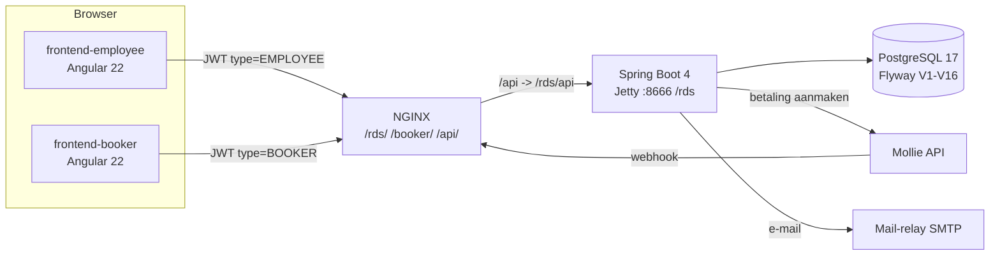

# Overzicht: wat is RDS en hoe zit het in elkaar?

## In één alinea

RDS (**R**eis **D**ossier **S**ysteem) is een multi-tenant SaaS voor reisorganisaties. Medewerkers beheren **boekingen** (een dossier per reis: hoofdboeker, reizigers, accommodaties, activiteiten, documenten, betalingen). Het systeem genereert **Word/PDF-documenten** en verstuurt **e-mails** vanuit templates, laat klanten via een **portal** hun dossier bekijken en laat ze via **Mollie** betalen. Elke organisatie (tenant) ziet alleen eigen data.

## Gebruikers en wat ze doen

| Gebruiker | App | Doet |
|---|---|---|
| **ADMIN** (systeembeheer) | `frontend-employee` | organisaties, personen, accounts, rollen, authorities beheren. Heeft bewust géén boekingsrechten. |
| **MANAGER** | `frontend-employee` | alles binnen de eigen organisatie: boekingen, stamgegevens, templates (Word + e-mail), documenten, betalingen, thema, gebruikersbeheer |
| **EMPLOYEE** | `frontend-employee` | dagelijks werk: boekingen, bookers/prospects, documenten, mails versturen; templates alleen lezen |
| **Booker** (klant, extern) | `frontend-booker` | inloggen met e-mailadres + boekingsnummer + eenmalige code (OTP); eigen reisschema, documenten, accommodaties, activiteiten en betalingen zien; betalen |

De precieze rechten staan in [security.md](security.md) (rollen → authorities).

## Functionaliteit per gebied

### Boekingen (`frontend-employee` → *Boekingen*)
- Lijst en detailscherm per boeking: boekingsnummer, **status** (`aanvraag → offerte → boeking → voorschot → betaald → opreis → weerthuis → afgerond`), periode en totaalbedrag, **hoofdboeker**, **reizigers**, **boekingsregels** (accommodatie + leverancier + periode + prijs), **boekingsactiviteiten**, **documenten**, **betalingen**.
- Acties in het detail: documenten uploaden of **genereren** uit een Word-template (docx of pdf), een Mollie-betaling aanmaken, **e-mail versturen** naar de hoofdboeker (*Nieuw → E-mail aan hoofdboeker* in de tijdlijn *Berichten en documenten*).
- **Concept-boeking:** vanuit een boeker/prospect een nieuwe boeking starten (`/bookings/new?bookerId=…`). Het scherm is voorgevuld, maar er wordt **niets opgeslagen** totdat de eerste onderdelen (reiziger, boekingsregel, …) worden toegevoegd (`ensureBookingPersisted`). Heeft de gekozen boeker al een lopende (niet afgeronde) boeking, dan volgt een waarschuwing.

### Bookers en prospects
- Een **prospect** is in het datamodel gewoon een `Booker` met `status = PROSPECT` (zie [domain.md](domain.md)). Het scherm *Prospects* is het aanmeldproces: potentiële klanten registreren en ze mailen. In het booker-dialoog zet **Maak boeker** een prospect om naar `ACTIVE`.
- *Bookers* toont de reguliere boekers; een icoon per rij start een concept-boeking.
- *Reizigers* (`travelers`) hangen aan een boeking.

### Stamgegevens
Accommodaties (met adressen en leveranciers), leveranciers (met adressen), activiteiten (soort: tour, excursie, ticket, transfer). Alleen met de bijbehorende `*_CREATE/UPDATE/DELETE`-authorities zichtbaar.

### Documenten en Word-templates
- Een **Word-template** is een `.docx` met velden zoals `${booking.bookingNumber}`; de backend voegt dit samen met de boekingsgegevens (xdocreport + FreeMarker) tot een document (docx of pdf), dat aan de boeking hangt. De naam bevat sjabloonnaam, boekingsnummer en datum+tijd, zodat hetzelfde sjabloon meerdere keren kan worden ingezet.
- Een template kan **geüpload** worden of in de **WYSIWYG-editor** gemaakt worden (met variabelen, afbeeldingen en herhaalde tabellen); zie [templates.md](templates.md).

### E-mail
E-mailtemplates (onderwerp + HTML) met dezelfde editor; het scherm *E-mailtemplates* is alleen voor het beheren ervan. Versturen (met voorbeeld) gebeurt **alleen** vanuit een boeking (naar de hoofdboeker) of vanuit een prospect (mail-icoon in *Prospects*). Zie [email.md](email.md).

### Betalingen (Mollie)
De medewerker maakt een betalingsrecord voor een boeking; de klant triggert in de portal de echte betaling; een webhook werkt de status bij. Zie [mollie.md](mollie.md).

### Beheer (alleen met de juiste authorities)
Organisaties (incl. afzenderadres voor e-mail en Mollie-sleutel), een **onboarding-wizard** voor een nieuwe organisatie (organisatie → persoon → account → rol), personen, accounts (vergrendelen, TOTP resetten), rollen, authorities, en het **organisatiethema** (kleuren, logo) dat de hele UI inkleurt.

### Profiel en beveiliging van het eigen account
Wachtwoord wijzigen (afgedwongen bij eerste login als `must_change_password`), **TOTP** (2FA) instellen/uitzetten met herstelcodes.

### Booker-portal (`frontend-booker`)
Inloggen met OTP; dashboard, reisschema (itinerary), documenten, accommodaties, activiteiten en betalingen van de **eigen boeking**. Zie [bookerportal.md](bookerportal.md).

## Architectuur in het kort



- **Backend:** per domeinmodule de lagen *controller → service (+impl) → repository*, DTO's + MapStruct, Flyway, `TenantContext`. Details: [architecture.md](architecture.md).
- **Frontends:** standalone componenten, services voor API-calls, authority-gestuurde UI, ngx-translate. Details: [frontend.md](frontend.md).
- **Templating:** één FreeMarker-model voor e-mail en Word, strikt afgeschermd. Details: [templates.md](templates.md).

## Repository-indeling

```
rds/
├── CLAUDE.md                    # projectregels voor Claude (leidend)
├── pom.xml                      # backend (Maven, Java 21)
├── src/main/java/nl/puurkroatie/rds/
│   ├── auth/        # organisaties, personen, accounts, rollen, authorities, JWT, TOTP, thema, security-config
│   ├── booking/     # boekingen, bookers, reizigers, accommodaties, leveranciers, activiteiten, adressen, documenten, document-templates
│   ├── mollie/      # betalingen + webhook
│   ├── bookerportal/# OTP-login en portal-endpoints voor klanten
│   ├── email/       # e-mailtemplates, versturen, afbeeldingenbibliotheek
│   ├── docgen/      # gedeeld template-model, documentgeneratie, HTML→docx, herhaalde tabellen
│   └── common/      # kleine gedeelde hulpmiddelen (enum-parsing)
├── src/main/resources/db/migration/   # Flyway V1..V16
├── src/test/java/…                    # backend-tests (unit + MockMvc-integratie)
├── frontend-employee/           # Angular-app voor medewerkers
├── frontend-booker/             # Angular-app voor klanten
├── deploy/nginx/rds.conf        # versioneerde NGINX-config
├── deploy/scripts/              # build+deploy-scripts (backend, beide frontends)
├── start/scripts/               # lokale Mollie-tunnel (cloudflared)
└── docs/                        # deze documentatie
```

## Demo-/seeddata
`V2__initial_data.sql` vult twee organisaties (**Puurkroatie** en **TechPartner BV**), de rollen ADMIN/EMPLOYEE/MANAGER, de authorities, personen/accounts en voorbeeldboekingen. Tests leunen op deze vaste UUID's (zie `AbstractControllerTest`, `AbstractBookingControllerTest`). Productiedata hoort daar niet in.
