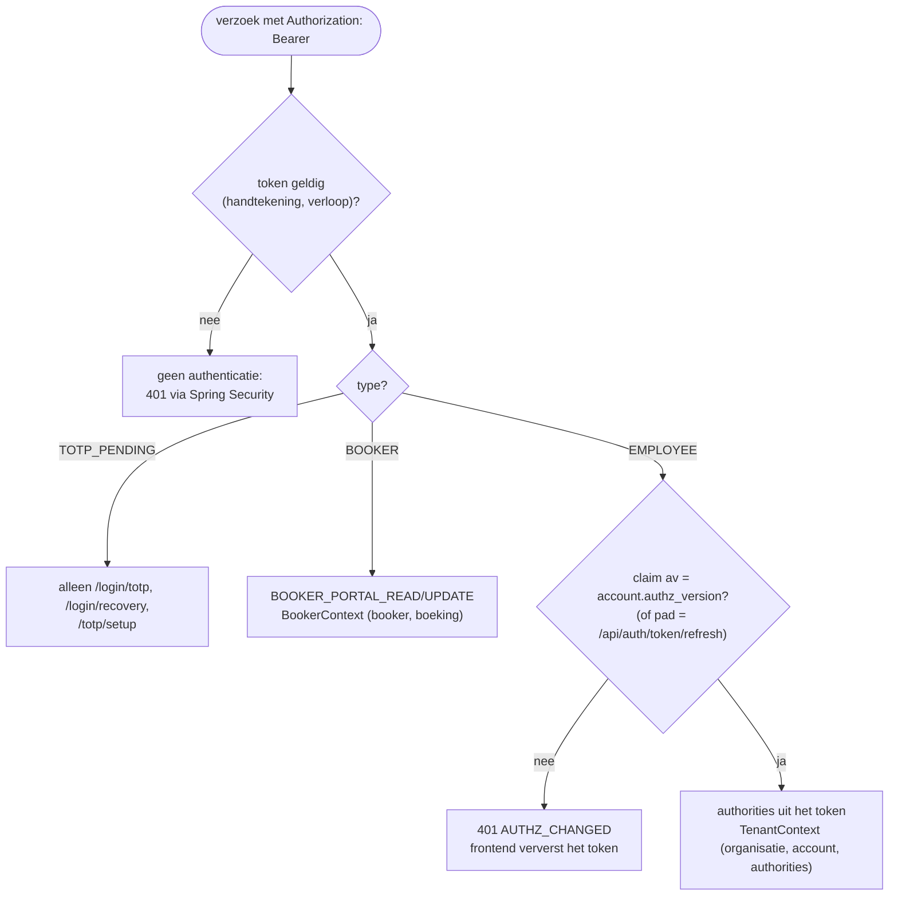
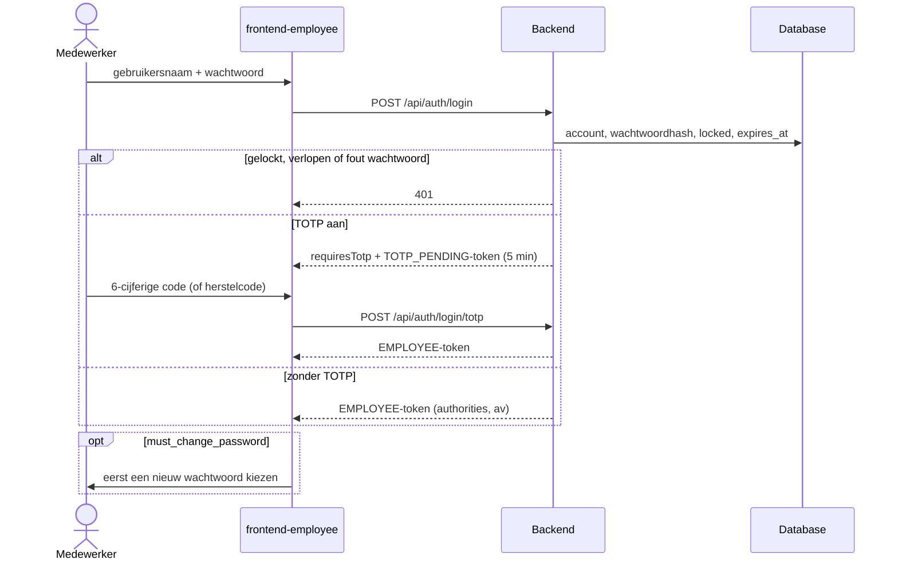

# Security

Samenvatting: stateless JWT, multi-tenant per organisatie, rechten op **authorities**, optionele TOTP-2FA voor medewerkers, OTP-login voor klanten, en een afgeschermde template-engine omdat templates door gebruikers geschreven worden. Bekende risico's staan in [open-items.md](open-items.md).

## Tokens (JWT, HS-ondertekend, `JwtTokenProvider`)

| `type` | Wie | Levensduur | Belangrijkste claims |
|---|---|---|---|
| `EMPLOYEE` | ingelogde medewerker | `app.jwt.expiration-ms` (nu 1 uur) | `sub`=accountId, `org`, `personId`, `userName`, `personName`, `organizationName`, `authorities`, `roles`, `av` (rechtenversie, V26) |
| `TOTP_PENDING` | tussenstap na wachtwoord als TOTP vereist is | kort | `sub`=accountId; geeft alleen toegang tot de TOTP-/herstelcode-login |
| `BOOKER` | klant na OTP | `app.jwt.booker-expiration-ms` (nu 1 uur) | `sub`=bookerId, `bookingId` |

Het token wordt door beide frontends in `localStorage` bewaard en als `Authorization: Bearer …` meegestuurd. Een `401` (behalve op login-endpoints) logt de gebruiker uit. Een token zonder `type` geldt als `EMPLOYEE`.

**Rechten direct doorvoeren (V26).** `account.authz_version` gaat omhoog zodra de rechten van een account veranderen: een rol toegewezen of ingetrokken, een recht toegevoegd aan of weggehaald uit een van zijn rollen (ook via `sync_system_roles()`), of het account gelockt, ontgrendeld of met een andere vervaldatum. Databasetriggers doen dat, dus ook bij directe SQL. `JwtAuthenticationFilter` vergelijkt de claim `av` met de database (één opzoeking op primaire sleutel per aanroep) en weigert een verouderd token met `401` en `{"code":"AUTHZ_CHANGED"}`. Alleen `POST /api/auth/token/refresh` werkt dan nog: die geeft een nieuw token met de huidige rechten (`EmployeeTokenService`), zonder wachtwoord of 2FA, maar niet als het account gelockt of verlopen is of een nieuw wachtwoord moet kiezen (`401`). De frontend (`authInterceptor`) ververst bij `AUTHZ_CHANGED` één keer (gedeeld tussen gelijktijdige aanroepen), herhaalt de aanroep en zet het nieuwe token in de `AuthService`, waardoor menu, routes en kaarten direct meebewegen. Een token van vóór V26 heeft geen `av` en wordt dus ook ververst.

`JwtAuthenticationFilter` (vóór de Spring-filter): valideert het token, zet de `SecurityContext` en de ThreadLocals (`TenantContext` of `BookerContext`) en ruimt ze in een `finally` op. Een `BOOKER`-token krijgt vast `BOOKER_PORTAL_READ` en `BOOKER_PORTAL_UPDATE`; een `TOTP_PENDING`-token alleen een pseudo-authority `TOTP_PENDING`.

## Endpoint-toegang (`SecurityConfig`)

CSRF uit (stateless, token in header), sessies `STATELESS`.

| Pad | Toegang |
|---|---|
| `/api/auth/login`, `/api/auth/login/totp`, `/api/auth/login/recovery` | publiek |
| `/api/booker-auth/**` | publiek (OTP aanvragen/verifiëren) |
| `/api/mollie/payments/webhook` | publiek (Mollie roept dit aan; id wordt gevalideerd, zie [mollie.md](mollie.md)) |
| `GET /api/public/email-images/*` | publiek (alleen GET; onraadbare UUID; zie [email.md](email.md)) |
| `/monitoring/**` | publiek in Spring (JavaMelody); in **NGINX** beperkt tot `127.0.0.1` + beheer-IP (`deny all`) |
| `/api/booker-portal/**`, overige `/api/**` | ingelogd; daarna `@PreAuthorize` per methode |

Elke controller-methode heeft `@PreAuthorize("hasAuthority('…')")`; de volledige lijst staat in [api-examples.md](api-examples.md). Endpoints zonder annotatie die niet publiek zijn (TOTP-instellen, wachtwoord wijzigen) werken alleen op het eigen account.

## Rollen en authorities

**Model sinds V24** (ontwerp: [voorstel-eigen-rollen.md](voorstel-eigen-rollen.md)):

- **Authorities liggen vast**: ze komen alleen uit Flyway (`/api/authorities` is alleen-lezen; aanmaken, wijzigen en verwijderen geeft `405`). Elke authority heeft een `domain`, `tenant_assignable` (mag een klant hem uitdelen? niet: `PLATFORM_ADMIN`, `ORGANIZATION_*`, `BOOKER_PORTAL_*`) en `introduced_at`; afhankelijkheden staan in `authority_requires`.
- **Eén platformorganisatie "RDS Platform"** (`organization.platform`) met de beheerders; alle andere organisaties zijn klanten. Niet te verwijderen (service `409` én trigger).
- **Rollen horen bij één organisatie** (`role.tenant_organization` NOT NULL). **Systeemrollen** (`system_key` ADMIN/MANAGER/EMPLOYEE) liggen vast: hun inhoud staat in `system_role_template`; elke organisatie heeft een kopie (ADMIN alleen in het platform, MANAGER en EMPLOYEE bij elke klant, aangemaakt bij het aanmaken van de organisatie). `sync_system_roles()` houdt de kopieën gelijk; triggers weigeren elke andere wijziging aan systeemrollen.
- **Toewijzingen** (`account_role`) hebben een `tenant_organization`; samengestelde foreign keys dwingen af dat account en rol bij dezelfde organisatie horen.
- **Regels** (`AuthorizationRules`, `RoleServiceImpl`, `RoleAuthorityService`, `AccountRoleService`): je deelt alleen uit wat je zelf hebt én wat een klant mag hebben (G(u) = E(u) ∩ T, E(u) uit de database); je wijzigt alleen eigen rollen van je eigen organisatie onder je niveau; vereisten gaan automatisch mee en een recht dat een ander recht in de rol nodig heeft, gaat er niet uit (`409`). `PLATFORM_ADMIN` mag bij klanten alleen de systeemrollen toewijzen (bijv. de eerste manager). Elke organisatie houdt minstens één bruikbare beheerder (MANAGER bij een klant, ADMIN in het platform; `AdministratorGuard`, `409`).
- **Rollenscherm** (frontend `role-detail`, `role-authority-matrix`): één formulier met naam, sjabloon en rechtenmatrix als concept; *Opslaan* stuurt `POST /api/roles` of `PUT /api/roles/{id}` met `authorities` (de gewenste set) en de server slaat alleen het verschil op, in één transactie. Het rechtenlogboek bewaart per regel ook de naam van wie het deed (`created_by_name`, V27), aantal accounts per rol, melding nieuwe rechten (`/api/roles/new-authorities`, *Gezien* zet `organization.roles_reviewed_at`).
- **Rechtenlogboek** `authorization_log` (alleen toevoegen, trigger): wie gaf of nam wanneer welke rol of welk recht; `GET /api/authorization-log?roleId=&accountId=` (`ROLE_READ`).

Seed vóór V24 (V2, V6, V10, V12; V16 haalt `DOCUMENT_DELETE` weg) — letters = C(reate) R(ead) U(pdate) D(elete), S = send. Sinds V24 krijgt MANAGER daarbij `ROLE_CREATE/UPDATE/DELETE` en `ROLEAUTHORITY_CREATE/DELETE` (eigen rollen inrichten), en vervallen `AUTHORITY_CREATE/UPDATE/DELETE`:

| Domein | ADMIN | MANAGER | EMPLOYEE |
|---|:--:|:--:|:--:|
| ORGANIZATION | CRUD | – | – |
| PERSON | CRUD | CRUD | R U |
| ACCOUNT | CRUD | CRUD | R U |
| ACCOUNTROLE | C R D | C R D | – |
| ROLE | CRUD | R | – |
| AUTHORITY | CRUD | R | – |
| ROLEAUTHORITY | C R D | R | – |
| PAYMENT_CORRECT (status van een betaling corrigeren, V10) | ✓ | ✓ | – |
| PAYMENT_RELINK (betaling met reden aan een andere boeking hangen, V12) | ✓ | ✓ | – |
| BOOKING (boekingen, bookers, reizigers, adressen, regels, activiteiten) | – | CRUD | CRUD |
| ACCOMMODATION, SUPPLIER, ACTIVITY | – | CRUD | R |
| DOCUMENT (geen verwijderen: een document wordt nooit verwijderd) | – | C R U | C R U |
| PAYMENT | – | CRUD\* | C R |
| TEMPLATE (Word + e-mail + afbeeldingen) | – | CRUD | R |
| EMAIL_SEND | – | S | S |
| ORGANIZATION_THEME | – | CRUD | – |
| BOOKER_PORTAL_READ/UPDATE | – | – | – (alleen via een BOOKER-token) |

\* `PAYMENT_DELETE` bestaat als authority (en zit bij MANAGER), maar geen enkel endpoint gebruikt het: betalingen worden nooit verwijderd. `PAYMENT_UPDATE` werkt alleen zolang een betaling nog niet bij Mollie bestaat.

- **ADMIN = systeembeheer**: bewust geen boekings-, template- of e-mailrechten. Vandaar `403` voor ADMIN op die endpoints (ook in de tests). ADMIN heeft wel `PAYMENT_CORRECT` en `PAYMENT_RELINK`, maar niet `PAYMENT_READ`: die twee rechten zijn in de praktijk voor MANAGER bedoeld.
- **Nieuwe authority:** een Flyway-migratie die hem toevoegt (met `domain`, `tenant_assignable`, `introduced_at` en zo nodig `authority_requires`), in `system_role_template` zet bij de systeemrollen die hem krijgen, en daarna `SELECT sync_system_roles();` aanroept. Eigen rollen van klanten krijgen hem niet vanzelf.
- **Frontend:** componenten, menu-items en routes worden getoond of toegelaten op basis van authorities, nooit rollen (`core/auth/access.ts`, `authorityGuard`; zie [frontend.md](frontend.md)). Dat is gemak, geen beveiliging: de backend controleert zelf.

## Tenant-isolatie

- Elke tenant-entiteit heeft `tenant_organization`; `@PrePersist` vult die uit `TenantContext`; de kolom is `updatable = false`.
- **Services** doen de controle op authorities, nooit op rolnamen (sinds V23): met `PLATFORM_ADMIN` (rol ADMIN) zie je alles, anderen alleen `tenantOrganization == TenantContext.getOrganizationId()` (`findByTenantOrganization`, `verifyOrganization` → `AccessDeniedException` → 403).
- **Data-scope via authorities** (`TenantContext.hasAuthority`, constanten in `auth/security/Authorities`):
  - `PLATFORM_ADMIN` (ADMIN): over organisaties heen;
  - `USER_SCOPE_ORGANIZATION` (ADMIN, MANAGER): personen en accounts van de hele organisatie; zonder deze authority alleen het eigen persoon en account.
  - `PAYMENT_OVERVIEW` (MANAGER, V28): de lijsten met álle betalingen van de organisatie (menu Betalingen, manager-dashboard). De betalingen van één boeking vragen alleen `PAYMENT_READ`, zodat een medewerker ze in de boeking ziet zonder het overzicht.
  - Een rol met een andere naam gedraagt zich dus precies volgens zijn authorities. `NoRoleNameChecksTest` laat de build falen bij `hasRole(` in de backend. Zie [voorstel-eigen-rollen.md](voorstel-eigen-rollen.md).
- Er is **bewust geen tenant-filter** op: het publiek uitleveren van een e-mailafbeelding (de ontvanger heeft geen organisatie) en op het booker-portal-pad dat aan één boeking gebonden is.
- **Afbeeldingen/templates:** een template mag alleen afbeeldingen van de eigen organisatie bevatten (`TemplateImages`), anders `400` zonder te verraden of de afbeelding elders bestaat.

## Authenticatie van medewerkers

1. `POST /api/auth/login` met gebruikersnaam + wachtwoord (BCrypt). Een **vergrendeld** account (`locked`) en een **verlopen** account (`expires_at` in het verleden) worden geweigerd met `401` (`CustomUserDetailsService`). Verversen van het token (`/api/auth/token/refresh`) weigert dezelfde accounts.
2. Heeft het account `totp_enabled`, dan volgt een `TOTP_PENDING`-token en een tweede stap: `/login/totp` (6-cijferige code) of `/login/recovery` (herstelcode).
3. `must_change_password` zorgt dat de app na de login een wachtwoordwijziging afdwingt (`/api/auth/change-password`).
4. TOTP instellen: `/api/auth/totp/setup` (QR + herstelcodes), bevestigen met `/totp/verify`, uitzetten met `/totp/disable`. Een beheerder kan TOTP van een ander account resetten (`DELETE /api/accounts/{id}/totp`, `ACCOUNT_UPDATE`).
5. NGINX beperkt de login-endpoints tot een lage frequentie (zie hieronder).

## Authenticatie van klanten

OTP per e-mail + boekingsnummer, token gebonden aan één boeking: zie [bookerportal.md](bookerportal.md). **Let op:** de OTP-mail is nog een stub (logt de code); zie [open-items.md](open-items.md).

## Afscherming van templates (zeer belangrijk)

Word- en e-mailtemplates worden door gebruikers (MANAGER) geschreven en zijn dus **niet vertrouwd**. FreeMarker kan anders met één regel een commando op de server uitvoeren (`?new` → `Execute`) of via Java-reflectie (`${x.class…}`) bij klassen komen. Maatregelen (`FreemarkerHardening`, `TemplateModels`, `EmailRenderServiceImpl`):

- `?new` uit (`ALLOWS_NOTHING_RESOLVER`), `?api` uit, geen `include`/`import` (geen template-loader).
- Het model is **plat**: alleen maps, lijsten, tekst, getallen en booleans (datums → tekst, enums → naam). Geen Java-beans, dus geen `class`-property.
- Voor e-mail: de body is `HTMLOutputFormat` (waarden worden HTML-ge-escaped); herhaalde tabellen valideren lijst- en itemnaam strikt (identifiers) voordat die in een FreeMarker-instructie komen.
- De `.docx` uit de editor gaat door **dezelfde** afgeschermde straat; er is een test die een payload in de editor typt en bevestigt dat die geblokkeerd wordt (`HtmlToDocxConverterTest`, `DocgenTemplateInjectionTest`).
- Afbeeldingen: type uit de **bytes** (PNG/JPEG/GIF/WebP, geen SVG), maximaal 2 MB; in een Word-template alleen uit de eigen bibliotheek, nooit via een URL opgehaald (geen SSRF).

## Netwerklaag (NGINX, `deploy/nginx/rds.kbtg.nl.conf`)

- Eigen `server` voor `rds.kbtg.nl` met een **Let's Encrypt-certificaat** (automatisch vernieuwd) en HSTS; poort 80 stuurt door naar HTTPS (behalve de ACME-challenge).
- Catch-all `default_server` (`deploy/nginx/catch-all.conf`): door het wildcard-DNS-record komt elk `*.kbtg.nl` bij de server uit; onbekende hostnamen en het kale IP krijgen geen antwoord (`444`) en geen TLS-handshake, dus er lekt ook geen certificaat met de namen van andere sites.
- Publiek zonder login alleen wat nodig is: de Mollie-webhook (exacte location) en e-mailafbeeldingen (exact `/api/public/email-images/<uuid>`, alleen GET/HEAD).
- Rate-limits (`deploy/nginx/rds-zones.conf`): `rds_login` (employee-login, TOTP, herstelcode, booker-OTP), `rds_mollie` (webhook), `rds_email_image` (afbeeldingen).
- Scanner-/exploit-paden (`/.…`, `.php`, `/vendor/`, `.env`, `/mcp`, `/graphql`, …) worden met `444` afgekapt.
- `/api/` → `http://127.0.0.1:8666/rds/api/`; de backend luistert alleen op `127.0.0.1`.

## Geschiedenis niet kwijtraken (verwijderbescherming)

Aangemaakte documenten en betalingen zijn de "waarheid" en mogen niet verdwijnen. De database zou ze echter stilletjes meeverwijderen (`ON DELETE CASCADE`) zodra een boeking, of iets waaraan een boeking hangt, wordt verwijderd. `DeletionGuard` (`booking/service`) weigert daarom met **409 Conflict** (`DeletionBlockedException`) het verwijderen van:
- een **boeking** met documenten, betalingen, een herkoppeling (als van- of naar-boeking) of verzonden e-mails (`sent_email`);
- een **booker, accommodatie, leverancier of activiteit** die voorkomt in een boeking met documenten of betalingen.

De controle zit in de services (dus niet te omzeilen via de API) en geldt voor iedereen met de verwijder-authority. Documenten en betalingen kunnen niet worden verwijderd: er is geen knop en geen endpoint (`DELETE` geeft `405`). Alleen voor betalingen en hun statusregels dwingen ook databasetriggers dat af.

**Organisatie verwijderen:** `OrganizationDeletionGuard` (`auth/service`) weigert met **409** zolang er nog data met `tenant_organization` = die organisatie is. De tabellen komen uit de databasecatalogus: elke tabel waarvan de foreign key op `tenant_organization` `ON DELETE RESTRICT` heeft (bedrijfsgegevens), dus een nieuwe tenant-tabel is automatisch meegenomen; de melding noemt de aantallen per tabel. Reden: een verwijderde organisatie zou verweesde data achterlaten. Sinds V21 dwingt de database dat ook zelf af: elke `tenant_organization` heeft een foreign key naar `organization` met `ON DELETE RESTRICT` (bewust geen cascade: betalingen mogen nooit verdwijnen, V11/V12, en administratie hoort niet met één klik weg te gaan). Handmatige SQL of een codepad zonder guard stuit dus op een foreign-key-fout; de guard blijft voor de nette 409 met aantallen. Personen, accounts, thema en instellingen hebben sinds V22 ook `tenant_organization`, met `ON DELETE CASCADE`: die gaan mee met een lege organisatie (`TenantOrganizationForeignKeyTest` houdt die lijst vast). Verplaatsen of eerst opruimen is aan de beheerder. Verzonden e-mails aan de hoofdboeker (`sent_email`) hangen aan een boeking en blokkeren dat verwijderen al; e-mailtemplates zijn gewoon te verwijderen.

## Foutafhandeling

`@ControllerAdvice` (`GlobalExceptionHandler`), antwoorden `{ message, status, timestamp }`. Een onbekende of onbevoegde bron geeft bewust dezelfde soort melding (geen lekken over andermans data). Tabel met statuscodes: [architecture.md](architecture.md).

## Regels bij nieuwe code

- Nieuwe endpoint ⇒ `@PreAuthorize` met een bestaande of nieuwe authority (nieuwe via Flyway) en een test voor ADMIN/EMPLOYEE/MANAGER/ongeauthenticeerd.
- Nieuwe tenant-entiteit ⇒ `tenant_organization` NOT NULL met foreign key `fk_<tabel>_tenant_organization` naar `organization` (`ON DELETE RESTRICT`) en een index, service-controle, test dat een andere organisatie niets ziet. `TenantOrganizationForeignKeyTest` faalt als de foreign key ontbreekt.
- **Verwijzingen controleren, niet alleen het object zelf.** Een `create`/`update` die een ander object via id koppelt (boeking, booker, accommodatie, …) moet ook de organisatie van díe verwijzing controleren (`verifyOrganization(...)`), anders kan een gebruiker een object van een andere tenant aan zijn eigen gegevens hangen. Zo is dat bij `BookingServiceImpl.resolveBooker`, `DocumentServiceImpl` en `TravelerServiceImpl` (`resolveBooking`).
- **Rollen toewijzen:** zie *Rollen en authorities* hierboven (V24): alleen rollen van dezelfde organisatie als het account, onder je eigen niveau; ADMIN bestaat bij een klant niet en is dus nooit toe te wijzen. De frontend vraagt via `GET /api/account-roles/assignable-roles?accountId=…` welke rollen de gebruiker voor dat account mag beheren en toont alleen die; een 403 of 409 bij toewijzen of intrekken geeft een duidelijke melding.
- **Nooit entities in een response.** `/api/account-roles` gaf eerder de `AccountRole`-entity terug en lekte daarmee `passwordHash`, TOTP-geheim, herstelcodes en `mollieKey`; nu `AccountRoleResponseDto` (alleen ids en rolnaam). Hetzelfde is gedaan voor `/api/role-authorities` (`RoleAuthorityResponseDto`). `NoEntityInApiTest` laat de build falen zodra een controller-methode (parameter of return, ook geneste typen) of een DTO een JPA-entity gebruikt.
- Extern bereikbare endpoints ⇒ minimale eigen DTO's.
- Geen wachtwoorden, sleutels of tokens loggen of in documentatie zetten.
