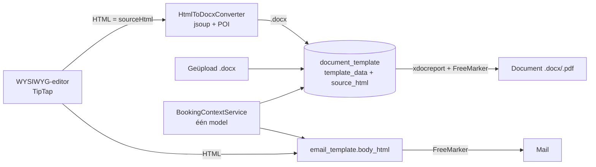

# Templates: gedeelde editor, Word-templates en herhaalde tabellen

E-mailtemplates en Word-templates (.docx) worden in **dezelfde WYSIWYG-editor** gemaakt, met dezelfde variabelen, dezelfde afbeeldingenbibliotheek en dezelfde herhaalde tabellen. Wat bij e-mail is beschreven (versturen, SMTP, relay) staat in [email.md](email.md); dit document gaat over wat de twee delen.

## Overzicht

| | E-mailtemplate | Word-template (.docx) |
|---|---|---|
| Wat wordt bewaard | onderwerp + HTML (`email_template.body_html`) | het .docx (`document_template.template_data`) **en**, bij een template uit de editor, de HTML (`source_html`) |
| Wanneer ontstaat het eindresultaat | bij preview/versturen: HTML wordt gemerged | bij het opslaan wordt de HTML een echt .docx; bij het genereren wordt dat .docx gemerged (xdocreport) |
| Model in de template | `${prospect.*}` en (bij een boeking) `${booking.*}` | `${booking.*}` |
| Upload van een bestand | n.v.t. | blijft bestaan naast de editor |



## Eén model voor documenten én e-mail

`BookingContextService` (`docgen/service`) bouwt de gegevens op; documenten en e-mails gebruiken dezelfde code. Het model is een **platte** structuur (maps, lijsten, tekst, getallen; zie `TemplateModels`), geen Java-objecten.

**`booking`** (`BookingContext`):

| Veld | Inhoud |
|---|---|
| `booking.bookingNumber`, `booking.bookingStatus` | nummer en status (enum-naam, bv. `BOEKING`) |
| `booking.fromDate`, `booking.untilDate` | periode (`jjjj-mm-dd`) |
| `booking.totalSum` | totaalbedrag (getal) |
| `booking.booker.*` | de hoofdboeker (zelfde velden als `prospect.*`) |
| `booking.travelers` | lijst: `firstname`, `prefix`, `lastname`, `gender`, `birthdate`, `initials` |
| `booking.bookingLines` | lijst: `fromDate`, `untilDate`, `price`, `accommodation.{key,name,addresses}`, `supplier.{key,name,addresses}` |
| `booking.bookingActivities` | lijst: `activityName`, `activityType`, `fromDate`, `untilDate` (afgeleid uit activiteitsdatum + tijden; einde is de volgende dag bij tot-tijd < van-tijd), `meetingPoint`, `totalPrice` |

Een adres heeft `street`, `housenumber`, `housenumberAddition`, `postalcode`, `city`, `country`, `addressrole`. De velden van de booker/prospect staan in [email.md](email.md).

Het model bevat alleen wat de contextklassen in `docgen/context` aanbieden. De editor biedt in `template-variables.ts` dezelfde namen aan; een veld dat daar niet bestaat kan in de editor ook niet gekozen worden (een verzonnen veld zou pas bij het samenvoegen fout gaan).

### Valkuilen bij het schrijven van een expressie

- **Bedragen:** zonder opmaak toont FreeMarker `1250.00` als `1.250` (afgerond, met groepering). De editor voegt bedragen daarom in als `${booking.totalSum?string("#,##0.00")}`.
- **Gebruik dubbele aanhalingstekens** (`"…"`), nooit enkele (`'…'`): xdocreport schrijft een enkele aanhalingsteken in een Word-template om, waardoor de expressie een syntaxfout geeft bij het samenvoegen. Dit geldt ook voor een zelf geüpload .docx.
- Datums zijn tekst (`jjjj-mm-dd`); andere opmaak kan met FreeMarker-functies op de tekst, of door er een formattering op te zetten in de template.
- Tekst als `[#` of `<#` in een Word-template wordt door FreeMarker als instructie gelezen (dat is hoe lussen werken). Gewone tekst heeft daar geen last van.

## Herhaalde tabellen

Een gewone tabel met twee extra attributen: `data-repeat` (de lijst, bv. `booking.travelers`) en `data-item` (de naam waaronder elk element in de rij beschikbaar is, bv. `t`). **De laatste rij** wordt voor elk element herhaald; rijen erboven (een kopregel) blijven één keer staan. Zonder elementen blijft alleen de kop over.

```html
<table data-repeat="booking.travelers" data-item="t"><tbody>
  <tr><th>Voornaam</th><th>Achternaam</th></tr>
  <tr><td>${t.firstname}</td><td>${t.lastname}</td></tr>
</tbody></table>
```

In de editor: tabelmenu → *Herhaalde tabel* → reizigers, accommodaties of activiteiten. Dat voegt een tabel in met kopregel en een rij met de passende velden; *Herhaling uitzetten* maakt er weer een gewone tabel van. Een herhaalde tabel heeft in de editor een gestippelde rand, en de herhalende rij is gekleurd. Voeg je een rij toe onder de laatste, dan wordt díé de herhalende rij.

Eén concept, twee uitvoeren (`RepeatTables`):

| | Uitvoer |
|---|---|
| E-mail | `<#list lijst as item>` om de laatste `<tr>`; de attributen verdwijnen uit de uiteindelijke mail |
| Word | echte Word-**samenvoegvelden** `@before-row[#list …]` (eerste cel) en `@after-row[/#list]` (laatste cel) in de laatste rij; xdocreport herhaalt de rij |

(Een lus over tabelrijen werkt in xdocreport alleen met echte samenvoegvelden; gewone tekst `[#list]` werkt wel voor alinea's, maar niet voor rijen.)

**Veiligheid:** lijst en itemnaam komen van een gebruiker en komen in een FreeMarker-instructie terecht. Ze worden daarom strikt gevalideerd (een pad van identifiers, bv. `booking.travelers`; itemnaam is één identifier). Iets anders — bv. een poging om een instructie in te smokkelen — geeft een `400`.

## Word-templates uit de editor

### Opslaan

`POST/PUT /api/document-templates` accepteert naast `templateData` (upload) ook **`sourceHtml`** (maximaal 500.000 tekens). De service beslist:

| Verzoek | Gevolg |
|---|---|
| `sourceHtml` meegestuurd | afbeeldingen worden gecontroleerd, `HtmlToDocxConverter` bouwt het .docx, `template_data` én `source_html` worden bewaard. Eventueel meegestuurde `templateData` wordt genegeerd. |
| alleen `templateData` (upload) | de bytes vervangen de template; `source_html` vervalt (anders zou de editor een oudere versie tonen dan er in gebruik is) |
| geen van beide (alleen naam/omschrijving) | `template_data` en `source_html` blijven staan |

Een geüploade template heeft geen bron-HTML en blijft dus *alleen uploaden/downloaden*: een willekeurig Word-bestand kan niet betrouwbaar naar HTML terug. In de dialoog kiest een nieuwe template tussen *Word-bestand uploaden* en *In de editor maken*. Een template uit de editor blijft in de editor te bewerken; een geüploade template kan bij het bewerken **omgeschakeld** worden naar de editor (dan begint de editor leeg en vervangt opslaan het geüploade bestand, met een waarschuwing). Inzien vanuit de lijst opent het dialoog alleen-lezen (voor een geüploade template met een download-knop).

Genereren, downloaden (`GET …/{id}/content`) en PDF-conversie werken voor beide soorten hetzelfde: het is gewoon een .docx.

### Wat de converter ondersteunt

Alles wat de editor kan maken: alinea's, koppen (h1–h6), **vet / cursief / onderstreept / doorgehaald**, lettertype, -grootte en kleur, links (alleen `http`, `https`, `mailto`, `tel`), opsommingen en genummerde lijsten (ook genest; elke genummerde lijst begint weer bij 1), tabellen (kopcel, samengevoegde kolommen/rijen, vastgelegde kolombreedte), afbeeldingen, horizontale lijn, citaat, codeblok, uitlijning. De pagina is **A4** met 2,5 cm marge; standaardlettertype Calibri 11.

Een tabel krijgt randen, 100% breedte, een grijze kopcel en een kopregel die op elke pagina herhaalt. Na een tabel staat een lege alinea (anders plakt Word tabellen aan elkaar).

**Beperkingen** (de converter weigert dit met een duidelijke melding in plaats van iets verkeerds te maken):

- Geen tabel **in** een tabelcel.
- Maximaal 64 kolommen.
- Afbeeldingen moeten **PNG, JPEG of GIF** zijn. WebP mag wel in de bibliotheek (voor e-mail) maar niet in een Word-template.
- Afbeeldingen moeten uit de bibliotheek komen (zie hieronder); een externe URL of `data:`-afbeelding wordt geweigerd.
- Onbekende elementen worden genegeerd (hun inhoud blijft); `script`, `style`, `iframe` e.d. vervallen.

### Afbeeldingsgrootte

Een afbeelding in de editor selecteer je met een klik; dan verschijnt rechtsonder een **greep** waarmee je de afbeelding met de muis groter of kleiner maakt (de beeldverhouding blijft behouden; minimaal 40 px). De grootte wordt als `width`- en `height`-attribuut op de `` bewaard, naast de vaste stijl `max-width:100%;height:auto` (nooit breder dan de mail/pagina), bv. ``. Dit geldt voor e-mail- én Word-templates (één editor) en komt terug bij het heropenen van de template.

- **E-mail**: `EmailImageUrlResolver.toAbsolute` past bij het versturen alleen het `src`-pad aan; de attributen blijven ongemoeid.
- **Word**: `HtmlToDocxConverter.displaySize` neemt `width`/`height` (attribuut, anders `style`) over; zonder afmeting geldt de eigen afmeting van het plaatje, en nooit breder dan de pagina (605 px; de hoogte schaalt dan mee).

### Afbeeldingen: één bibliotheek

E-mail en Word gebruiken **dezelfde** bibliotheek (`email_image`, endpoints `/api/email-images`; de naam is historisch). Zie [email.md](email.md) voor opslag, publiek uitleveren en verwijderen.

- Een template mag alleen afbeeldingen van de **eigen organisatie** bevatten. Die controle staat op één plek, `TemplateImages.verifyBelongTo`, en wordt bij het opslaan van e-mail- én Word-templates gedaan. De melding maakt geen onderscheid tussen "bestaat niet" en "is van een ander".
- De converter haalt een afbeelding **alleen op via de UUID** uit de bibliotheek van die organisatie (`TemplateImages.lookupFor`). Er wordt nooit een URL opgehaald, dus ook geen SSRF via een afbeeldingsadres.
- Een afbeelding die in een Word-template uit de editor staat telt in de bibliotheek als **"in gebruik"** (de bibliotheek kijkt naar `email_template.body_html` én `document_template.source_html`, beide per organisatie) en kan dus niet verwijderd worden. Het .docx bevat zelf een eigen kopie van de afbeelding, maar opnieuw opslaan vanuit de editor heeft de afbeelding nodig.

## Veiligheid

Templates zijn door gebruikers geschreven en dus **niet vertrouwd**.

- FreeMarker draait afgeschermd voor e-mail én Word: `?new` en `?api` uit (anders kan één regel tekst een commando op de server uitvoeren), geen include/import, en een **plat model** zonder Java-objecten (`FreemarkerHardening`, `TemplateModels`). Een template uit de editor gaat door dezelfde afschermde straat als een geüpload bestand; er is een test dat een payload die in de editor wordt getypt nog steeds geblokkeerd wordt.
- De converter behandelt de HTML als data: tekst wordt via Word-API's geschreven (geen string-plakken in XML), links met een ander schema dan http/https/mailto/tel worden platte tekst, een onbekend lettertype of kleur wordt genegeerd.
- Rechten: `TEMPLATE_CREATE/UPDATE/DELETE/READ` voor beheer; `DOCUMENT_CREATE` om te genereren; `EMAIL_SEND` om te versturen. ADMIN heeft deze business-authorities bewust niet.

## Frontend

Gedeeld in `frontend-employee/src/app/shared/template-editor/`:

| Bestand | Rol |
|---|---|
| `template-body-editor.component.ts` | de TipTap-editor (`ControlValueAccessor`), variabelenpaneel, tabel- en herhaalde-tabelmenu, afbeeldingen |
| `template-variables.ts` | de variabelen en herhaalde tabellen per soort template (`EMAIL_VARIABLE_GROUPS`, `DOCUMENT_VARIABLE_GROUPS`, `BOOKING_REPEAT_TABLES`) |
| `template-image-library.component.ts`, `template-image.service.ts` | bibliotheek en upload |

De editor krijgt via `variableGroups` en `repeatTables` te horen wat hij moet aanbieden: een e-mail heeft de ontvanger (`prospect.*`) en de boeking (met de uitleg dat die alleen bij een boeking werkt); een Word-template de boeking en de hoofdboeker. Vertalingen staan onder `templateEditor.*`.

Gebruikers van de editor: `features/email-templates/email-template-dialog` en `features/templates/template-dialog` (upload of editor). E-mail versturen voor een boeking: *Nieuw → E-mail aan hoofdboeker* in de tijdlijn *Berichten en documenten* van het boekingdetail (`EMAIL_SEND`), of de preview-dialoog vanuit de e-maillijst met de keuze *Prospect / boeker* of *Boeking*.

## Codekaart (backend)

| Laag | Klasse(n) |
|---|---|
| Gedeeld model | `docgen/service/BookingContextService` (+ impl), `docgen/context/*`, `docgen/service/TemplateModels`, `docgen/service/FreemarkerHardening` |
| Herhaalde tabellen | `docgen/service/RepeatTables` |
| Converter | `docgen/service/HtmlToDocxConverter` (jsoup + Apache POI) |
| Afbeeldingen | `email/service/TemplateImages` (controle + opzoeken) |
| Word-templates | `booking/service/impl/DocumentTemplateServiceImpl`, `booking/entity/DocumentTemplate` (`sourceHtml`), `booking/dto/DocumentTemplateDto` |
| Documentnaam | `docgen/service/GeneratedDocumentName` (sjabloonnaam + boekingsnummer + datum en tijd) |
| Migratie | `V8__document_template_source_html.sql` |

Afhankelijkheid: `org.jsoup:jsoup` (MIT) in `pom.xml`.

## Tests

- `HtmlToDocxConverterTest`: de hele keten HTML → .docx → afgeschermde xdocreport-merge → tekst (ook herhaalde tabellen, lijsten, tabellen, afbeeldingen, PDF-conversie, injectiepogingen).
- `RepeatTablesTest`, `BookingContextServiceImplTest`, `EmailRenderServiceImplTest` (boeking, herhaalde tabel, hardening), `EmailSendServiceImplTest` (`sendForBooking`), `DocumentTemplateServiceImplTest`.
- Integratie: `DocumentTemplateEditorControllerTest` (aanmaken/bijwerken vanuit de editor, genereren als .docx en PDF, afbeeldingen van een andere organisatie, rechten) en `EmailTemplateControllerTest` (`bookingId`).
- Frontend: specs naast de componenten in `shared/template-editor`, `features/templates`, `features/email-templates` en `features/bookings`.

## Beperkingen / toekomst

- Een geüploade .docx is niet in de editor te openen (geen terugweg van Word naar HTML).
- De "in gebruik"-controle zoekt het pad in de HTML (`LIKE`); een echte koppeling afbeelding ↔ template zou dit sneller en strikter maken.
- Geen kop-/voettekst, paginanummers of inhoudsopgave in een Word-template uit de editor.
- Geen geneste tabellen; geen tekstvak/vormen.
- De herhalende rij is altijd de **laatste** rij; meerdere herhalende rijen in één tabel kan niet (gebruik twee tabellen).
