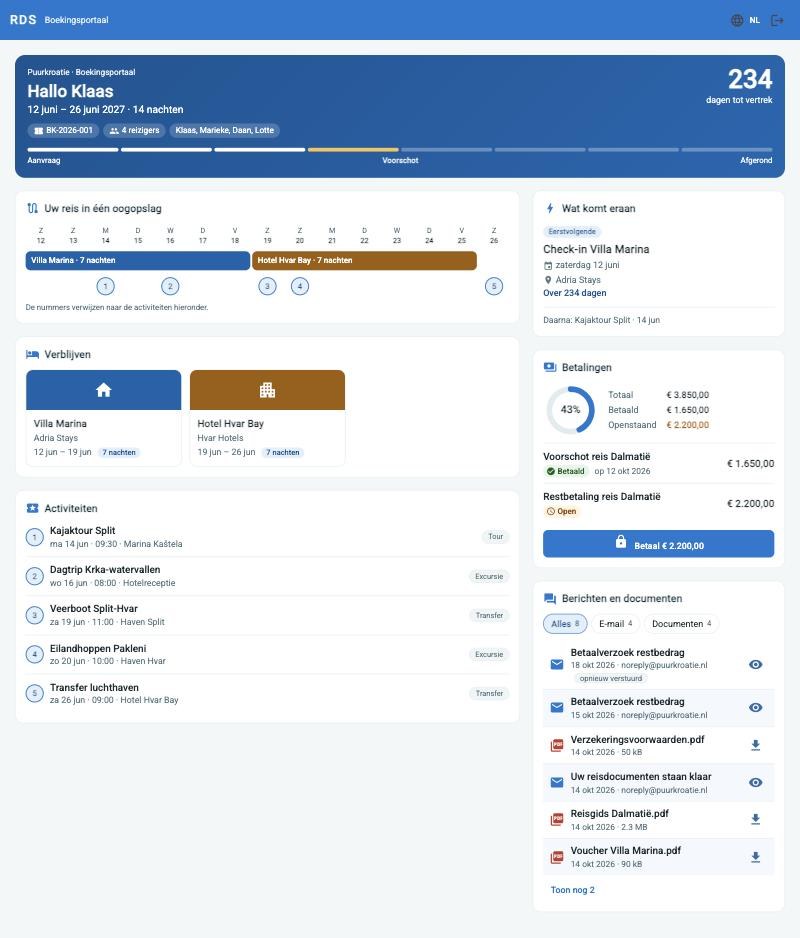
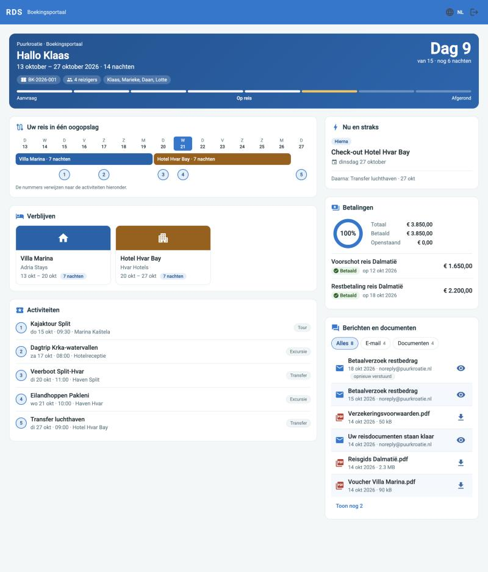
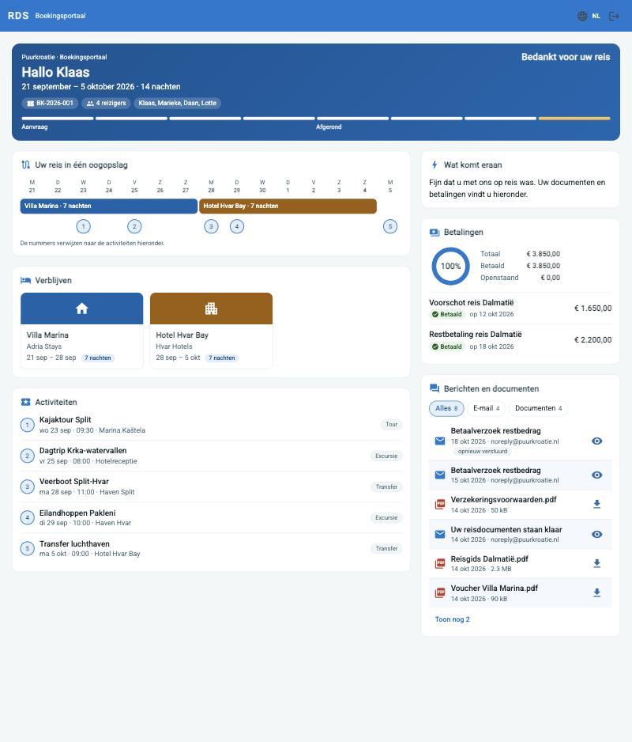
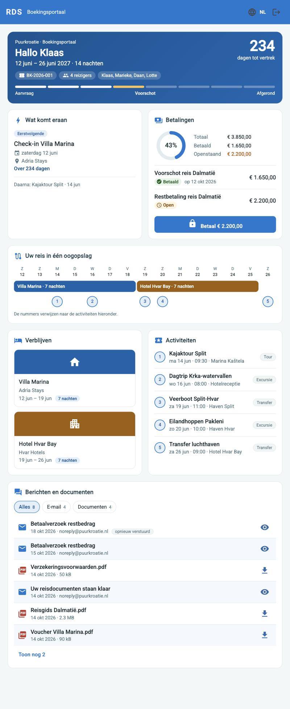
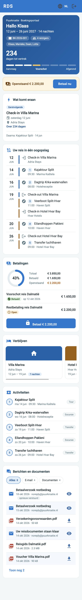
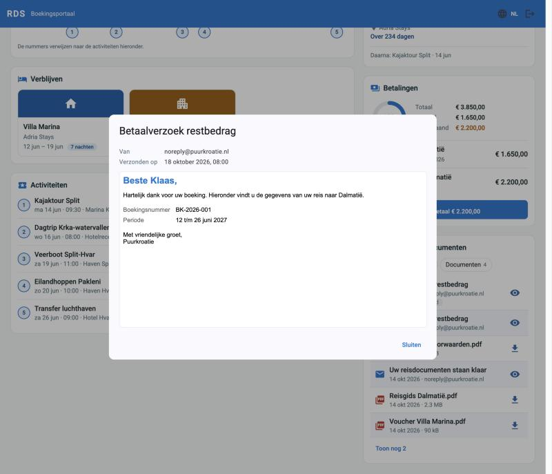

# Voorstel: dashboard voor het boekerportaal (`frontend-booker`)

| | |
|---|---|
| Status | **gebouwd** (21-10-2026). Dit document blijft het ontwerp met de afwegingen; de uitgewerkte beschrijving staat in [frontend.md](frontend.md#frontend-booker) en [bookerportal.md](bookerportal.md). Afwijkingen van het voorstel staan onderaan (§11) |
| Datum | 21-10-2026 |
| Doel | in plaats van zes tabbladen waarbij je telkens één onderdeel ziet, **één dashboard met veel informatie tegelijk, zonder te klikken**, en dat **responsive** werkt op telefoon, tablet en desktop |
| Raakt | `frontend-booker`, en in de backend het pakket `bookerportal` (nieuw overview-endpoint, slankere DTO's, document-download) |
| Zie ook | [bookerportal.md](bookerportal.md), [frontend.md](frontend.md), [security.md](security.md), [open-items.md](open-items.md) |

> De afbeeldingen in §3 zijn **echte schermen** uit de gebouwde app (`ng serve`, 21-10-2026), op 1280, 768 en 375 px, voor, tijdens en na de reis en met een geopende e-mail. Ze zijn opnieuw gemaakt na de invoering van de risicokleuren en de om-en-om tint in *Berichten en documenten*. De gegevens zijn **fictief**: ze komen van een stub van `/api/booker-portal/**`, omdat de lokale database niet voor de tooling bereikbaar was. De huisstijl is die van de organisatie *Puurkroatie* uit de seeddata. De oorspronkelijke schema's staan nog per breedte onder *Schema van het ontwerp*.

## 1. Waar we nu staan

- Zes tabbladen (*Overzicht, Reisschema, Documenten, Accommodaties, Activiteiten, Betalingen*) in een inhoudsbreedte van maximaal 700 px. Je ziet steeds één onderdeel.
- Het dashboard toont alleen het **boeking-ID** en vier doorklik-tegels.
- Per scherm een eigen API-aanroep; geen gedeelde toestand.

**Wat de portal-API nu niet levert** en dus eerst aan de backend moet worden toegevoegd:

| Ontbreekt | Gevolg voor het dashboard |
|---|---|
| boekingsnummer, status, periode, totaalbedrag | geen kop met de kerngegevens, geen voortgang |
| voornaam van de boeker, reizigers | geen persoonlijke aanhef, geen reizigersoverzicht |
| naam, kleuren en logo van de organisatie | geen huisstijl (de app heeft geen `ThemeService`; de kleuren zijn nu de standaard-teal) |
| huidige betaalstatus per betaling | de client moet nu zelf de statusregels doorlopen |
| documentgrootte en een aparte download | zie hieronder |

**Bestaande zwakke plekken die bij deze klus meegenomen horen:**

1. `GET /api/booker-portal/documents` geeft per document de **volledige bytes** (`byte[] document`) terug. Een dashboard dat alle documenten in één keer laadt zou alle PDF's meesturen.
2. De portal-DTO's voor documenten en betalingen bevatten velden als `createdBy`, `modifiedBy` en `tenantOrganization`. [bookerportal.md](bookerportal.md) schrijft *minimale* DTO's voor externe gebruikers voor.
3. De documentenlijst in de huidige UI heeft **geen download-knop** ([open-items.md](open-items.md) punt 30).

## 2. Ontwerpprincipes

1. **Eén pagina, geen tabbladen.** Alles staat in kaarten; klikken is alleen voor acties (betalen, downloaden).
2. **Volgorde naar urgentie.** Eerst wat je moet doen (een openstaande betaling), dan wat er nu of straks gebeurt, dan het overzicht, dan de documenten.
3. **Eén tijdlijn in plaats van losse lijsten.** Verblijven zijn balken over de dagen, activiteiten genummerde punten; de lijst eronder legt ze uit.
4. **Het scherm past zich aan het moment aan** (§3.2).
5. **Dezelfde gegevens, andere weergave per schermbreedte.** Geen afgeslankte telefoonversie: wat op desktop staat, staat ook op de telefoon, alleen anders gerangschikt.
6. **Een kaart die faalt of leeg is breekt de pagina niet.** Elke kaart heeft zijn eigen laad-, leeg- en foutstand.

## 3. Het scherm

### 3.1 Kaarten

| Kaart | Inhoud | Bron |
|---|---|---|
| **Kop** | aanhef (*Hallo Klaas*), boekingsnummer, periode en aantal nachten, reizigers (namen), statusbalk met 8 stappen, aftelling | `overview` (nieuw) |
| **Betaalbalk** (alleen telefoon) | *Openstaand € 2.200* met knop *Betaal nu*, onder de kop | betalingen |
| **Wat komt eraan** (tijdens de reis *Nu en straks*) | de eerstvolgende stap, of tijdens de reis wat er nu en hierna is; na de reis een bedankje | afgeleid uit het reisschema |
| **Tijdlijn** | balken per verblijf, genummerde punten per activiteit, vandaag-markering; op de telefoon een verticale agenda | `itinerary` |
| **Betalingen** | donut (betaald/totaal), totaal-betaald-openstaand, regel per betaling met statuschip, knop *Betaal* | `payments` (+ status) |
| **Verblijven** | kaart per verblijf met naam, plaats, leverancier, periode, aantal nachten | `booking-lines` |
| **Activiteiten** | genummerde lijst met datum, tijd, trefpunt, soort | `booking-activities` |
| **Berichten en documenten** | de verzonden e-mails en de vrijgegeven documenten in één lijst, nieuwste eerst, met filter; betalingen niet | `messages` en `documents` (slank) |

### 3.2 Het scherm per moment van de reis

De fase volgt uit de **datums**, niet uit de status (de status zet een medewerker handmatig).

| Fase | Wanneer | Kop | *Wat komt eraan* | Tijdlijn |
|---|---|---|---|---|
| Voor de reis | vandaag < vertrekdatum | aftelling (*234 dagen tot vertrek*) | eerste verblijf of activiteit | geen vandaag-markering |
| Tijdens de reis | vertrek ≤ vandaag ≤ terugkomst | *Dag 9 van 15, nog 6 nachten* | **Nu** en **Hierna** | vandaag gemarkeerd |
| Na de reis | vandaag > terugkomst | *Bedankt voor uw reis* | een bedankje | zonder markering |

**Voor de reis** — aftelling, de eerstvolgende stap, de statusbalk op *Voorschot* en een openstaande betaling:



**Tijdens de reis** — dag 9 van 15, vandaag gemarkeerd in de tijdlijn, *Nu en straks*, alles betaald:



**Na de reis** — bedankje in de kop en bij *Wat komt eraan*, statusbalk op *Afgerond*:



### 3.3 Indeling per breedte

Breekpunten (container queries op de pagina): **telefoon < 600 px**, **tablet 600–999 px**, **desktop ≥ 1000 px**.

**Desktop (≥ 1000 px)** — brede kolom met planning, verblijven en activiteiten; smalle kolom met *wat komt eraan*, betalingen en berichten en documenten:


**Tablet (600–999 px)** — twee kolommen: *wat komt eraan* naast betalingen, de tijdlijn over de volle breedte, verblijven naast activiteiten, daaronder berichten en documenten:



**Telefoon (< 600 px)** — één kolom in volgorde van urgentie: kop, betaalbalk, wat komt eraan, de tijdlijn als agenda per dag, betalingen, verblijven (zwiepbaar), activiteiten, berichten en documenten. Op de telefoon staan *Betalingen* en de betaalbalk bovenaan als er iets openstaat; zijn alle betalingen voldaan, dan verdwijnt de balk.



<details>
<summary>Schema van het ontwerp (voor de bouw)</summary>

Desktop:

```
┌──────────────────────────────────────────────────────────────┐
│ KOP: Hallo Klaas · BK-… · 12–26 jun · 4 reizigers · 234 dgn  │
│ statusbalk ▮▮▮▮▯▯▯▯                                          │
├───────────────────────────────────────────┬──────────────────┤
│ TIJDLIJN                                  │ EERSTVOLGENDE    │
│ 12 13 14 15 … 26   (balken + punten)      ├──────────────────┤
│                                           │ BETALINGEN       │
├───────────────────────────────────────────┤ (donut + regels) │
│ VERBLIJVEN (2 kaarten)                    ├──────────────────┤
├───────────────────────────────────────────┤ DOCUMENTEN       │
│ ACTIVITEITEN (genummerd)                  │                  │
└───────────────────────────────────────────┴──────────────────┘
```

Tablet:

```
┌──────────────────────────────────────────┐
│ KOP                                      │
├────────────────────┬─────────────────────┤
│ EERSTVOLGENDE      │ BETALINGEN          │
├────────────────────┴─────────────────────┤
│ TIJDLIJN (balken)                        │
├────────────────────┬─────────────────────┤
│ VERBLIJVEN         │ ACTIVITEITEN        │
├────────────────────┴─────────────────────┤
│ DOCUMENTEN                               │
└──────────────────────────────────────────┘
```

Telefoon:

```
┌────────────────────────┐
│ KOP (compact)          │
│ Openstaand € 2.200 [Betaal nu] │
│ EERSTVOLGENDE          │
│ TIJDLIJN (agenda)      │
│  12 jun  Check-in …    │
│  14 jun  Kajaktour …   │
│ BETALINGEN             │
│ VERBLIJVEN  ◀ swipe ▶  │
│ ACTIVITEITEN           │
│ DOCUMENTEN             │
└────────────────────────┘
```

</details>

### 3.4 Een e-mail lezen

Het oog-icoon bij een e-mail opent het bericht zoals de klant het ontving, in een afgeschermd venster (geen scripts):



## 4. Technisch voorstel: frontend

Hetzelfde stack als nu (Angular 22, standalone, signals, Material, ngx-translate). **Geen nieuwe bibliotheken**, met het oog op de bundelgrootte op mobiel.

### 4.1 Structuur

```
frontend-booker/src/app/
  core/portal/portal.store.ts        signals + computed (fase, aftelling, tijdlijn, totalen, eerstvolgende)
  core/portal/portal.service.ts      API-aanroepen (overview, betalingen, documenten)
  features/dashboard/
    dashboard.page.ts                grid met areas per breekpunt
    trip-hero.component.ts           kop, statusbalk, aftelling
    next-up.component.ts             eerstvolgende / nu
    trip-timeline.component.ts       balken + punten (≥ 600 px) of agenda (< 600 px)
    stays.component.ts               verblijven (scroll-snap op telefoon)
    activities.component.ts
    payments.component.ts            donut, regels, betalen, statuspolling (zoals nu, 2,5 s)
    documents.component.ts           lijst + download
  shared/section-card.component.ts   kaartschil met skeleton / leeg / fout
```

- Routes: `/login` en `/verify` blijven. Alle oude routes (`/itinerary`, `/documents`, …) verwijzen naar `/` (eventueel met een ankerlink).
- `OnPush` en signals overal; geen API-calls in componenten (alleen via de service), conform [frontend.md](frontend.md).

### 4.2 Responsive aanpak

- **CSS Grid met `grid-template-areas`**, per breekpunt een eigen indeling; geen JavaScript nodig voor de lay-out.
- **Container queries** op de pagina en per kaart, zodat een kaart ook goed werkt in een smallere kolom. Dit werkt in de browsers die Angular 22 ondersteunt.
- De tijdlijn heeft één model en twee weergaven (balken en agenda). Alleen hier is `BreakpointObserver` (CDK) of een container query nodig om de weergave te kiezen.
- Verblijven op telefoon: horizontaal scrollen met `scroll-snap`; op tablet en desktop een gewoon grid.
- Tikdoelen minimaal 44 × 44 px, `env(safe-area-inset-*)` voor telefoons met een inkeping.

### 4.3 Tijdlijn en grafieken zonder bibliotheek

- **Tijdlijn:** een grid met één kolom per dag. Een verblijf is een element met `grid-column: start / end`, berekend uit de datums. Activiteiten zijn punten in de kolom van hun datum, genummerd zoals in de lijst.
- **Donut:** SVG met twee cirkels (`stroke-dasharray`); de waarden komen uit de totalen. Het percentage staat ook als tekst en in een `aria-label`.
- **Statusbalk:** acht segmenten in een grid; de huidige stap is gemarkeerd en benoemd (niet alleen met kleur).

### 4.4 Toestand, laden en fouten

- Eén `overview`-aanroep voor de kop en de kerngegevens; de rest laadt parallel, elk met eigen `resource`/`httpResource` en eigen fout- en laadtoestand. Skeletons in plaats van spinners.
- Kaarten onder de vouw kunnen met `@defer (on viewport)` worden uitgesteld, vooral op telefoon.
- Een mislukte kaart toont een korte melding met *Opnieuw proberen*; de rest blijft werken.
- Geen offline-modus in deze fase.

### 4.5 Overig

- **Huisstijl:** de kleuren uit `overview` worden op `:root` gezet als `--theme-primary`, `--theme-accent` en `--theme-card-title`; de afgeleide tinten bestaan al (`color-mix` in `styles.scss`). Zonder thema blijft de standaard-teal.
- **Toegankelijkheid:** landmarks per kaart, koppen in volgorde, contrast ≥ 4,5 : 1, status nooit alleen met kleur, `prefers-reduced-motion`, optioneel `prefers-color-scheme: dark`.
- **i18n:** alle teksten in `nl.json` en `en.json`; datums en bedragen via `DatePipe` en `CurrencyPipe` met de gekozen taal.
- **Datums:** de reisdata zijn `LocalDate` zonder tijdzone. De fase wordt bepaald met de lokale datum van het apparaat.

## 5. Technisch voorstel: backend

### 5.1 Nieuw endpoint

`GET /api/booker-portal/overview` (`BOOKER_PORTAL_READ`), gebonden aan het `bookingId` uit de `BookerContext`.

```json
{
  "booking": { "bookingNumber": "BK-2026-00042", "status": "voorschot",
               "fromDate": "2027-06-12", "untilDate": "2027-06-26", "totalSum": 3850.00 },
  "booker": { "firstname": "Klaas" },
  "travelers": [ { "firstname": "Klaas" }, { "firstname": "Marieke" } ],
  "organization": { "name": "Puurkroatie", "primaryColor": "#0e8f8a",
                    "accentColor": "#e0a100", "cardTitleColor": "#12303b", "logoUrl": null }
}
```

- Een eigen minimale DTO (`PortalOverviewDto`, record), via een service en MapStruct waar dat past; **geen entities** en geen interne velden (`createdBy`, `tenantOrganization`, …).
- De organisatiekleuren komen uit `organization_theme`; ontbreekt het thema, dan zijn ze `null` en geldt de standaard.
- Of reizigers met achternaam of alleen met voornaam worden getoond is een open keuze (§8).

### 5.2 Wijzigingen aan bestaande portal-endpoints

| Endpoint | Wijziging |
|---|---|
| `GET /documents` | slanke DTO: `documentId`, `displayname`, `mimeType`, `size`, `createdAt`; **zonder bytes** |
| `GET /documents/{id}/content` (nieuw) | levert het bestand; alleen als het document bij de eigen boeking hoort **en** `visibleInPortal` is, anders `404`; `Content-Disposition` met de bestandsnaam |
| `GET /documents/{id}` | vervalt of wordt dezelfde slanke DTO |
| `GET /payments` | slanke DTO: `molliePaymentId`, `description`, `amount`, `currency`, `method`, `currentStatus`, `createdAt`; **zonder** `createdBy`, `tenantOrganization`, interne ids |
| `GET /payments/status-entries` | blijft voor de statushistorie in een uitklapregel |

De overige endpoints (`itinerary`, `booking-lines`, `booking-activities`, `accommodations`, `activities`) blijven; het dashboard gebruikt `itinerary`, `booking-lines` en `booking-activities`. Wat daarna ongebruikt blijft, kan in een latere ronde weg.

### 5.3 Beveiliging en tests

- Elke query bindt aan `BookerContext.getBookingId()`; een betaling of document van een andere boeking geeft `404`/`403`, zoals nu bij het betalen.
- `NoEntityInApiTest` blijft de build bewaken tegen entities in API's.
- Nieuwe MockMvc-tests: BOOKER-token (200), medewerkerstoken (403), geen token (401), andere boeking (geen data), niet-zichtbaar document (404), `content`-endpoint met de juiste `Content-Type`.
- De rate-limit van NGINX op `/api/booker-auth/` verandert niet.

## 6. Prestaties en kwaliteit

Streefwaarden, nog niet gemeten:

- Lighthouse (mobiel): performance ≥ 90, toegankelijkheid ≥ 95.
- LCP < 2,5 s op een gemiddelde 4G-verbinding; één `overview`-aanroep vóór de eerste weergave.
- Geen layout-sprongen: skeletons hebben de hoogte van de uiteindelijke kaart.

Tests: Jasmine-specs voor de store (fase, aftelling, tijdlijnmodel, betaaltotalen, eerstvolgende), voor de weergave per breekpunt en voor de leeg- en foutstanden. Daarna echte screenshots met de Claude Preview-tools bij 375, 768 en 1280 px.

## 7. Fasering

| Stap | Inhoud | Resultaat |
|---|---|---|
| **0** | `overview`-endpoint, slanke documenten en betalingen, document-download, backendtests | API klaar; oude UI blijft werken |
| **1** | schil en `PortalStore`, kop, betaalbalk en betalingenkaart | meeste waarde: kerngegevens en betalen op één scherm |
| **2** | tijdlijn (balken en agenda), *Eerstvolgende/Nu*, fasesturing | het hart van het dashboard |
| **3** | verblijven, activiteiten, documenten (met download), skeleton-, leeg- en foutstanden | alle informatie op één pagina |
| **4** | organisatiekleuren, toegankelijkheids- en prestatiecheck, oude schermen en routes opruimen | afgerond; docs bijwerken |

Elke stap is los te testen en te reviewen; na stap 1 staat er al een bruikbaar dashboard.

## 8. Open keuzes

| # | Keuze | Voorstel |
|---|---|---|
| 1 | **Aggregator-endpoint of bestaande endpoints hergebruiken?** | `overview` voor kop en kerngegevens, bestaande endpoints voor de rest (minder werk dan alles in één DTO) |
| 2 | **Reizigers tonen met achternaam?** | alleen voornamen, voor de hoofdboeker zichtbaar |
| 3 | **Boekingstitel** (bijv. *Dalmatië rondreis*) | nu niet beschikbaar; de kop toont periode en boekingsnummer. Een titelveld op `Booking` kan later |
| 4 | **Adressen en foto's bij verblijven** | niet in deze ronde; de kaarten gebruiken een gekleurd vlak met een icoon. Adressen (voor een kaartlink) of foto's vragen uitbreiding van de portal-DTO |
| 5 | **Mobiele navigatie** | geen; de pagina scrolt. Optioneel een rij ankerlinks bovenaan bij weinig ruimte |
| 6 | **Donkere modus** | optioneel, later |

## 9. Risico's en afhankelijkheden

- **OTP-mail is een stub** ([open-items.md](open-items.md) punt 3): klanten kunnen pas echt inloggen als dat is gekoppeld. Dit dashboard is daar niet van afhankelijk om te bouwen, wel om gebruikt te worden.
- **Eén Mollie-sleutel voor alle organisaties** (punt 2) blijft gelden voor betalen vanuit het dashboard.
- **Statusovergangen zijn vrij** (punt 14): de statusbalk toont wat een medewerker zet; de fase van de reis volgt daarom uit de datums.
- **Weinig frontendtests voor `frontend-booker`** (punt 20): dit voorstel verhoogt de dekking bewust, vooral voor de store en de weergave per breekpunt.
- **Gedrag zonder gegevens:** een boeking zonder boekingsregels heeft geen datums (die zijn afgeleid). De kop en de tijdlijn tonen dan een leeg-stand in plaats van een lege balk.

## 10. Buiten bereik

Geen wijzigen van gegevens door de klant, geen chat of berichten, geen pushmeldingen, geen offline-modus, geen eigen kaartweergave.

## 11. Wat er gebouwd is en waar het afwijkt

Alle vijf stappen uit §7 zijn in één keer opgeleverd. Verschillen met het voorstel:

| Onderwerp | Voorstel | Gebouwd |
|---|---|---|
| Tijdlijn | balken en agenda | zo gebouwd; overlappende verblijven krijgen een eigen rij, activiteiten van dezelfde dag staan onder elkaar, en een periode langer dan 62 dagen toont alleen de agenda |
| Laden | per kaart een `resource`/`httpResource` | een kleine eigen `Loadable` (signals + RxJS), met stille verversing voor de betaalstatus |
| Betalingen | statushistorie in een uitklapregel | geen uitklap meer (niets verborgen achter een klik); de kaart toont wel wanneer er is betaald |
| Overview | boeking, boeker, reizigers, organisatie | zo gebouwd; de totale som komt uit de boekingsregels en activiteiten |
| Documenten | slanke lijst en download | zo gebouwd (`size` met `octet_length` in de query, het bestand via `…/content`); daarna uitgebreid met de verzonden e-mails: de kaart heet nu *Berichten en documenten* (`/messages`, alle mails aan de hoofdboeker, betalingen niet) |
| Betaalbalk | knop start de betaling of brengt je naar de kaart | zo gebouwd |
| Kleur en rijtint | niet uitgewerkt | bekijken en downloaden hebben de risicokleur *info* (gedempt blauw, `act-info`); de regels in *Berichten en documenten* hebben een zachte om-en-om tint (`zebra-rows`) en de pictogrammen links geen eigen achtergrond. De afbeeldingen in §3 zijn hiermee opnieuw gemaakt. Zie [frontend.md](frontend.md#actie-iconen-en-hun-risicokleur) |
| Donkere modus, ankerrij op de telefoon | optioneel | niet gebouwd |
| Mobiele test | Lighthouse-score | niet gemeten; wel visueel gecontroleerd op 375, 768 en 1280 px met echte schermen uit de draaiende app (tegen een stub van de API) |

De oude schermen (`itinerary`, `documents`, `accommodations`, `activities`, `payments`) en `ApiService` zijn verwijderd; hun paden verwijzen naar het dashboard. Het verwijderen van `GET /api/booker-portal/documents/{id}` is een wijziging van het contract: de interface gebruikte dat endpoint niet.
