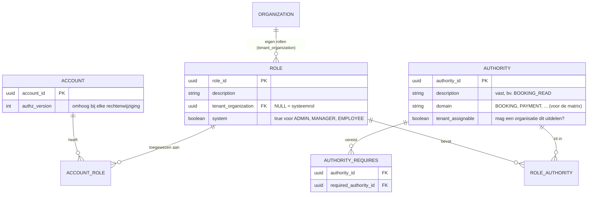
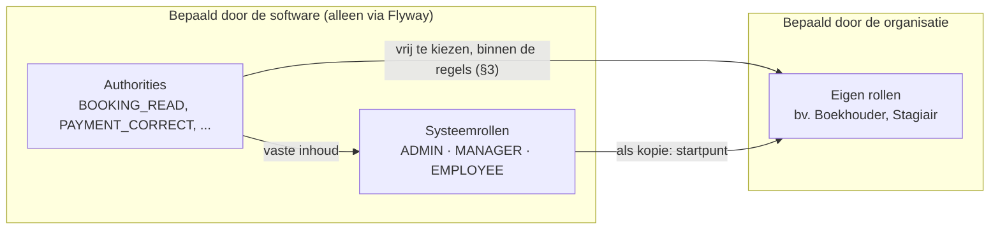
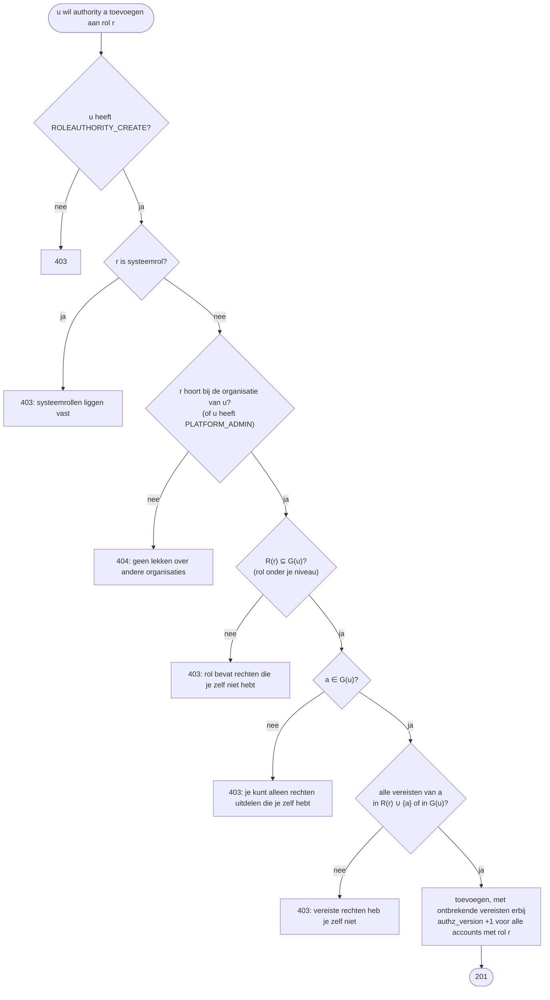
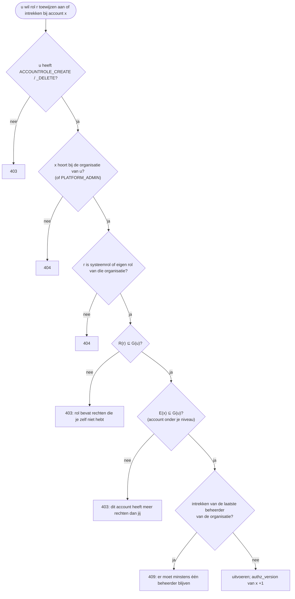
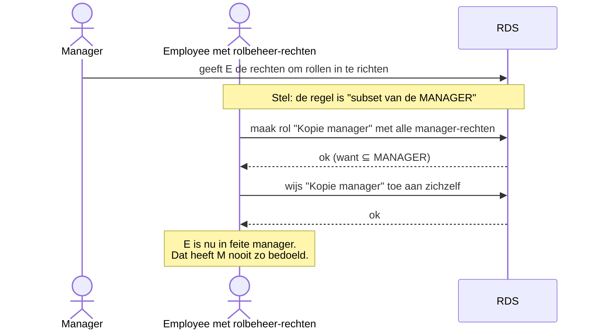
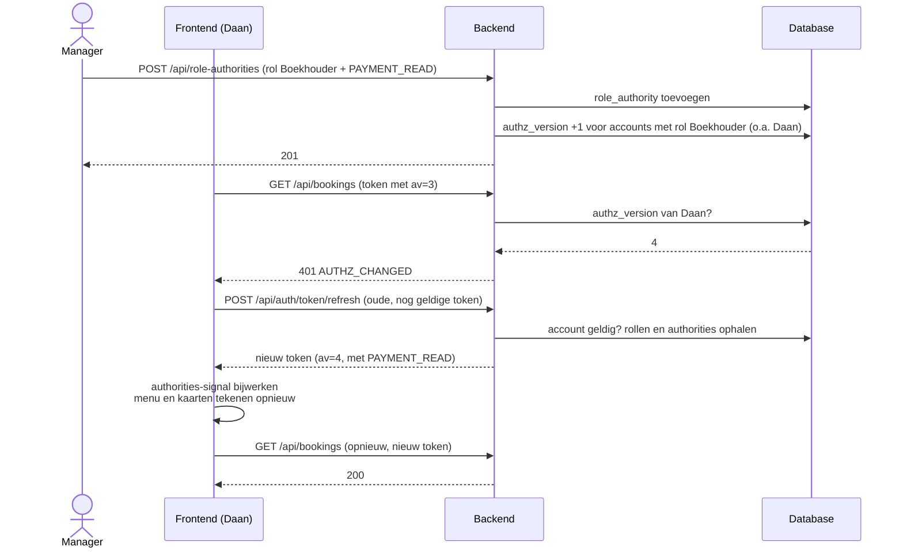
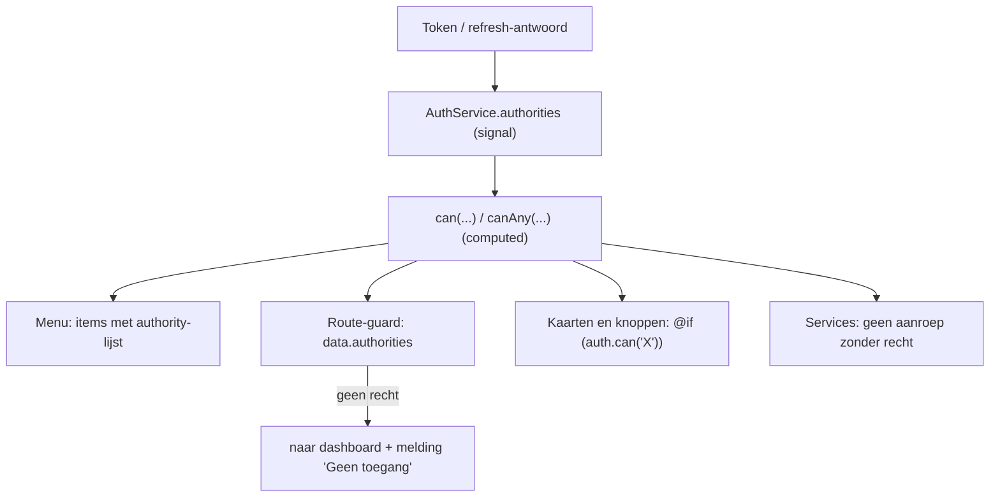
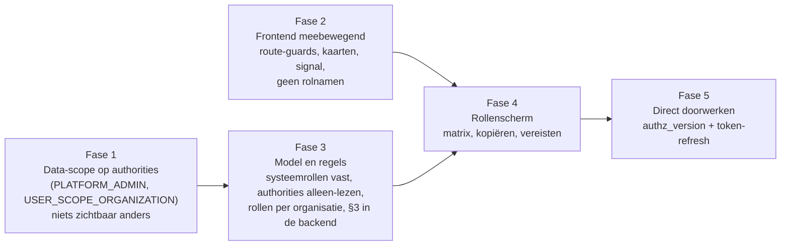

# Voorstel: eigen rollen per organisatie

Status: **ontwerp, nog niet gebouwd.** Dit document beschrijft hoe een organisatie zelf rollen kan maken en daar
authorities aan kan hangen. Het scherm toont of verbergt dan per gebruiker alles op basis van zijn authorities.

Samengevat:

- **Authorities liggen vast.** De software bepaalt ze en ze komen alleen via Flyway.
- **ADMIN, MANAGER en EMPLOYEE zijn vaste systeemrollen.** Niemand kan ze wijzigen.
- **Eigen rollen zijn vrij, per organisatie,** en bestaan uit de vaste authorities.
- **Niemand kan meer uitdelen dan hij zelf heeft** (*no-escalation*).

Verwante documenten: [security.md](security.md) (huidige rollen en tenant-isolatie), [database-model.md](database-model.md),
[frontend.md](frontend.md).

---

## 1. Uitgangspunt: hoe het nu werkt

| Onderdeel | Nu | Probleem voor eigen rollen |
|---|---|---|
| Authorities | 70 rijen in `authority`; ADMIN kan ze via `/api/authorities` aanmaken, wijzigen en verwijderen | Een nieuwe authority doet niets, want geen endpoint controleert hem. Hernoemen van bijv. `BOOKING_READ` sluit iedereen buiten. |
| Rollen | 3 globale rollen (`role` zonder organisatie), met vaste UUID's | Een organisatie kan geen eigen rol hebben. ADMIN kan systeemrollen hernoemen of leeghalen. |
| Endpoint-toegang | `@PreAuthorize("hasAuthority('…')")` overal | Is al goed. |
| Data-scope | 35× `TenantContext.hasRole("ADMIN")` (over organisaties heen); `isEmployee()` op rolnaam in `PersonServiceImpl` en `AccountServiceImpl` ("alleen eigen gegevens") | Een eigen rol valt hier nergens onder. Een rol "Boekhouder" zou alle personen en accounts zien. |
| Rollen toewijzen | Vaste lijst `ROLES_MANAGEABLE_BY_NON_ADMIN = {EMPLOYEE, MANAGER}` in `AccountRoleService` | Werkt alleen voor de vaste namen. |
| Token | JWT met `authorities` en `roles`, 1 uur geldig, geen verversing | Een wijziging in een rol werkt pas na opnieuw inloggen door. |
| Frontend | Ongeveer 80× `hasAuthority`, menu op authorities | Routes zijn niet bewaakt op authority (alleen inlogcheck). Kaarten die eigen API-aanroepen doen, geven 403's bij een gedeeltelijke set rechten. Een paar plekken gebruiken nog rolnamen: onboarding kiest "MANAGER", de rolfilter in de accountlijst, de welkomstkop. |

---

## 2. Het nieuwe model



### 2.1 Drie soorten objecten



| | Authorities | Systeemrollen | Eigen rollen |
|---|---|---|---|
| Wie maakt ze | Ontwikkelaar (Flyway) | Ontwikkelaar (Flyway) | Organisatie (gebruiker met `ROLE_CREATE`) |
| Wijzigen via API/scherm | Nee, alleen lezen | Nee, ook ADMIN niet | Ja, binnen de regels |
| Zichtbaar voor | Iedereen met `AUTHORITY_READ` | Alle organisaties | Alleen de eigen organisatie (ADMIN: alle) |
| Toewijzen aan accounts | n.v.t. | Ja, binnen de regels | Ja, binnen de regels, alleen binnen de eigen organisatie |

### 2.2 Wijzigingen in de database (één migratie)

- `authority`: kolommen `domain` en `tenant_assignable` (NOT NULL). Niet uit te delen door organisaties:
  `PLATFORM_ADMIN`, `ORGANIZATION_CREATE/READ/UPDATE/DELETE`.
- `authority_requires`: afhankelijkheden (§3.4), gevuld door de migratie.
- `role`: kolommen `tenant_organization` (nullable, FK `ON DELETE RESTRICT`, index) en `system`.
  - Check: `system = (tenant_organization IS NULL)`.
  - Unieke index op `(tenant_organization, lower(description))`.
  - Een eigen rol mag niet heten als een systeemrol.
  - `role` is daarmee de enige tenant-tabel met een *nullable* `tenant_organization`. `TenantOrganizationForeignKeyTest` krijgt hiervoor een uitzondering.
- `account`: kolom `authz_version` (int, standaard 0), zie §5.
- Nieuwe authorities (§4): `PLATFORM_ADMIN` en `USER_SCOPE_ORGANIZATION`.
- Koppelingen:
  - ADMIN krijgt `PLATFORM_ADMIN` en `USER_SCOPE_ORGANIZATION`.
  - MANAGER krijgt `USER_SCOPE_ORGANIZATION` plus `ROLE_CREATE/UPDATE/DELETE` en `ROLEAUTHORITY_CREATE/DELETE`, voor de eigen organisatie.
  - `AUTHORITY_CREATE/UPDATE/DELETE` verdwijnen, net als de bijbehorende endpoints (dan `405`) en schermen.
- Optioneel: een databasetrigger die wijzigingen aan `role_authority` van systeemrollen weigert, net als de triggers die betalingen beschermen. De service blokkeert het al; de trigger vangt ook directe SQL af.

---

## 3. De regels

Notatie:

| Symbool | Betekenis |
|---|---|
| **E(u)** | De effectieve authorities van gebruiker *u*: de vereniging van al zijn rollen, **gelezen uit de database**, niet uit het token |
| **T** | Alle authorities met `tenant_assignable = true` |
| **G(u) = E(u) ∩ T** | Wat *u* mag uitdelen |
| **R(r)** | De authorities van rol *r* |
| **E(x)** | De effectieve authorities van een ander account *x* |

> **Kernregel:** je kunt alleen doorgeven wat je zelf hebt en wat een organisatie mag hebben.
> Je kunt alleen sleutelen aan rollen en accounts die "onder je niveau" liggen: **R(r) ⊆ G(u)** of **E(x) ⊆ G(u)**.

Waarom niet "alles wat de MANAGER heeft": zie §3.6.

### 3.1 Authority toevoegen aan een rol (`POST /api/role-authorities`)



### 3.2 Authority weghalen uit een rol (`DELETE /api/role-authorities`)

Hier gelden dezelfde controles op systeemrol, organisatie en niveau (**R(r) ⊆ G(u)**). Een employee kan dus niets weghalen
uit een rol met meer rechten dan hij heeft. Dat voorkomt sabotage van de managerrol.

Extra regel: is *a* een vereiste van een andere authority in *r*, dan geeft de API een `409` met de namen. Het scherm
biedt aan om die dan ook weg te halen.

### 3.3 Rol toewijzen of intrekken (`/api/account-roles`)



Deze ene regel vervangt de vaste lijst `ROLES_MANAGEABLE_BY_NON_ADMIN`:

- **ADMIN** toewijzen kan nooit door een organisatie, want `PLATFORM_ADMIN ∉ T`.
- **MANAGER** toewijzen kan alleen wie zelf alle manager-rechten heeft.
- **EMPLOYEE** toewijzen kan iedereen die die set zelf heeft.

"Laatste beheerder" is een account met `ROLE_*`, `ROLEAUTHORITY_*` en `ACCOUNTROLE_*`. Zo kan een organisatie
zichzelf niet buitensluiten.

### 3.4 Afhankelijkheden

Sommige rechten zijn zonder andere nutteloos, of geven half werkende schermen. Ze staan in `authority_requires`:

| Authority | Vereist |
|---|---|
| `X_CREATE`, `X_UPDATE`, `X_DELETE` | `X_READ` (generieke regel, gevuld door de migratie) |
| `QUOTE_SEND` | `BOOKING_READ`, `DOCUMENT_CREATE`, `EMAIL_SEND`, `TEMPLATE_READ` |
| `PAYMENT_*` | `BOOKING_READ` |
| `ROLEAUTHORITY_*` | `ROLE_READ`, `AUTHORITY_READ` |
| `ACCOUNTROLE_*` | `ACCOUNT_READ`, `ROLE_READ` |

*Bij het bouwen per scherm nalopen.* Het scherm vinkt de vereisten automatisch mee aan. De backend controleert hetzelfde.

### 3.5 Rol aanmaken, hernoemen, verwijderen (`/api/roles`)

- **Aanmaken** (`ROLE_CREATE`): altijd in de eigen organisatie; `tenant_organization` komt uit `TenantContext`,
  nooit uit de request. Optioneel als kopie van een bestaande rol, waarbij §3.1 per authority geldt.
- **Hernoemen** (`ROLE_UPDATE`): alleen eigen rollen onder je niveau.
- **Verwijderen** (`ROLE_DELETE`): alleen eigen rollen onder je niveau. Is de rol nog aan accounts toegewezen, dan
  volgt `409` met het aantal accounts. Dat werkt net als `OrganizationDeletionGuard`.

### 3.6 Waarom niet "een subset van de MANAGER"?



Met **G(u) = E(u) ∩ T** kan dit niet. Wil de manager dat de employee meer kan uitdelen, dan geeft hij hem eerst die
rechten zelf. Dat is expliciet en zichtbaar. Bovendien bestaat "de manager" niet eenduidig: een organisatie kan meerdere
managers of eigen managerachtige rollen hebben.

### 3.7 Wat gebeurt er als u later rechten verliest?

De controle gebeurt **bij het uitdelen**, niet achteraf. Rollen die *u* eerder maakte, blijven zoals ze zijn. Bevatten ze
nu meer dan *u* heeft, dan kan *u* ze niet meer wijzigen (§3.1). Dat is voorspelbaar en voorkomt kettingreacties.

---

## 4. Data-scope zonder rolnamen

De backend gebruikt rolnamen nog voor *welke* gegevens iemand ziet. Dat gaat naar authorities:

| Nu | Straks | Wie krijgt hem (migratie) |
|---|---|---|
| `hasRole("ADMIN")`: over organisaties heen (35×) | `PLATFORM_ADMIN` (niet uit te delen door organisaties) | ADMIN |
| `isEmployee()`: personen en accounts "alleen eigen" | `USER_SCOPE_ORGANIZATION`: personen en accounts van de hele organisatie; zonder deze authority alleen het eigen | ADMIN, MANAGER |
| `isAdmin()` in `AuthController`, `OrganizationThemeServiceImpl` | `PLATFORM_ADMIN` | ADMIN |

Uitvoering: één helper `TenantContext.hasAuthority(String)` (of een klein `AccessScope`-component), en
`TenantContext.hasRole` verdwijnt. Dan houdt een test of ArchUnit-regel nieuwe rolnaam-controles tegen.

Deze stap verandert **niets zichtbaars**: met de migratie krijgen ADMIN, MANAGER en EMPLOYEE precies hetzelfde gedrag als
nu. Hij kan dus als eerste en apart worden opgeleverd (§8, fase 1).

---

## 5. Wijzigingen direct laten doorwerken

Het token bevat de authorities en is 1 uur geldig. Zonder extra maatregel werkt een rolwijziging pas na opnieuw inloggen
door.

**Voorstel:** een versienummer per account.

- `account.authz_version` gaat omhoog bij:
  - het toewijzen of intrekken van een rol aan dat account;
  - het wijzigen van een rol die het account heeft (bulk-update op alle accounts met die rol).
- Het token krijgt een claim `av`.
- `JwtAuthenticationFilter` vergelijkt `av` met de database. Een lookup op primaire sleutel, eventueel 30 seconden
  gecachet.
- Bij een verschil volgt `401` met code `AUTHZ_CHANGED`. De frontend haalt dan een nieuw token op en doet de aanroep
  opnieuw.



Regels voor `POST /api/auth/token/refresh`:

- Alleen met een geldig, niet-verlopen `EMPLOYEE`-token.
- Een gelockt of verlopen account of een openstaande wachtwoordwijziging geeft `401` en de gebruiker gaat naar het
  inlogscherm.
- 2FA wordt niet opnieuw gevraagd: het oude token bewijst dat al.

Eenvoudiger alternatief: niets bouwen en in het rollenscherm melden "wijzigingen gelden na opnieuw inloggen (uiterlijk
1 uur)". Dat kan als tussenstap.

---

## 6. Frontend: het scherm beweegt mee

### 6.1 Eén bron van waarheid



- **`AuthService.authorities` wordt een signal.** Alles wat ervan afhangt (`computed`, `@if`) tekent opnieuw zodra een
  nieuw token binnenkomt. Opnieuw inloggen of herladen is niet nodig.
- **Route-guard `authorityGuard`.** Elke route krijgt `data: { authorities: [...], match: 'any' | 'all' }`. Menu en
  routes delen één definitie, zodat ze niet uit elkaar kunnen lopen. Een ingetypte URL zonder recht gaat naar het
  dashboard met een melding, in plaats van naar een half scherm met 403's.
- **Kaarten bewaken zichzelf.** Elke kaart die een eigen API-aanroep doet, krijgt een `@if (auth.can(...))` en roept
  zonder recht de API niet aan. Bijvoorbeeld de betalingen, documenten en e-mails in de boekingsdetails, en de
  dashboardwidgets.
- **Geen rolnamen meer in de UI.**
  - Onboarding kiest de beheerdersrol via `assignable-roles` en een vlag, niet op naam.
  - De rolfilter in de accountlijst toont de rollen van de organisatie.
  - De welkomstkop toont de rolnaam alleen als tekst; daar hangt geen logica aan.
- **Inventarisatie als onderdeel van het werk:** een tabel scherm → benodigde authorities (bijlage A bij de bouw). Een test
  per route controleert dat de guard bestaat.

### 6.2 Het rollenscherm

Menu *Organisatiebeheer → Rollen*, voor wie `ROLE_READ` heeft.

```
Rol: Boekhouder                                   [Kopie van: EMPLOYEE ▾]   [Opslaan]

                       Lezen   Aanmaken   Wijzigen   Verwijderen   Overig
Boekingen               [x]      [ ]        [ ]         [ ]
Betalingen              [x]      [ ]        [x]         [ ]        [x] Corrigeren  [ ] Opnieuw koppelen
Documenten              [x]      [ ]        [ ]         —
Templates               [x]      [ ]        [ ]         [ ]
Personen en accounts    [x]      [ ]        [ ]         [ ]        [ ] Hele organisatie
Huisstijl               [ ]      [ ]        [ ]         [ ]
...
  [ ] grijs = recht dat je zelf niet hebt (niet aan te vinken)
  Aanvinken van Wijzigen vinkt Lezen mee aan (vereiste).
```

- Rijen komen uit `authority.domain`, kolommen uit de actie in de naam. Wat niet in het CRUD-raster past, staat onder
  *Overig*.
- Alleen **G(u)** is aan te vinken. De rest is zichtbaar maar grijs, met de uitleg "Dit recht heb je zelf niet".
- Een rol buiten je niveau (**R(r) ⊄ G(u)**) is alleen-lezen, met de melding "Deze rol bevat rechten die je zelf niet
  hebt".
- Systeemrollen staan in de lijst met een slotje en de knop *Kopiëren*.
- Onderaan: "Gebruikt door 3 accounts" met links.
- Het scherm is gemak, geen beveiliging: de backend dwingt §3 zelf af.

---

## 7. API-overzicht (wijzigingen)

| Endpoint | Verandering |
|---|---|
| `GET /api/authorities` | Plus `domain`, `tenantAssignable`, `requires[]` |
| `POST/PUT/DELETE /api/authorities` | Vervalt (`405`) |
| `GET /api/authorities/grantable` | **Nieuw:** G(u), voor het rollenscherm |
| `GET /api/roles` | Systeemrollen plus de eigen rollen van de organisatie (ADMIN: alle); plus `system`, `accountCount`, `editable` (R(r) ⊆ G(u)) |
| `POST /api/roles` | Eigen rol in de eigen organisatie; optioneel `copyFromRoleId` |
| `PUT/DELETE /api/roles/{id}` | Regels §3.5 |
| `POST/DELETE /api/role-authorities` | Regels §3.1–3.2 |
| `GET /api/account-roles/assignable-roles` | Rollen met R(r) ⊆ G(u) (vervangt de vaste lijst) |
| `POST/DELETE /api/account-roles` | Regels §3.3 |
| `POST /api/auth/token/refresh` | **Nieuw**, §5 |

Foutmeldingen volgen `GlobalExceptionHandler` (`{ message, status, timestamp }`). Een rol of account van een andere
organisatie geeft `404`, geen `403`: zo lekt er niets.

---

## 8. Fasering

Elke fase is los op te leveren en te testen.



Fase 1 en 2 hebben ook zonder eigen rollen waarde:

- Fase 1 haalt het risico "rolnaam bepaalt data-scope" weg.
- Fase 2 lost de 403-fouten en de onbewaakte routes op.

Fase 1 en 2 kunnen tegelijk.

---

## 9. Tests

- **Regels (§3), Mockito plus integratie op embedded Postgres:**
  - toevoegen buiten G(u) geeft 403;
  - een rol boven je niveau wijzigen geeft 403;
  - een systeemrol wijzigen geeft 403;
  - een rol van een andere organisatie geeft 404;
  - een account boven je niveau geeft 403;
  - de laatste beheerder intrekken geeft 409;
  - vereisten worden automatisch meegenomen;
  - een gebruikte rol verwijderen geeft 409.
- **Escalatiescenario uit §3.6** als test: moet falen.
- **Data-scope:**
  - een eigen rol zonder `USER_SCOPE_ORGANIZATION` ziet alleen het eigen persoon en account;
  - met die authority ziet hij de hele organisatie;
  - zonder `PLATFORM_ADMIN` ziet hij nooit een andere organisatie.
- **Architectuur:** geen `hasRole(` meer in `src/main/java`.
- **Token:**
  - na een rolwijziging geeft een oud token `401 AUTHZ_CHANGED`;
  - refresh geeft de nieuwe authorities;
  - een gelockt account kan niet verversen.
- **Frontend (Jasmine/Karma):**
  - `authorityGuard`;
  - het menu en de kaarten reageren op een nieuw authorities-signal;
  - het rollenscherm grijst niet-uitdeelbare rechten uit en vinkt vereisten mee aan.

---

## 10. Open vragen

1. **Audit.** Rolwijzigingen krijgen de gewone `createdBy`/`modifiedBy`. Is ook een geschiedenis nodig van "wie gaf
   wie wanneer welk recht"? Advies: ja, als append-only tabel, net als de statusregels van betalingen.
2. **Meta-rechten doorgeven.** `ROLE_*`, `ROLEAUTHORITY_*` en `ACCOUNTROLE_*` vallen nu onder dezelfde subset-regel:
   een employee met die rechten kan ze doorgeven. Is dat gewenst, of komt er een vlag "niet doorgeefbaar"?
3. **Wat telt als beheerder** voor de regel "laatste beheerder" (§3.3)? Het voorstel is de set rolbeheer-rechten. Het kan
   ook expliciet de systeemrol MANAGER zijn.
4. **Nieuwe organisatie.** Die begint met alleen de systeemrollen. Zijn standaard eigen rollen als voorbeeld gewenst?
5. **Nieuwe authorities in de toekomst.** Een nieuwe authority komt via Flyway bij de systeemrollen. Eigen rollen
   krijgen hem niet vanzelf; de organisatie moet hem zelf aanvinken. Melden we "nieuwe rechten beschikbaar" in het
   rollenscherm?
