# Voorstel: eigen rollen per organisatie

Status: **alle fasen gebouwd (V22–V26, backend en frontend). Alle open vragen zijn beantwoord (§11).** Dit document beschrijft hoe een organisatie zelf rollen kan maken en daar
authorities aan kan hangen. Het scherm toont of verbergt dan per gebruiker alles op basis van zijn authorities.

Samengevat:

- **Eén platformorganisatie** met daarin alleen de beheerders (ADMIN). Alle andere organisaties zijn klanten
  (reisbureaus). Een ADMIN hoort nooit bij een klant.
- **Authorities liggen vast.** De software bepaalt ze en ze komen alleen via Flyway.
- **Systeemrollen liggen vast.**
  - ADMIN bestaat alleen in de platformorganisatie.
  - Elke klant krijgt een eigen, vergrendelde kopie van MANAGER en EMPLOYEE.
  - Niemand kan systeemrollen wijzigen.
- **Eigen rollen zijn vrij, per organisatie,** en bestaan uit de vaste authorities.
- **Alles hoort bij precies één organisatie.**
  - Elke rol, elk account en elke koppeling tussen een account en een rol heeft een verplichte `tenant_organization`.
  - De database dwingt af dat account en rol bij dezelfde organisatie horen.
- **Niemand kan meer uitdelen dan hij zelf heeft** (*no-escalation*).

Verwante documenten: [security.md](security.md) (huidige rollen en tenant-isolatie), [database-model.md](database-model.md),
[frontend.md](frontend.md).

---

## 1. Uitgangspunt: hoe het nu werkt

| Onderdeel | Nu | Probleem voor eigen rollen |
|---|---|---|
| Organisaties | Alle organisaties zijn gelijk. De ADMIN uit de seed (`jan.vanbergen`) zit in klantorganisatie *Puurkroatie*. | Een ADMIN krijgt thema, instellingen en dashboardcijfers van een klant waar hij niet werkt. Bij het opruimen van die klant hangt de beheerder ertussen. |
| Authorities | 70 rijen in `authority`; ADMIN kan ze via `/api/authorities` aanmaken, wijzigen en verwijderen | Een nieuwe authority doet niets, want geen endpoint controleert hem. Hernoemen van bijv. `BOOKING_READ` sluit iedereen buiten. |
| Rollen | 3 globale rollen (`role` zonder organisatie, zonder auditvelden), met vaste UUID's | Een organisatie kan geen eigen rol hebben. ADMIN kan systeemrollen hernoemen of leeghalen. |
| Accounts | `account` heeft geen eigen organisatiekolom; die volgt uit `person.organization_id` | Filteren gaat altijd via een join. De database kan niet afdwingen dat een account en zijn rollen bij dezelfde organisatie horen. |
| Kolomnamen | `person`, `organization_settings` en `organization_theme` gebruiken `organization_id`; de rest `tenant_organization` | Twee namen voor hetzelfde begrip (zie §3.6). |
| Endpoint-toegang | `@PreAuthorize("hasAuthority('…')")` overal | Is al goed. |
| Data-scope | 35× `TenantContext.hasRole("ADMIN")` (over organisaties heen); `isEmployee()` op rolnaam in `PersonServiceImpl` en `AccountServiceImpl` ("alleen eigen gegevens") | Een eigen rol valt hier nergens onder. Een rol "Boekhouder" zou alle personen en accounts zien. |
| Rollen toewijzen | Vaste lijst `ROLES_MANAGEABLE_BY_NON_ADMIN = {EMPLOYEE, MANAGER}` in `AccountRoleService` | Werkt alleen voor de vaste namen. |
| Token | JWT met `authorities` en `roles`, 1 uur geldig, geen verversing | Een wijziging in een rol werkt pas na opnieuw inloggen door. |
| Frontend | Ongeveer 80× `hasAuthority`, menu op authorities | Routes zijn niet bewaakt op authority (alleen inlogcheck). Kaarten die eigen API-aanroepen doen, geven 403's bij een gedeeltelijke set rechten. Een paar plekken gebruiken nog rolnamen: onboarding kiest "MANAGER", de rolfilter in de accountlijst, de welkomstkop. |

---

## 2. Platform- en klantorganisaties

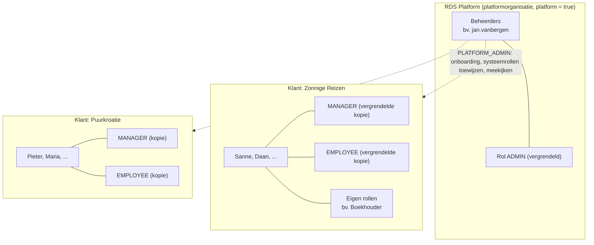

| | Platformorganisatie | Klantorganisatie |
|---|---|---|
| Naam | **RDS Platform** (niet getoond in de kop van de app) | Naam van het reisbureau |
| Aantal | Precies één (`organization.platform = true`, unieke index op alleen die vlag) | Onbeperkt |
| Wie zit erin | Alleen beheerders | Managers en medewerkers van het reisbureau |
| Systeemrollen | ADMIN | Eigen, vergrendelde kopie van MANAGER en EMPLOYEE |
| Eigen rollen | Mogelijk, bijv. later een helpdeskrol die alleen mag meekijken | Ja |
| Bedrijfsgegevens (boekingen, leveranciers, templates, thema, instellingen, Mollie) | Geen. Het menu van een ADMIN toont ze niet, omdat hij die authorities niet heeft. | Ja |
| Verwijderen | Kan niet (service geeft `409`; daarnaast een trigger) | Ja, als hij leeg is (`OrganizationDeletionGuard`) |
| In lijsten en statistieken | Niet in de klantenlijst, onboarding en organisatiecijfers | Ja |

Over organisaties heen werken hangt aan de authority `PLATFORM_ADMIN`, niet aan "zit in de platformorganisatie".
Zo kan de platformorganisatie later ook rollen krijgen die minder mogen. Een beheerder die wil zien wat een klant ziet,
krijgt daar later een aparte, tijdelijke en gelogde functie voor. Hij wordt geen lid van de klant.

---

## 3. Het nieuwe model

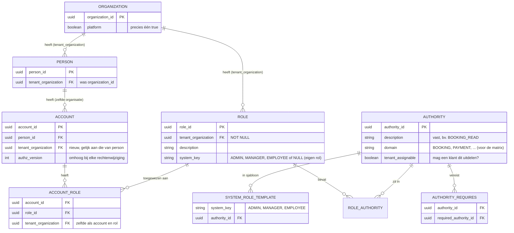

### 3.1 Drie soorten objecten

| | Authorities | Systeemrollen | Eigen rollen |
|---|---|---|---|
| Wie bepaalt ze | Ontwikkelaar (Flyway) | Ontwikkelaar: het sjabloon via Flyway | Organisatie (gebruiker met `ROLE_CREATE`) |
| Waar staan ze | Eén globale lijst | ADMIN in de platformorganisatie; MANAGER en EMPLOYEE als kopie in elke klantorganisatie | In de eigen organisatie |
| Wijzigen via API of scherm | Nee, alleen lezen | Nee, ook ADMIN niet | Ja, binnen de regels (§4) |
| Toewijzen aan accounts | n.v.t. | Ja, binnen de regels; door PLATFORM_ADMIN ook bij klanten (§4.4) | Ja, binnen de regels, alleen in de eigen organisatie |
| Als startpunt kopiëren | n.v.t. | Ja | Ja |

### 3.2 Systeemrollen: sjabloon en kopieën

De inhoud van een systeemrol staat één keer, in `system_role_template`. Elke organisatie heeft een kopie: een gewone
rij in `role` met `system_key` gevuld, plus de bijbehorende `role_authority`-rijen. Zo werken alle zoekacties op rollen
gewoon binnen de eigen organisatie, zonder uitzondering.

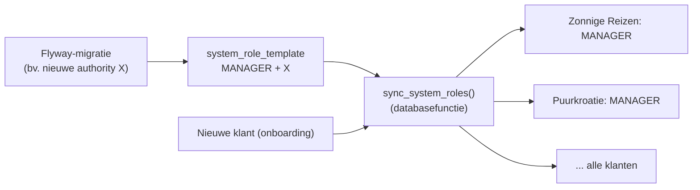

- `sync_system_roles()` maakt de `role_authority` van alle kopieën gelijk aan het sjabloon: ontbrekende rijen erbij,
  overbodige eruit. De functie is idempotent.
- Een migratie die een systeemrol wijzigt, past het sjabloon aan en roept daarna `sync_system_roles()` aan. Dat is twee
  regels SQL.
- Bij een nieuwe klantorganisatie maakt de service de kopieën MANAGER en EMPLOYEE aan en roept dezelfde functie aan.
- Een trigger op `role_authority` weigert wijzigingen aan rollen met een `system_key`, behalve vanuit
  `sync_system_roles()` (die zet `SET LOCAL rds.sync_system_roles = on`). Dat werkt net als de triggers die betalingen
  beschermen.
- De code verwijst naar systeemrollen via `system_key`, nooit via UUID of naam. De vaste UUID's `c1000000-…` verdwijnen
  uit de code; nu komen ze er alleen in één testbestand en het demoscript nog in voor.

### 3.3 Consistentie in de database

De database dwingt de organisatieregels zelf af, met samengestelde foreign keys:

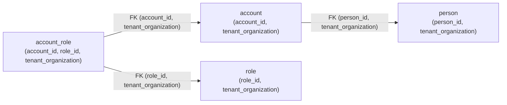

- `person`, `account` en `role` krijgen een unieke sleutel op `(id, tenant_organization)`, zodat ze doel van zo'n
  foreign key kunnen zijn.
- Daardoor kan een account nooit een rol van een andere organisatie krijgen, ook niet via directe SQL. Een account hoort
  altijd bij dezelfde organisatie als zijn persoon.
- Systeemrol ADMIN alleen in de platformorganisatie: de service controleert dat, en een trigger op `role` weigert
  `system_key = 'ADMIN'` buiten de platformorganisatie.

### 3.4 Wijzigingen in de database

| Tabel | Wijziging |
|---|---|
| `organization` | `platform boolean NOT NULL DEFAULT false`, unieke index `WHERE platform`; trigger tegen verwijderen van de platformorganisatie; `roles_reviewed_at timestamp`: wanneer de organisatie de nieuwe rechten voor het laatst als gezien markeerde (§7.2) |
| `person` | `organization_id` → `tenant_organization` (§3.6); unieke sleutel `(person_id, tenant_organization)` |
| `organization_settings`, `organization_theme` | `organization_id` → `tenant_organization` (blijft uniek: één per organisatie) |
| `account` | `tenant_organization NOT NULL` (gevuld uit `person`), FK `(person_id, tenant_organization)`, index; `authz_version int NOT NULL DEFAULT 0` (§6) |
| `role` | `tenant_organization NOT NULL` (FK `ON DELETE RESTRICT`, index); `system_key` (nullable); auditvelden (§3.6); unieke index op `(tenant_organization, lower(description))` en op `(tenant_organization, system_key)` |
| `account_role` | `tenant_organization NOT NULL` met de twee samengestelde FK's (§3.3) |
| `role_authority` | `created_at`, `created_by` (§3.6) |
| `authority` | `domain`, `tenant_assignable`, `introduced_at` (alle NOT NULL; `introduced_at` = wanneer de authority in RDS kwam, §7.2). Niet door klanten uit te delen: `PLATFORM_ADMIN`, `ORGANIZATION_CREATE/READ/UPDATE/DELETE` |
| `authority_requires` | Nieuw: afhankelijkheden (§4.5) |
| `system_role_template` | Nieuw: inhoud van ADMIN, MANAGER en EMPLOYEE |
| `authorization_log` | Nieuw, alleen toevoegen (trigger zoals bij de statusregels van betalingen): het rechtenlogboek (§4.9) |

Wijzigingen in authorities en sjabloon:

- Nieuw: `PLATFORM_ADMIN` (in ADMIN) en `USER_SCOPE_ORGANIZATION` (in ADMIN en MANAGER), zie §5.
- MANAGER krijgt `ROLE_CREATE/UPDATE/DELETE` en `ROLEAUTHORITY_CREATE/DELETE`.
- `AUTHORITY_CREATE/UPDATE/DELETE` verdwijnen, net als de bijbehorende endpoints (dan `405`) en schermen.

Met `tenant_organization NOT NULL` in `role` heeft `TenantOrganizationForeignKeyTest` geen uitzondering nodig. De test
gaat ook `account`, `account_role` en `role` controleren.

### 3.5 Migratie en begindata

Er is nog geen productiesysteem. Er hoeven dus geen bestaande gegevens te worden omgezet. Eén Flyway-migratie
bouwt de structuur en vult een werkend systeem met de begindata:

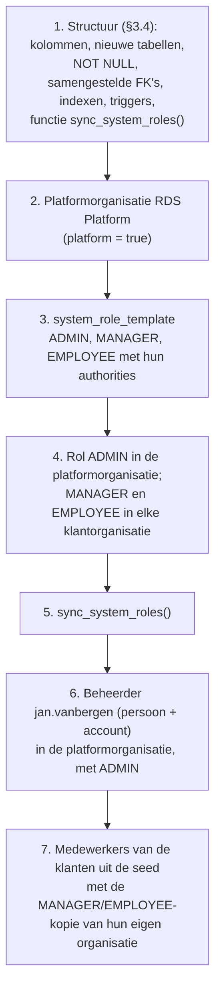

Wat er na de migratie staat:

| Organisatie | Soort | Rollen | Accounts |
|---|---|---|---|
| RDS Platform | platform | ADMIN | `jan.vanbergen` (ADMIN) |
| Puurkroatie | klant | MANAGER, EMPLOYEE (kopieën) | `pieter.degroot` (MANAGER), `maria.jansen` en `sophie.vandijk` (EMPLOYEE) |
| TechPartner BV | klant | MANAGER, EMPLOYEE (kopieën) | zoals in de seed |

Technisch: Flyway past geen oude migraties aan. De nieuwe migratie zet de gegevens uit V2 daarom zelf om:
- de globale MANAGER- en EMPLOYEE-rij vervangen door kopieën per organisatie;
- de persoon van `jan.vanbergen` verhuizen naar de platformorganisatie.

Omdat er geen productiedata is, gebeurt dit zonder uitzonderingsgevallen. De gegevens zijn bekend.

### 3.6 Naamgeving en auditvelden

Bij de controle van het schema (alle tabellen in `public`) kwam dit naar voren.

**Organisatiekolommen**

| Tabel | Nu | Voorstel | Toelichting |
|---|---|---|---|
| `person` | `organization_id` (JPA `@ManyToOne Organization organization`) | `tenant_organization`, Java-veld `tenantOrganization` | Zelfde begrip als bij alle andere tenant-tabellen. De relatie naar `Organization` mag blijven (naam van de organisatie in het token). |
| `organization_settings` | `organization_id` | `tenant_organization` | Eén rij per organisatie; de unieke sleutel blijft. |
| `organization_theme` | `organization_id` | `tenant_organization` | Idem. |
| `account` | geen; via `person` | `tenant_organization NOT NULL` + FK `(person_id, tenant_organization)` | Direct filterbaar en een FK-doel voor `account_role` (§3.3). |
| `account_role` | geen | `tenant_organization NOT NULL` | Laat de database afdwingen dat account en rol bij dezelfde organisatie horen. |
| `role` | geen | `tenant_organization NOT NULL` | Rollen per organisatie (§2). |
| `accommodation_address`, `accommodation_supplier`, `booker_address`, `supplier_address`, `booking_mollie_payment`, `mollie_payment_status_entry` | geen; via de ouders | ongewijzigd | Koppel- of kindtabellen. De organisatie volgt uit beide ouders, die al gecontroleerd worden. |

De API volgt mee: `PersonDto.organizationId` wordt `tenantOrganization`, net als in de andere DTO's. De frontend en het
demoscript gaan in dezelfde wijziging mee. Het hernoemen is ook los van dit voorstel uit te voeren, als kleine eerste
stap.

**Auditvelden** (`created_at`, `created_by`, `modified_at`, `modified_by`)

| Tabel(len) | created | modified | Oordeel |
|---|---|---|---|
| Alle tenant-tabellen met wijzigbare gegevens (`booking`, `booker`, `traveler`, `accommodation`, `supplier`, `activity`, `address`, `document`, de templates, `mollie_payment`, `person`, `account`, `organization*`) | ✓ | ✓ | In orde. |
| `account_role` | ✓ | ✓ | In orde (`modified_*` is overbodig voor een koppeling, maar onschuldig). |
| `booking_status_change`, `booking_mollie_payment_relink`, `sent_email`, `email_image` | ✓ | – | In orde: onveranderlijk of alleen toevoegen. |
| `notification` | ✓ | – | In orde: de enige wijziging is afhandelen, en die heeft eigen velden `handled_at` en `handled_by`. |
| `mollie_payment_status_entry` | ✓ | ✓ | Alleen toevoegen (trigger), dus `modified_*` blijft leeg. Mag blijven of weg, lage prioriteit. |
| **`role`** | – | – | **Moet erbij:** rollen worden klantgegevens die gebruikers zelf aanmaken en hernoemen. |
| **`role_authority`** | – | – | **`created_*` erbij.** Een koppeling wijzigt nooit; weghalen komt in het rechtenlogboek (§4.9). |
| `accommodation_address`, `accommodation_supplier`, `booker_address`, `supplier_address`, `booking_mollie_payment` | – | – | Advies: `created_*` erbij ("wie koppelde dit"). `modified_*` is niet nodig: een koppeling wordt verwijderd en opnieuw gemaakt, nooit gewijzigd. Losse, kleine migratie; geen voorwaarde voor dit voorstel. |
| `authority`, `system_role_template`, `authority_requires` | – | – | Niet nodig: vast via Flyway, de migratiegeschiedenis is de audit. |
| `otp` | alleen `created_at` | – | In orde: technisch en kortlevend, zonder gebruiker als maker. |

Elke tabel met een organisatiekolom heeft dus minstens `created_at` en `created_by`. De tabellen zonder auditvelden zijn
`role`, `role_authority` en de koppeltabellen; die hebben (nog) geen organisatiekolom.

---

## 4. De regels

Notatie:

| Symbool | Betekenis |
|---|---|
| **E(u)** | De effectieve authorities van gebruiker *u*: de vereniging van al zijn rollen, **gelezen uit de database**, niet uit het token |
| **T** | Alle authorities met `tenant_assignable = true` |
| **G(u) = E(u) ∩ T** | Wat *u* mag uitdelen |
| **R(r)** | De authorities van rol *r* |
| **E(x)** | De effectieve authorities van een ander account *x* |
| **org(…)** | De `tenant_organization` van een gebruiker, rol of account |

> **Kernregel:** je kunt alleen doorgeven wat je zelf hebt en wat een organisatie mag hebben.
> Je kunt alleen sleutelen aan rollen en accounts in je eigen organisatie die "onder je niveau" liggen: **R(r) ⊆ G(u)**
> of **E(x) ⊆ G(u)**.

Waarom niet "alles wat de MANAGER heeft": zie §4.7.

### 4.1 Authority toevoegen aan een rol (`POST /api/role-authorities`)

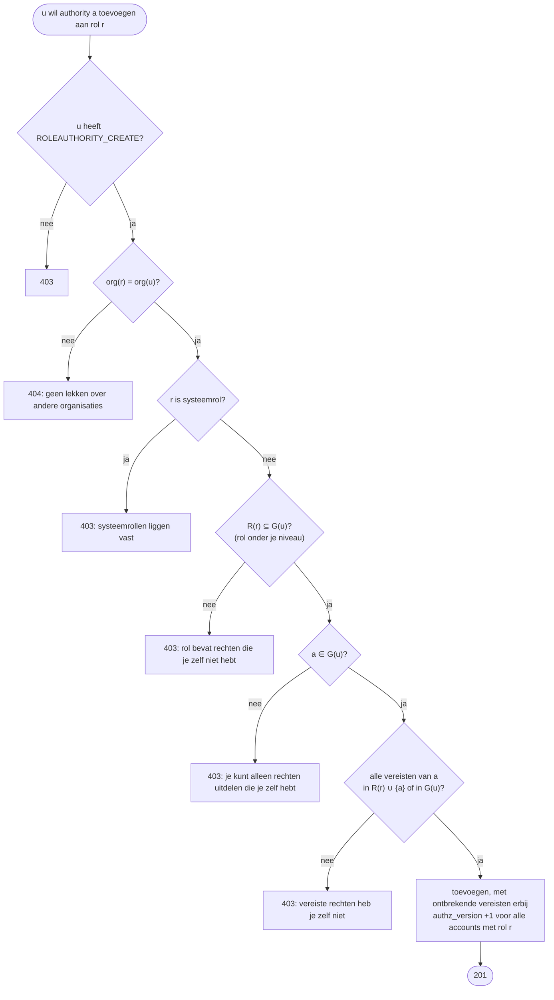

Een ADMIN wijzigt geen rollen van klanten: eigen rollen van een klant zijn van de klant. Met `PLATFORM_ADMIN` kan hij ze
wel lezen (support).

### 4.2 Authority weghalen uit een rol (`DELETE /api/role-authorities`)

Hier gelden dezelfde controles op organisatie, systeemrol en niveau (**R(r) ⊆ G(u)**). Een employee kan dus niets
weghalen uit een rol met meer rechten dan hij heeft. Dat voorkomt sabotage van de managerrol.

Extra regel: is *a* een vereiste van een andere authority in *r*, dan geeft de API een `409` met de namen. Het scherm
biedt aan om die dan ook weg te halen.

### 4.3 Rol toewijzen of intrekken (`/api/account-roles`)

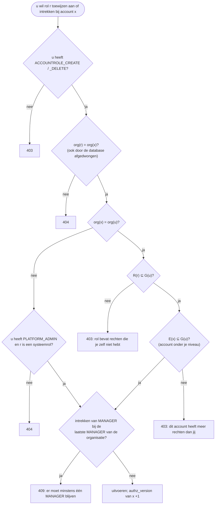

Deze regels vervangen de vaste lijst `ROLES_MANAGEABLE_BY_NON_ADMIN`:

- **ADMIN** bestaat bij een klant niet, dus kan daar nooit worden toegewezen.
- **MANAGER** toewijzen kan alleen wie zelf alle manager-rechten heeft.
- **EMPLOYEE** toewijzen kan iedereen die die set zelf heeft.

**Laatste MANAGER.** Bij onboarding krijgt elke klant een MANAGER. De regel is daarom eenvoudig: elke klantorganisatie
houdt minstens één account met de systeemrol MANAGER dat niet gelockt en niet verlopen is. De controle geldt bij:

- MANAGER intrekken;
- dat account verwijderen of locken;
- de vervaldatum van dat account in het verleden zetten.

In al die gevallen geeft de API `409` met de melding "Er moet minstens één manager blijven". Een eigen rol met dezelfde
rechten telt niet mee: alleen de systeemrol MANAGER. Zo blijft de regel voorspelbaar.

### 4.4 De beheerder bij klanten (PLATFORM_ADMIN)

De subset-regel zou een beheerder blokkeren: hij heeft zelf geen boekingsrechten, dus MANAGER valt niet "onder zijn
niveau". Daarom één bewuste, smalle uitzondering. Met `PLATFORM_ADMIN` mag je bij een klant:

- een organisatie aanmaken, met de kopieën van MANAGER en EMPLOYEE;
- personen en accounts aanmaken, bijvoorbeeld de eerste manager;
- **systeemrollen** (MANAGER, EMPLOYEE) toewijzen en intrekken, bijvoorbeeld als een klant zich heeft buitengesloten;
- alles lezen.

Je mag geen eigen rollen van de klant aanmaken, wijzigen of toewijzen. Zo blijft de inrichting van de klant van de klant.

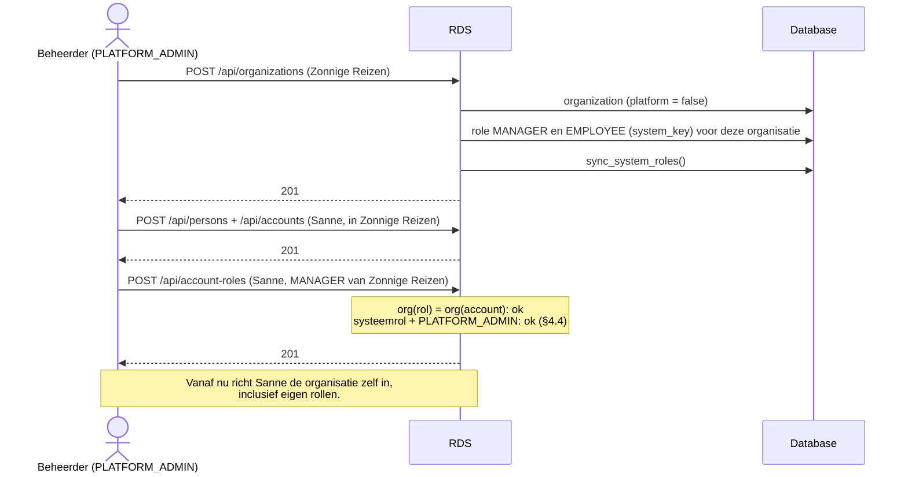

### 4.5 Afhankelijkheden

Sommige rechten zijn zonder andere nutteloos, of geven half werkende schermen. Ze staan in `authority_requires`:

| Authority | Vereist |
|---|---|
| `X_CREATE`, `X_UPDATE`, `X_DELETE` | `X_READ` (generieke regel, gevuld door de migratie) |
| `QUOTE_SEND` | `BOOKING_READ`, `DOCUMENT_CREATE`, `EMAIL_SEND`, `TEMPLATE_READ` |
| `PAYMENT_*` | `BOOKING_READ` |
| `ROLEAUTHORITY_*` | `ROLE_READ`, `AUTHORITY_READ` |
| `ACCOUNTROLE_*` | `ACCOUNT_READ`, `ROLE_READ` |

*Bij het bouwen per scherm nalopen.* Het scherm vinkt de vereisten automatisch mee aan. De backend controleert hetzelfde.

### 4.6 Rol aanmaken, hernoemen, verwijderen (`/api/roles`)

- **Aanmaken** (`ROLE_CREATE`): altijd in de eigen organisatie; `tenant_organization` komt uit `TenantContext`,
  nooit uit de request. Optioneel als kopie van een bestaande rol (ook een systeemrol), waarbij §4.1 per authority geldt.
- **Hernoemen** (`ROLE_UPDATE`): alleen eigen rollen onder je niveau. Een naam die al bestaat in de organisatie, of
  die gelijk is aan een systeemrol, geeft `409`.
- **Verwijderen** (`ROLE_DELETE`): alleen eigen rollen onder je niveau. Is de rol nog aan accounts toegewezen, dan
  volgt `409` met het aantal accounts. Dat werkt net als `OrganizationDeletionGuard`.

### 4.7 Waarom niet "een subset van de MANAGER"?

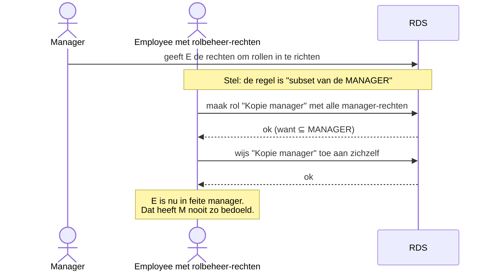

Met **G(u) = E(u) ∩ T** kan dit niet. Wil de manager dat de employee meer kan uitdelen, dan geeft hij hem eerst die
rechten zelf. Dat is expliciet en zichtbaar. Bovendien bestaat "de manager" niet eenduidig: een organisatie kan meerdere
managers of eigen managerachtige rollen hebben.

Dat geldt ook voor de rechten om rollen te beheren (`ROLE_*`, `ROLEAUTHORITY_*`, `ACCOUNTROLE_*`). Er is geen aparte vlag
"niet doorgeefbaar": wie ze heeft, mag ze doorgeven, maar nooit meer dan hij zelf heeft.

### 4.8 Wat gebeurt er als u later rechten verliest?

De controle gebeurt **bij het uitdelen**, niet achteraf. Rollen die *u* eerder maakte, blijven zoals ze zijn. Bevatten ze
nu meer dan *u* heeft, dan kan *u* ze niet meer wijzigen (§4.1). Dat is voorspelbaar en voorkomt kettingreacties.

### 4.9 Rechtenlogboek

Elke wijziging aan rechten komt als regel in `authorization_log`, in dezelfde transactie als de wijziging zelf. De tabel
is alleen-toevoegen, net als de statusregels van betalingen: een trigger weigert `UPDATE` en `DELETE`.

| Kolom | Inhoud |
|---|---|
| `authorization_log_id`, `created_at`, `created_by` | Wie, wanneer |
| `tenant_organization` | Organisatie van de rol of het account |
| `action` | `ROLE_CREATED`, `ROLE_RENAMED`, `ROLE_DELETED`, `AUTHORITY_ADDED`, `AUTHORITY_REMOVED`, `ROLE_ASSIGNED`, `ROLE_REVOKED` |
| `role_id`, `role_name` | De rol; de naam wordt bewaard, zodat de regel leesbaar blijft na hernoemen of verwijderen |
| `authority` | Bij `AUTHORITY_*`: de naam van de authority |
| `account_id`, `account_user_name` | Bij `ROLE_ASSIGNED` en `ROLE_REVOKED` |
| `details` | Bijv. oude en nieuwe naam bij hernoemen; automatisch meegenomen vereisten |

- Wijzigingen door `sync_system_roles()` na een migratie worden niet per organisatie gelogd. De migratie zelf is daar
  het logboek; de release notes vermelden de nieuwe rechten (§7.2).
- Lezen kan met `ROLE_READ`, alleen voor de eigen organisatie (met `PLATFORM_ADMIN` voor alle).
- In het scherm: een tabblad *Geschiedenis* bij een rol en bij een account.

---

## 5. Data-scope zonder rolnamen

De backend gebruikt rolnamen nog voor *welke* gegevens iemand ziet. Dat gaat naar authorities:

| Nu | Straks | In het sjabloon van |
|---|---|---|
| `hasRole("ADMIN")`: over organisaties heen (35×) | `PLATFORM_ADMIN` (niet uit te delen door klanten) | ADMIN |
| `isEmployee()`: personen en accounts "alleen eigen" | `USER_SCOPE_ORGANIZATION`: personen en accounts van de hele organisatie; zonder deze authority alleen het eigen | ADMIN, MANAGER |
| `isAdmin()` in `AuthController`, `OrganizationThemeServiceImpl` | `PLATFORM_ADMIN` | ADMIN |

Uitvoering:

- Er komt één helper `TenantContext.hasAuthority(String)` (of een klein `AccessScope`-component).
- `TenantContext.hasRole` verdwijnt.
- Een test of ArchUnit-regel houdt nieuwe rolnaam-controles tegen.

Deze stap verandert **niets zichtbaars**: ADMIN, MANAGER en EMPLOYEE gedragen zich precies zoals nu. Hij kan dus als
eerste en apart worden opgeleverd (§9, fase 1).

---

## 6. Wijzigingen direct laten doorwerken

Het token bevat de authorities en is 1 uur geldig. Zonder extra maatregel werkt een rolwijziging pas na opnieuw inloggen
door.

**Voorstel:** een versienummer per account.

- `account.authz_version` gaat omhoog bij:
  - het toewijzen of intrekken van een rol aan dat account;
  - het wijzigen van een rol die het account heeft (bulk-update op alle accounts met die rol);
  - `sync_system_roles()` na een migratie (alle accounts met een gewijzigde systeemrol).
- Het token krijgt een claim `av`.
- `JwtAuthenticationFilter` vergelijkt `av` met de database. Een lookup op primaire sleutel, eventueel 30 seconden
  gecachet.
- Bij een verschil volgt `401` met code `AUTHZ_CHANGED`. De frontend haalt dan een nieuw token op en doet de aanroep
  opnieuw.

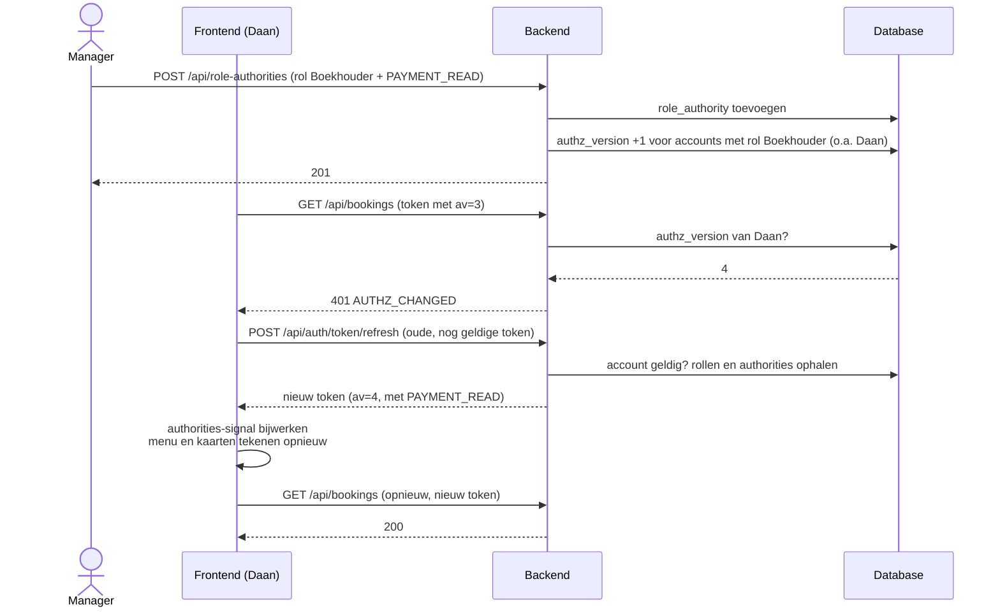

Regels voor `POST /api/auth/token/refresh`:

- Alleen met een geldig, niet-verlopen `EMPLOYEE`-token.
- Een gelockt of verlopen account of een openstaande wachtwoordwijziging geeft `401` en de gebruiker gaat naar het
  inlogscherm.
- 2FA wordt niet opnieuw gevraagd: het oude token bewijst dat al.

Eenvoudiger alternatief: niets bouwen en in het rollenscherm melden "wijzigingen gelden na opnieuw inloggen (uiterlijk
1 uur)". Dat kan als tussenstap.

---

## 7. Frontend: het scherm beweegt mee

### 7.1 Eén bron van waarheid

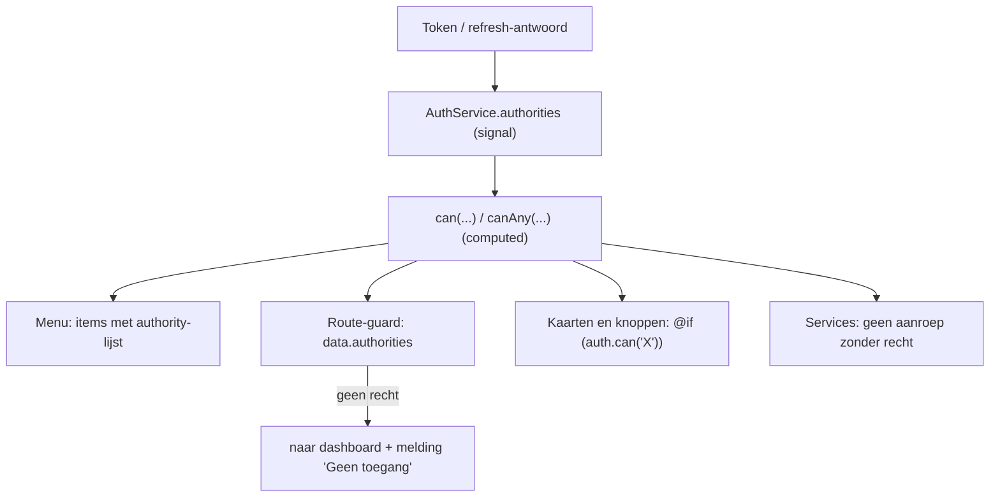

- **`AuthService.authorities` wordt een signal.** Alles wat ervan afhangt (`computed`, `@if`) tekent opnieuw zodra een
  nieuw token binnenkomt. Opnieuw inloggen of herladen is niet nodig.
- **Route-guard `authorityGuard`.** Elke route krijgt `data: { authorities: [...], match: 'any' | 'all' }`. Menu en
  routes delen één definitie, zodat ze niet uit elkaar kunnen lopen. Een ingetypte URL zonder recht gaat naar het
  dashboard met een melding, in plaats van naar een half scherm met 403's.
- **Kaarten bewaken zichzelf.** Elke kaart die een eigen API-aanroep doet, krijgt een `@if (auth.can(...))` en roept
  zonder recht de API niet aan. Bijvoorbeeld de betalingen, documenten en e-mails in de boekingsdetails, en de
  dashboardwidgets.
- **Geen rolnamen meer in de UI.**
  - Onboarding kiest de beheerdersrol via `system_key`, niet op naam.
  - De rolfilter in de accountlijst toont de rollen van de organisatie.
  - De welkomstkop toont de rolnaam alleen als tekst; daar hangt geen logica aan.
- **Platformorganisatie:**
  - De organisatielijst toont alleen klanten.
  - De platformorganisatie staat apart, zonder verwijderknop.
- **Inventarisatie als onderdeel van het werk:** een tabel scherm → benodigde authorities (bijlage A bij de bouw). Een test
  per route controleert dat de guard bestaat.

### 7.2 Het rollenscherm

Menu *Organisatiebeheer → Rollen*, voor wie `ROLE_READ` heeft.

```
Rol: Boekhouder                                   [Kopie van: EMPLOYEE ▾]   [Opslaan]

                       Lezen   Aanmaken   Wijzigen   Verwijderen   Overig
Boekingen               [x]      [ ]        [ ]         [ ]
Betalingen              [x]      [ ]        [x]         [ ]        [x] Corrigeren  [ ] Opnieuw koppelen
Documenten              [x]      [ ]        [ ]         —
Templates               [x]      [ ]        [ ]         [ ]
Personen en accounts    [x]      [ ]        [ ]         [ ]        [ ] Hele organisatie
Huisstijl               [ ]      [ ]        [ ]         [ ]
...
  [ ] grijs = recht dat je zelf niet hebt (niet aan te vinken)
  Aanvinken van Wijzigen vinkt Lezen mee aan (vereiste).
```

- Rijen komen uit `authority.domain`, kolommen uit de actie in de naam. Wat niet in het CRUD-raster past, staat onder
  *Overig*.
- Alleen **G(u)** is aan te vinken. De rest is zichtbaar maar grijs, met de uitleg "Dit recht heb je zelf niet".
- Een rol buiten je niveau (**R(r) ⊄ G(u)**) is alleen-lezen, met de melding "Deze rol bevat rechten die je zelf niet
  hebt".
- Systeemrollen staan in de lijst met een slotje en de knop *Kopiëren*.
- Onderaan: "Gebruikt door 3 accounts" met links.
- Het scherm is gemak, geen beveiliging: de backend dwingt §4 zelf af.
- **Nieuwe rechten.** Een authority met `introduced_at` na `organization.roles_reviewed_at` krijgt in de matrix een
  label *Nieuw*. Bovenaan staat: "Er zijn N nieuwe rechten beschikbaar. Eigen rollen krijgen ze niet vanzelf." De knop
  *Gezien* zet `roles_reviewed_at` (vereist `ROLE_UPDATE`). De systeemrollen krijgen nieuwe rechten via het sjabloon wel
  vanzelf.
- **Release notes.** Elke release met nieuwe authorities vermeldt ze in de release notes: naam, betekenis en of
  MANAGER en EMPLOYEE ze automatisch krijgen. Die release notes bestaan nog niet; ze komen als `docs/release-notes.md`
  (en eventueel een leesversie in HTML) en horen bij de Definition of Done van een release.

---

## 8. API-overzicht (wijzigingen)

| Endpoint | Verandering |
|---|---|
| `GET /api/organizations` | Plus `platform`; standaard alleen klanten |
| `POST /api/organizations` | Maakt ook de kopieën van MANAGER en EMPLOYEE (§4.4) |
| `DELETE /api/organizations/{id}` | Platformorganisatie geeft `409` |
| `GET /api/authorities` | Plus `domain`, `tenantAssignable`, `requires[]` |
| `POST/PUT/DELETE /api/authorities` | Vervalt (`405`) |
| `GET /api/authorities/grantable` | **Nieuw:** G(u), voor het rollenscherm |
| `GET /api/roles` | De rollen van de eigen organisatie (met `PLATFORM_ADMIN` per organisatie op te vragen); plus `systemKey`, `accountCount`, `editable` (R(r) ⊆ G(u)) |
| `POST /api/roles` | Eigen rol in de eigen organisatie; optioneel `?copyFrom={roleId}` |
| `GET /api/roles/new-authorities`, `POST /api/roles/new-authorities/seen` | Nieuwe rechten tonen en als gezien markeren (§7.2) |
| `PUT/DELETE /api/roles/{id}` | Regels §4.6 |
| `POST/DELETE /api/role-authorities` | Regels §4.1–4.2 |
| `GET /api/account-roles/assignable-roles` | Rollen waarvoor §4.3 slaagt (vervangt de vaste lijst) |
| `POST/DELETE /api/account-roles` | Regels §4.3–4.4 |
| `GET/POST/PUT /api/persons` | `organizationId` → `tenantOrganization` (§3.6) |
| `GET /api/authorization-log` | **Nieuw:** rechtenlogboek, filter op rol of account (§4.9) |
| `POST /api/roles/review` | **Nieuw:** nieuwe rechten als gezien markeren (§7.2) |
| `PUT/DELETE /api/accounts/{id}` | Laatste MANAGER locken, laten verlopen of verwijderen geeft `409` (§4.3) |
| `POST /api/auth/token/refresh` | **Nieuw**, §6 |

Foutmeldingen volgen `GlobalExceptionHandler` (`{ message, status, timestamp }`). Een rol of account van een andere
organisatie geeft `404`, geen `403`: zo lekt er niets.

---

## 9. Fasering

Elke fase is los op te leveren en te testen.

| Fase | Status |
|---|---|
| 0. Opschonen | **Gebouwd** (V22): `tenant_organization` in `person`, `organization_settings`, `organization_theme` en `account` (met samengestelde FK naar de persoon); auditvelden voor `role`, `role_authority` en de koppeltabellen. Deze vier tabellen houden `ON DELETE CASCADE`: een lege organisatie neemt haar personen, accounts, huisstijl en instellingen mee; `OrganizationDeletionGuard` telt alleen de `RESTRICT`-tabellen. |
| 1. Data-scope op authorities | **Gebouwd** (V23): `PLATFORM_ADMIN` en `USER_SCOPE_ORGANIZATION`; `TenantContext.hasAuthority`, geen `hasRole` meer (`NoRoleNameChecksTest`). |
| 2. Frontend meebewegend | **Gebouwd**: `ACCESS` in `core/auth/access.ts` voor menu en routes, `authorityGuard` op elke pagina (`app.routes.spec.ts`), `AuthService.authorities` als signal en `can()`, geen `hasRole`; boekingsdetails en dashboards halen alleen op wat mag; rolfilter in de accountlijst uit de data. Nog niet: onboarding kiest MANAGER op naam (komt met `system_key` in fase 3). |
| 3. Platform en rollen per organisatie | **Gebouwd** (V24): RDS Platform, rollen en toewijzingen per organisatie met samengestelde FK's, sjabloon + kopieën + `sync_system_roles()` + triggers, authorities alleen-lezen met domein/vereisten/introductiedatum, de regels van §4 in de backend (incl. laatste beheerder en de uitzondering voor PLATFORM_ADMIN), het rechtenlogboek met `GET /api/authorization-log`. Frontend: onboarding kiest MANAGER op `systemKey`, systeemrollen en rollen boven je niveau zijn alleen te bekijken, het rolscherm biedt alleen uitdeelbare rechten aan, authorities-overzicht alleen-lezen, RDS Platform niet in de klantenlijst. `organization.roles_reviewed_at` en `authority.introduced_at` bestaan al, het scherm ervoor komt in fase 4. |
| 4. Rollenscherm | **Gebouwd**: rechtenmatrix per onderwerp (Lezen/Aanmaken/Wijzigen/Verwijderen/Overig; alleen G(u) aan te vinken, vereisten gaan via de server mee, label *Nieuw*), een rol aanmaken als kopie (`POST /api/roles?copyFrom=`, alleen als je alle rechten zelf mag uitdelen), "gebruikt door N accounts" (`accountCount`), geschiedenis uit het rechtenlogboek, melding nieuwe rechten met *Gezien* (`GET /api/roles/new-authorities`, `POST /api/roles/new-authorities/seen`). Seed: Wendy Vos is MANAGER van Puurkroatie (V25). |
| 5. Direct doorwerken | **Gebouwd** (V26): `account.authz_version` via databasetriggers (rollen toewijzen/intrekken, rechten van een rol, locken/vervaldatum), claim `av`, `JwtAuthenticationFilter` weigert een verouderd token met `401 AUTHZ_CHANGED`, `POST /api/auth/token/refresh` (`EmployeeTokenService`), `authInterceptor` ververst één keer en herhaalt de aanroep. Afwijking van §6: geen cache van 30 seconden, maar per aanroep één opzoeking op primaire sleutel. |

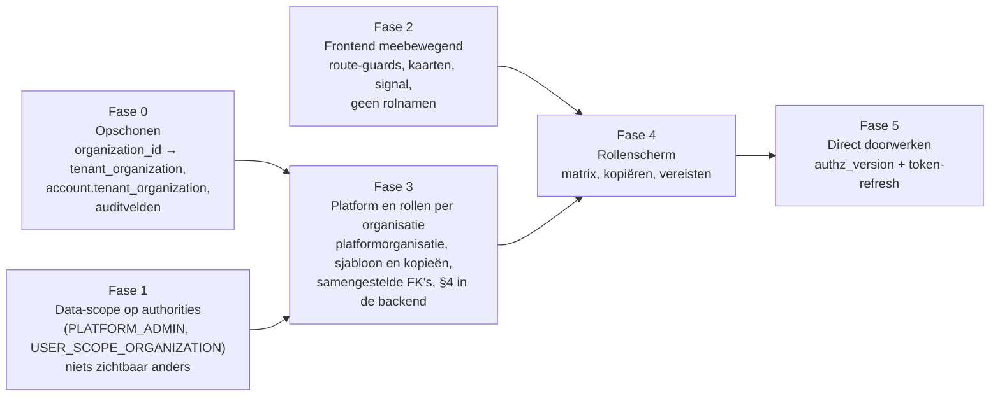

Fase 0, 1 en 2 hebben ook zonder eigen rollen waarde en kunnen tegelijk:

- Fase 0 maakt de naamgeving gelijk en vult de audit aan.
- Fase 1 haalt het risico "rolnaam bepaalt data-scope" weg.
- Fase 2 lost de 403-fouten en de onbewaakte routes op.

---

## 10. Tests

- **Regels (§4), Mockito plus integratie op embedded Postgres:**
  - toevoegen buiten G(u) geeft 403;
  - een rol boven je niveau wijzigen geeft 403;
  - een systeemrol wijzigen geeft 403;
  - een rol van een andere organisatie geeft 404;
  - een account boven je niveau geeft 403;
  - de laatste MANAGER intrekken, locken, laten verlopen of verwijderen geeft 409;
  - vereisten worden automatisch meegenomen;
  - een gebruikte rol verwijderen geeft 409.
- **Beheerder (§4.4):**
  - PLATFORM_ADMIN kan bij een klant MANAGER toewijzen;
  - PLATFORM_ADMIN kan geen eigen rol van een klant wijzigen of toewijzen;
  - ADMIN toewijzen bij een klant kan niet.
- **Escalatiescenario uit §4.7** als test: moet falen.
- **Rechtenlogboek (§4.9):**
  - elke wijziging levert precies één regel op;
  - `UPDATE` of `DELETE` op `authorization_log` faalt op de trigger;
  - een andere organisatie ziet de regels niet.
- **Nieuwe rechten (§7.2):** een authority met `introduced_at` na `roles_reviewed_at` telt mee; na *Gezien* niet meer.
- **Database (§3.3), met directe SQL:**
  - `account_role` met een rol van een andere organisatie faalt op de foreign key;
  - een account met een andere organisatie dan zijn persoon faalt;
  - een wijziging aan `role_authority` van een systeemrol faalt op de trigger;
  - de platformorganisatie verwijderen faalt;
  - een tweede platformorganisatie faalt op de unieke index.
- **Sjabloon:**
  - `sync_system_roles()` is idempotent;
  - na een sjabloonwijziging hebben alle kopieën dezelfde inhoud;
  - een nieuwe organisatie krijgt de kopieën.
- **Migratie (§3.5):** na een lege database plus alle migraties:
  - `jan.vanbergen` staat in de platformorganisatie met ADMIN;
  - alle accounts van klanten hebben de kopie van hun eigen organisatie;
  - inloggen en de bestaande controllertests werken zoals voorheen.
- **Data-scope:**
  - een eigen rol zonder `USER_SCOPE_ORGANIZATION` ziet alleen het eigen persoon en account;
  - met die authority ziet hij de hele organisatie;
  - zonder `PLATFORM_ADMIN` ziet hij nooit een andere organisatie.
- **Architectuur:**
  - geen `hasRole(` meer in `src/main/java`;
  - `TenantOrganizationForeignKeyTest` dekt ook `role`, `account` en `account_role`.
- **Token:**
  - na een rolwijziging geeft een oud token `401 AUTHZ_CHANGED`;
  - refresh geeft de nieuwe authorities;
  - een gelockt account kan niet verversen.
- **Frontend (Jasmine/Karma):**
  - `authorityGuard`;
  - het menu en de kaarten reageren op een nieuw authorities-signal;
  - het rollenscherm grijst niet-uitdeelbare rechten uit en vinkt vereisten mee aan.

---

## 11. Besluiten

De open vragen zijn beantwoord (17-11-2026):

| # | Vraag | Besluit | Uitgewerkt in |
|---|---|---|---|
| 1 | Een geschiedenis van wie wie welk recht gaf? | **Ja**: een rechtenlogboek, alleen toevoegen | §3.4, §4.9 |
| 2 | Een vlag "niet doorgeefbaar" voor rolbeheer-rechten? | **Nee**: de subset-regel geldt ook voor die rechten | §4.7 |
| 3 | Wat telt als beheerder voor "laatste beheerder"? | **De systeemrol MANAGER.** Onboarding maakt altijd een MANAGER; de laatste MANAGER kan niet weg | §4.3 |
| 4 | Standaard eigen rollen als voorbeeld bij een nieuwe organisatie? | **Nee**: alleen de kopieën van MANAGER en EMPLOYEE | §3.2 |
| 5 | "Nieuwe rechten beschikbaar" melden? | **Ja**, in het rollenscherm, en nieuwe rechten komen in de release notes | §7.2 |
| 6 | Naam van de platformorganisatie, en tonen in de kop? | **"RDS Platform"**, niet tonen in de kop | §2, §3.5 |
| – | Gedeelde of gekopieerde systeemrollen? | **Kopie per organisatie (B)**, met sjabloon | §3.2 |
| – | Bestaande gegevens omzetten? | **Niet nodig**: geen productie; één migratie zet een werkend systeem met begindata neer | §3.5 |
